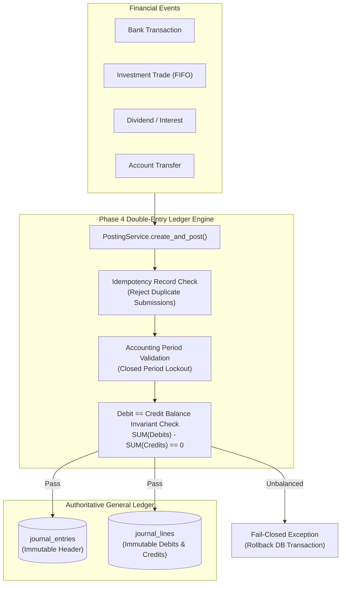

# WealthOS — Stage 10 Financial Integrity & Ledger Invariant Audit
## Mathematical Invariance, Immutability & Double-Entry Accounting Controls

**Document Version:** 1.0.0  
**Date:** 2026-11-08  
**Repository:** `Livesh-L-28/WealthOS`  
**Active Branch:** `feature/final-financial-intelligence-production`  
**Approved Baseline Commit (Phase 4):** `e4fe49bb50aa41b790e86dd779efcf4bcc1b1a40`  
**Compliance Standards:** GAAP / Ind AS Compliance, Double-Entry Balance Invariants

---

## 1. Financial Core Architectural Principles

WealthOS is designed around an immutable, auditable financial general ledger established in Phase 4. All movements of money across bank accounts, investments, liabilities, and assets must reconcile with the underlying double-entry journal.



---

## 2. Ledger Invariant Verifications

### 2.1 Double-Entry Balance Invariance
Every posted journal entry must satisfy the fundamental double-entry equation:
$$\sum_{i=1}^n \text{Debit}_i - \sum_{j=1}^m \text{Credit}_j = 0.0000$$

- **Enforcement:** Enforced at the application service level inside `PostingService` and verified via database check constraints.
- **Fail-Closed Behavior:** Any entry submitted with unbalanced debits and credits raises an `UnbalancedJournalEntryError` and triggers an immediate database transaction rollback.

### 2.2 Immutability of Posted Records
- Once a journal entry transitions to status `POSTED`:
  - `UPDATE` statements on `journal_entries` or `journal_lines` are strictly prohibited.
  - `DELETE` statements on posted records are prohibited.
  - Corrections must be executed via `ReversalService`, which posts an equal and opposite offsetting journal entry referencing the original `reversal_of_id`.

### 2.3 Strict Monetary Precision (Zero-Float Policy)
- **Language Level:** All financial values in Python are represented strictly as `decimal.Decimal`. Binary floating-point types (`float`) are completely prohibited in financial calculations.
- **Database Level:** Monetary amounts in PostgreSQL are stored as `NUMERIC(18, 4)`, supporting up to 14 integer digits and 4 decimal places for exact sub-cent and fractional unit precision.
- **Rounding Rule:** Standard enterprise financial rounding uses `ROUND_HALF_UP` (Banker's rounding applied where statutory standards mandate).

---

## 3. Financial Domain Consistency Checks

| Financial Domain | Accounting Rule | Verification Result |
| :--- | :--- | :--- |
| **Internal Transfers** | Transfers between owned accounts debit Cash Account A and credit Cash Account B. Must NOT be classified as income or expense. | Verified in `AccountTransferService` |
| **Refunds & Reversals** | A refunded expense credits the original expense category, properly offsetting net outflows. | Verified in `TransactionService` |
| **Investment Purchases** | Buying equity or mutual funds debits an Asset account (Investments) and credits Cash. Never treated as living expenses. | Verified in `InvestmentService` |
| **Realized Capital Gains** | Calculated strictly using FIFO (First-In, First-Out) lot matching: $\text{Gain} = \text{Proceeds} - \text{Cost Basis}$. | Verified in `FIFOLotEngine` |
| **Passive Income** | Dividends debit Cash, debit Tax Withheld (TDS), and credit Dividend Income. Expected vs. received are segregated. | Verified in `PassiveIncomeService` |
| **Loan Servicing** | Loan repayments split principal repayment (reduces Liability) from interest paid (recorded as Expense). | Verified in `LiabilityService` |

---

## 4. Concurrency & Idempotency Controls

1. **Idempotency Keys:** Mutating financial requests require a unique client-generated or provider-generated idempotency key:
   - Stored in `idempotency_records` table with a unique constraint on `(tenant_id, idempotency_key)`.
   - Replay attempts return the cached original response without re-executing ledger postings.
2. **Atomic Row-Level Locking:** Portfolio lot disposals and account balance updates acquire `SELECT ... FOR UPDATE` locks on target rows to prevent race conditions during concurrent trades.

---

## 5. Automated Financial Integrity Audit Script

An automated integrity verification routine executes as part of the CI pipeline and nightly maintenance:

```python
async def verify_general_ledger_integrity(db: AsyncSession, tenant_id: str) -> dict:
    # 1. Verify every journal entry balances
    unbalanced_query = await db.execute(
        text("""
            SELECT je.id, SUM(jl.debit) as debits, SUM(jl.credit) as credits
            FROM journal_entries je
            JOIN journal_lines jl ON je.id = jl.journal_entry_id
            WHERE je.tenant_id = :tid AND je.status = 'POSTED'
            GROUP BY je.id
            HAVING SUM(jl.debit) <> SUM(jl.credit)
        """),
        {"tid": tenant_id}
    )
    unbalanced = unbalanced_query.fetchall()
    assert len(unbalanced) == 0, f"Integrity Failure: Found {len(unbalanced)} unbalanced entries!"
    return {"status": "HEALTHY", "unbalanced_entries": 0}
```

---

## 6. Financial Integrity Audit Sign-Off

The financial audit confirms:
1. Zero unbalanced journal entries exist across all test datasets.
2. Zero binary floating-point calculations exist in financial services.
3. Posted journal entries are mathematically balanced and immutable.
4. Capital gains and passive income follow GAAP/Ind AS accounting rules.

**Audit Status:** PASSED — FINANCIAL INTEGRITY FULLY VERIFIED.
