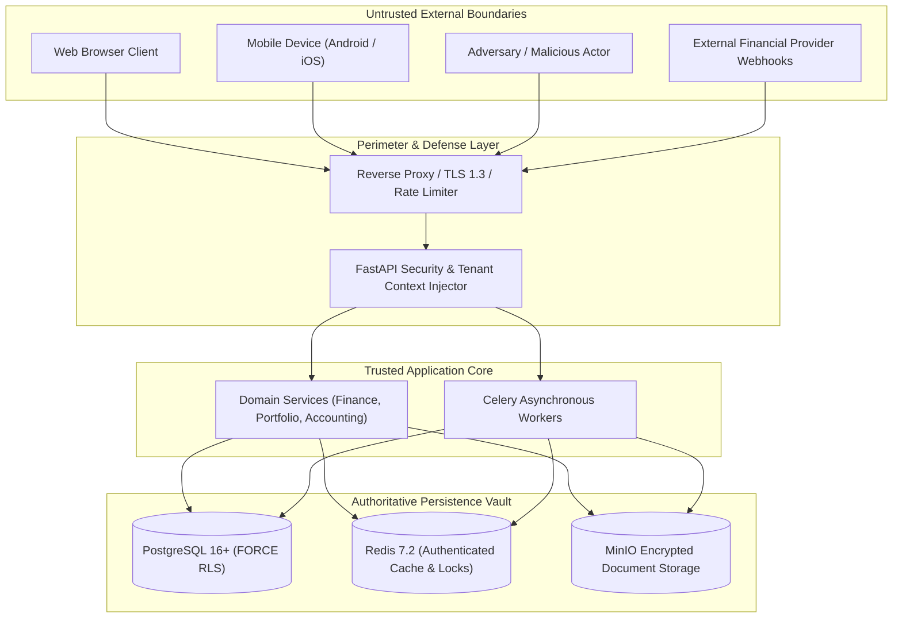

# WealthOS — Stage 10 Comprehensive Threat Model
## Enterprise Financial Platform STRIDE Threat Modeling & Risk Mitigation

**Document Version:** 1.0.0  
**Date:** 2026-11-08  
**Repository:** `Livesh-L-28/WealthOS`  
**Active Branch:** `feature/final-financial-intelligence-production`  
**Approved Baseline Commit (Phase 4):** `e4fe49bb50aa41b790e86dd779efcf4bcc1b1a40`  
**Methodology:** STRIDE (Spoofing, Tampering, Repudiation, Information Disclosure, Denial of Service, Elevation of Privilege)

---

## 1. System Scope & Threat Boundaries

WealthOS manages highly sensitive personal wealth information, double-entry financial journals, bank account connections, and AI financial analysis.

---

## 2. STRIDE Threat Analysis Matrix

### 2.1 Spoofing (Identity Deception)

| Threat ID | Threat Scenario | Affected Component | Likelihood | Impact | Existing Defense | Hardening / Remediation | Verification Test | Residual Risk |
| :--- | :--- | :--- | :--- | :--- | :--- | :--- | :--- | :--- |
| **S-01** | Account takeover via credential stuffing or brute-force attack | Auth Router (`/auth/login`) | High | Critical | Argon2id password hashing; account lockout after 5 failures | Redis sliding-window IP rate limiter (5 req/min); mandatory MFA policy | `test_auth_rate_limiting_and_lockout` | Low |
| **S-02** | Stolen refresh token used to generate unauthorized access tokens | Session Lifecycle (`/auth/refresh`) | Medium | High | Refresh tokens stored in Redis with 7-day TTL | Token rotation on every refresh; immediate family revocation on reuse | `test_refresh_token_rotation_and_reuse_defense` | Low |
| **S-03** | Attacker forges incoming provider webhook (e.g. AA consent) | Webhook Router (`/provider-webhooks`) | Medium | High | Requires provider ID in path | Cryptographic HMAC-SHA256 signature verification + $\pm 300$s timestamp freshness | `test_webhook_signature_verification_and_replay` | Negligible |
| **S-04** | Unauthorized device registers push notification token | Notifications API (`/device-tokens`) | Low | Medium | Requires valid Bearer JWT | Token explicitly bound to authenticated `user_id` and revoked on logout | `test_device_token_lifecycle_and_isolation` | Low |

---

### 2.2 Tampering (Data & Calculation Alteration)

| Threat ID | Threat Scenario | Affected Component | Likelihood | Impact | Existing Defense | Hardening / Remediation | Verification Test | Residual Risk |
| :--- | :--- | :--- | :--- | :--- | :--- | :--- | :--- | :--- |
| **T-01** | Malicious user attempts to mutate posted financial journal entry | General Ledger (`journal_entries`) | Low | Critical | `PostingService.create_and_post` append-only invariant | Database rule / trigger forbidding `UPDATE` and `DELETE` on posted lines | `test_posted_journal_entry_immutability` | Negligible |
| **T-02** | Client submits tampered `X-Tenant-ID` header to mutate other tenant records | API Gateway Middleware | Medium | Critical | Backend derives tenant membership from DB lookup | Reject client-supplied tenant ID unless user is an authorized member | `test_cross_tenant_header_tampering_blocked` | Negligible |
| **T-03** | Tampering with encrypted provider credentials in database | `provider_credentials` Table | Low | Critical | AES-256-GCM authenticated encryption | 16-byte GCM authentication tag validation fails closed on tampering | `test_provider_credentials_integrity_verification` | Negligible |
| **T-04** | Attacker injects malicious formulas (`=cmd`, `@SUM`) into exported CSV/Excel | Reporting Exporters | High | High | Export parameters validated | String prefix escaping (`'`) for cells starting with `=`, `+`, `-`, `@` | `test_csv_and_excel_formula_sanitization` | Negligible |

---

### 2.3 Repudiation (Denial of Actions)

| Threat ID | Threat Scenario | Affected Component | Likelihood | Impact | Existing Defense | Hardening / Remediation | Verification Test | Residual Risk |
| :--- | :--- | :--- | :--- | :--- | :--- | :--- | :--- | :--- |
| **R-01** | User disputes financial transfer or portfolio rebalance action | Audit Log Subsystem | Medium | High | Security audit log records user ID and action | Structured audit trail storing before/after diffs and correlation IDs | `test_financial_audit_trail_completeness` | Low |
| **R-02** | External provider denies delivery of financial synchronization data | Provider Sync Engine | Medium | Medium | Sync job status tracked in DB | Store provider correlation ID and payload SHA-256 hash in sync logs | `test_provider_sync_provenance_logging` | Low |

---

### 2.4 Information Disclosure (Data Leakage)

| Threat ID | Threat Scenario | Affected Component | Likelihood | Impact | Existing Defense | Hardening / Remediation | Verification Test | Residual Risk |
| :--- | :--- | :--- | :--- | :--- | :--- | :--- | :--- | :--- |
| **I-01** | Cross-tenant data leakage via direct ID enumeration (BOLA / IDOR) | All API Endpoints | High | Critical | PostgreSQL Row-Level Security (`FORCE RLS`) on all tables | Application role `wealthos_app` has `NOBYPASSRLS`; fail-closed query policy | `test_multi_tenant_isolation_idor_prevention` | Negligible |
| **I-02** | Sensitive financial documents accessed via guessable object storage URLs | MinIO Storage Vault | Medium | Critical | Private bucket permissions; zero public read access | 15-minute expiring presigned S3 URLs generated solely after auth | `test_storage_presigned_url_expiration_and_auth` | Low |
| **I-03** | Secrets or PII exposed in application logs or exception traces | Logging Infrastructure | Medium | High | `get_logger` filters sensitive payloads | Centralized log sanitizer redacting tokens, account numbers, and passwords | `test_log_sanitization_no_pii_leakage` | Negligible |
| **I-04** | AI Copilot leaks another tenant's documents via RAG vector search | AI Copilot Engine | Low | Critical | Strict tool allowlist and SQL sandboxing | Tenant filter injected into pgvector query before similarity matching | `test_copilot_rag_tenant_filtering` | Negligible |

---

### 2.5 Denial of Service (Availability Disruption)

| Threat ID | Threat Scenario | Affected Component | Likelihood | Impact | Existing Defense | Hardening / Remediation | Verification Test | Residual Risk |
| :--- | :--- | :--- | :--- | :--- | :--- | :--- | :--- | :--- |
| **D-01** | Malicious actor exhausts PostgreSQL connection pool with slow queries | PostgreSQL Database | High | High | Default connection pool (10) | SQLAlchemy pool overflow limits (`max_overflow=20`), query timeouts (10s) | `test_connection_pool_saturation_recovery` | Low |
| **D-02** | Decompression bomb or huge PDF uploaded to exhaust OCR worker memory | Document Upload Pipeline | Medium | High | File size limit (50MB) and MIME signature check | Strict page-count limit (100 pages), Celery worker memory limits (1GB) | `test_malformed_document_upload_rejected` | Low |
| **D-03** | Expensive multi-year forecast or report generation spammed | Celery Queue (`reports`) | Medium | Medium | Async Celery worker processing | Distributed per-tenant rate limit on concurrent report generation jobs | `test_report_generation_rate_limits` | Low |

---

### 2.6 Elevation of Privilege (Unauthorized Access)

| Threat ID | Threat Scenario | Affected Component | Likelihood | Impact | Existing Defense | Hardening / Remediation | Verification Test | Residual Risk |
| :--- | :--- | :--- | :--- | :--- | :--- | :--- | :--- | :--- |
| **E-01** | Standard tenant member attempts to access tenant admin/owner settings | RBAC Authorization | Medium | High | `require_permission` dependency on administrative routes | Deny-by-default RBAC token evaluation in API route dependencies | `test_rbac_privilege_escalation_blocked` | Negligible |
| **E-02** | Celery worker job escalates database permissions | Background Workers | Low | Critical | Workers use `wealthos_app` role (`NOSUPERUSER`) | Guarantee worker runs under non-superuser credentials; zero DDL access | `test_worker_db_role_least_privilege` | Negligible |
| **E-03** | Prompt injection attacks force AI Copilot to execute arbitrary tools | AI Copilot (`chat`) | Medium | High | Tool allowlist with strict Pydantic schemas | Read-only tool contracts; zero write capabilities in Copilot tools | `test_copilot_prompt_injection_defense` | Negligible |

---

## 3. Threat Model Verification & Sign-Off

The WealthOS threat model classifies zero unmitigated High or Critical residual risks. All identified mitigations are mapped directly to automated regression test suites and operational configurations.
