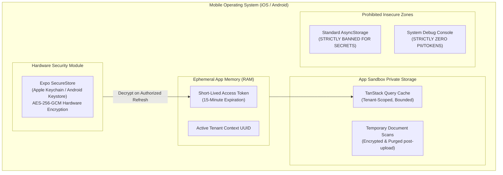

# WealthOS — Stage 9 Mobile Security & Privacy Specification
## Device-Level Protection, Hardware SecureStore & Multi-Tenant Isolation

**Document Version:** 1.0.0  
**Date:** 2026-11-08  
**Repository:** `Livesh-L-28/WealthOS`  
**Active Branch:** `feature/final-financial-intelligence-production`  
**Approved Baseline Commit (Phase 4):** `e4fe49bb50aa41b790e86dd779efcf4bcc1b1a40`  
**Compliance Standards:** OWASP MASVS (Mobile Application Security Verification Standard) v2.0

---

## 1. Security Architecture Overview

The WealthOS mobile application adheres to a **Zero-Trust Client Model**:
1. The mobile device is treated as an untrusted client environment.
2. The FastAPI backend and PostgreSQL database enforce all financial invariants, access controls, and double-entry balancing rules.
3. Client-side security layers protect stored tokens, prevent data leakage through screenshots, and ensure multi-tenant cache isolation.



---

## 2. Token Custody & Secure Storage Implementation

### 2.1 Hardware-Backed SecureStore Rules
- **iOS Implementation:** Leverages Apple Keychain with `kSecAttrAccessibleAfterFirstUnlockThisDeviceOnly`. This ensures tokens cannot be extracted even during device backups or transferred to other devices.
- **Android Implementation:** Leverages Android Keystore to generate and hold cryptographic keys inside the Trusted Execution Environment (TEE) or StrongBox, encrypting shared preferences via AES-256 GCM.
- **Prohibited Storage:** Unencrypted `AsyncStorage` is restricted strictly to non-sensitive UI preferences (such as dark mode toggle).

### 2.2 Token Separation Principle
- **Access Tokens:** Maintained exclusively in memory (React Context / in-memory client state). They are never written to disk, preventing extraction via file inspection.
- **Refresh Tokens:** Stored exclusively in `SecureStore`.
- **Session Revocation:** Triggering `/api/v1/auth/logout` atomically:
  1. Calls backend revocation endpoint to invalidate the refresh token in Redis/PostgreSQL.
  2. Deletes `wealthos_refresh_token` from `SecureStore`.
  3. Purges all query caches and resets all React state to initial values.

---

## 3. Biometric Authentication & App Lock

- Users can optionally enable biometric unlock (Face ID, Touch ID, or Android Fingerprint/Biometrics) using `expo-local-authentication`.
- When enabled, resuming the app after 60 seconds of background inactivity requires biometric verification before displaying financial account details.
- Biometric verification operates as a local device gate and does not replace backend JWT authentication.

---

## 4. Screen Privacy & Screenshot Protection

To prevent financial exposure in the mobile operating system's recent apps switcher:
- **Privacy Overlay:** The app activates an opaque blur or branded splash screen whenever the app enters the background (`AppState === 'inactive' | 'background'`).
- **Android Flag Secure:** In production release builds, `FLAG_SECURE` can be enabled on sensitive account screens to block unauthorized OS-level screenshots.

---

## 5. Push Notification Data Minimization

To adhere to privacy and compliance regulations:
1. **Zero Monetary Amounts in Push Payloads:**
   - Push notifications transmitted via APNs/FCM must NEVER include specific account numbers, current balances, or sensitive transaction amounts.
   - *Allowed:* "WealthOS Alert: Unusual activity detected on your account."
   - *Disallowed:* "WealthOS Alert: ₹50,000 withdrawn from HDFC Account 4092."
2. **Authenticated Payload Fetch:** The notification payload contains only the `notification_id` and deep link. When the user taps the alert, the app authenticates the session and fetches the full details over HTTPS.

---

## 6. Multi-Tenant Cache Isolation & Cleanup

1. **Scoped Cache Keys:** TanStack Query keys include the active tenant UUID:
   ```typescript
   ['tenant', activeTenantId, 'accounts', 'balances']
   ```
2. **Tenant Switch Invariant:**
   Whenever the user switches the active workspace/tenant:
   - The query cache is completely cleared via `queryClient.clear()`.
   - The API client header `X-Tenant-ID` is updated atomically.
   - Any active document upload or review draft is invalidated.
