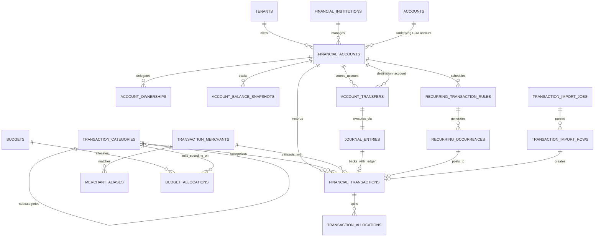
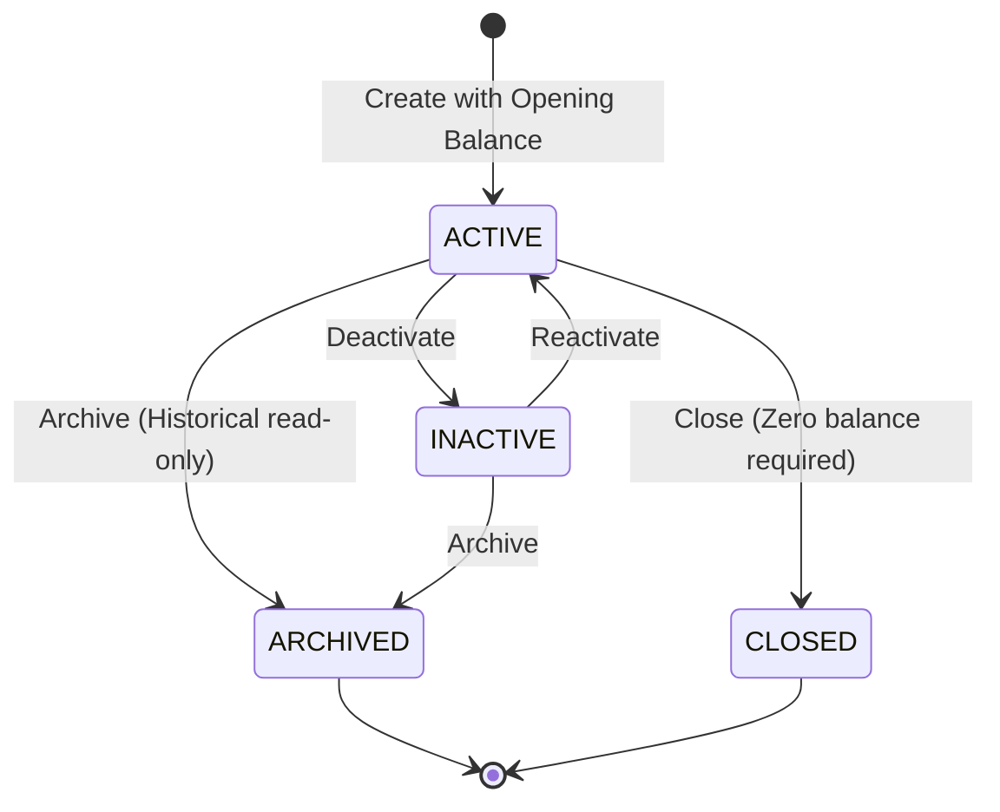
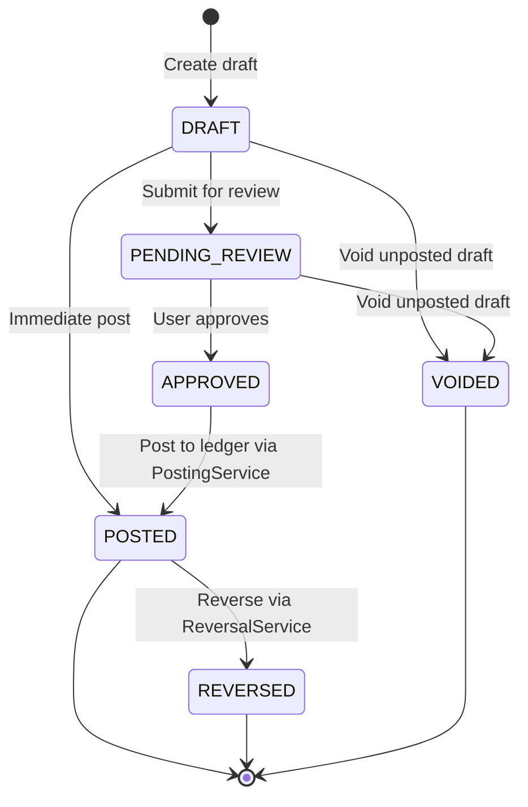

# WealthOS — Final Phase | Stage 2
# Financial Account, Transaction, Income & Expense Management
## Technical Design & Architectural Specification

**Date:** November 7, 2026  
**Document Reference:** WOS-FINAL-STAGE2-DESIGN  
**Status:** AWAITING TECHNICAL DESIGN APPROVAL  
**Branch:** `feature/final-financial-intelligence-production`  
**Starting Commit Baseline:** `2178a892705a63914949aeb0da238a8e0e7a2b05`  
**Integration Foundation:** Phase 4 Double-Entry Accounting Core (`e4fe49bb50aa41b790e86dd779efcf4bcc1b1a40`)

---

## 1. Executive Summary & Baseline Verification

Stage 2 establishes the core operational financial layer of WealthOS, enabling users to manage financial accounts, record and categorize transactions, manage merchants, execute transfers, schedule recurring payments, build budgets, and import statements.

Every financial event in Stage 2 maps directly to the deterministic Phase 4 double-entry general ledger via `PostingService.create_and_post`. Zero transactions or balance changes bypass the general ledger.

### Baseline Audit & Verification
- **Target Branch:** `feature/final-financial-intelligence-production` (verified clean working tree, remote branch tracked on `origin`).
- **Base Commit:** `2178a892705a63914949aeb0da238a8e0e7a2b05` (incorporating Phase 4 `e4fe49bb50aa41b790e86dd779efcf4bcc1b1a40` and Stage 1 Audit).
- **Accounting Engine Status:** All 127 automated tests pass in 14.49s. Immutability triggers and `FORCE ROW LEVEL SECURITY` are active in both `wealthos` and `wealthos_test`.
- **Reusable Core Services:**
  - `PostingService.create_and_post`: Atomic journal posting with period validation and double-entry balance check ($\sum \text{Debit} \equiv \sum \text{Credit}$).
  - `ReversalService.reverse_journal_entry`: Mirrored counter-entry generation with bidirectional links.
  - `BalanceService`: Real-time ledger balance calculation.
  - `TenantScopedRepository[T]`: Tenant-scoped query isolation.
  - `storage.py`: MinIO quarantine upload and MIME magic-byte validation.

---

## 2. Entity-Relationship Architecture (Mermaid ERD)



---

## 3. Database Schema Design (16 Relational Tables)

Migration `0005_financial_accounts_and_transactions.py` will establish the following 16 tables:

### 3.1 Financial Institutions & Accounts
1. **`financial_institutions`** (Directory of banks, credit unions, NBFCs)
   - `id UUID PRIMARY KEY DEFAULT gen_random_uuid()`
   - `tenant_id UUID NULL REFERENCES tenants(id) ON DELETE RESTRICT` (NULL for system-seeded banks)
   - `name VARCHAR(255) NOT NULL`
   - `code VARCHAR(50) NULL` (e.g. `HDFC`, `SBIN`, `ICIC`)
   - `institution_type VARCHAR(50) NOT NULL` (`COMMERCIAL_BANK`, `COOPERATIVE_BANK`, `PAYMENTS_BANK`, `NBFC`, `CREDIT_UNION`, `OTHER`)
   - `country VARCHAR(2) NOT NULL DEFAULT 'IN'`
   - `default_currency VARCHAR(3) NOT NULL DEFAULT 'INR'`
   - `website VARCHAR(255) NULL`
   - `logo_url VARCHAR(500) NULL`
   - `is_system BOOLEAN NOT NULL DEFAULT FALSE`
   - `is_active BOOLEAN NOT NULL DEFAULT TRUE`
   - `created_at TIMESTAMPTZ NOT NULL DEFAULT NOW()`, `updated_at TIMESTAMPTZ NOT NULL DEFAULT NOW()`
   - Constraints: `UNIQUE (tenant_id, name)`

2. **`financial_accounts`** (User bank, credit, cash, and deposit accounts)
   - `id UUID PRIMARY KEY DEFAULT gen_random_uuid()`
   - `tenant_id UUID NOT NULL REFERENCES tenants(id) ON DELETE RESTRICT`
   - `institution_id UUID NULL REFERENCES financial_institutions(id) ON DELETE RESTRICT`
   - `account_id UUID NOT NULL REFERENCES accounts(id) ON DELETE RESTRICT` (Underlying COA ledger account)
   - `name VARCHAR(255) NOT NULL`
   - `nickname VARCHAR(100) NULL`
   - `account_type VARCHAR(50) NOT NULL` (`SAVINGS`, `CURRENT`, `SALARY`, `CREDIT_CARD`, `CASH`, `FIXED_DEPOSIT`, `RECURRING_DEPOSIT`, `WALLET`, `OTHER`)
   - `account_number_masked VARCHAR(50) NULL` (e.g. `••••1234`)
   - `account_fingerprint VARCHAR(64) NULL` (SHA-256 for duplicate statement detection)
   - `currency_code VARCHAR(3) NOT NULL DEFAULT 'INR'`
   - `opening_balance NUMERIC(18, 4) NOT NULL DEFAULT 0.0000`
   - `opening_date DATE NOT NULL`
   - `credit_limit NUMERIC(18, 4) NULL` (For credit cards/lines)
   - `status VARCHAR(20) NOT NULL DEFAULT 'ACTIVE'` (`ACTIVE`, `INACTIVE`, `ARCHIVED`, `CLOSED`)
   - `notes TEXT NULL`
   - `is_archived BOOLEAN NOT NULL DEFAULT FALSE`
   - `archived_at TIMESTAMPTZ NULL`
   - `closed_at TIMESTAMPTZ NULL`
   - `created_at TIMESTAMPTZ NOT NULL DEFAULT NOW()`, `updated_at TIMESTAMPTZ NOT NULL DEFAULT NOW()`
   - Constraints: `chk_credit_limit_non_negative CHECK (credit_limit IS NULL OR credit_limit >= 0)`, `chk_account_status CHECK (status IN ('ACTIVE', 'INACTIVE', 'ARCHIVED', 'CLOSED'))`

3. **`account_ownerships`** (Beneficial ownership & joint account structure)
   - `id UUID PRIMARY KEY DEFAULT gen_random_uuid()`
   - `tenant_id UUID NOT NULL REFERENCES tenants(id) ON DELETE RESTRICT`
   - `financial_account_id UUID NOT NULL REFERENCES financial_accounts(id) ON DELETE CASCADE`
   - `user_id UUID NOT NULL REFERENCES users(id) ON DELETE RESTRICT`
   - `ownership_type VARCHAR(50) NOT NULL DEFAULT 'PRIMARY'` (`PRIMARY`, `JOINT`, `BENEFICIARY`, `AUTHORIZED_SIGNER`)
   - `ownership_percentage NUMERIC(5, 2) NOT NULL DEFAULT 100.00`
   - `created_at TIMESTAMPTZ NOT NULL DEFAULT NOW()`, `updated_at TIMESTAMPTZ NOT NULL DEFAULT NOW()`
   - Constraints: `chk_ownership_pct CHECK (ownership_percentage > 0 AND ownership_percentage <= 100)`

4. **`account_balance_snapshots`** (Periodic balance observations and statements)
   - `id UUID PRIMARY KEY DEFAULT gen_random_uuid()`
   - `tenant_id UUID NOT NULL REFERENCES tenants(id) ON DELETE RESTRICT`
   - `financial_account_id UUID NOT NULL REFERENCES financial_accounts(id) ON DELETE RESTRICT`
   - `snapshot_date DATE NOT NULL`
   - `balance_amount NUMERIC(18, 4) NOT NULL`
   - `available_amount NUMERIC(18, 4) NULL`
   - `currency_code VARCHAR(3) NOT NULL DEFAULT 'INR'`
   - `balance_type VARCHAR(50) NOT NULL DEFAULT 'LEDGER'` (`LEDGER`, `STATEMENT`, `AVAILABLE`, `OBSERVED`)
   - `source VARCHAR(50) NOT NULL DEFAULT 'MANUAL'` (`MANUAL`, `STATEMENT_IMPORT`, `RECONCILIATION`)
   - `created_at TIMESTAMPTZ NOT NULL DEFAULT NOW()`

### 3.2 Categories & Merchants
5. **`transaction_categories`** (Hierarchical income, expense, and transfer categories)
   - `id UUID PRIMARY KEY DEFAULT gen_random_uuid()`
   - `tenant_id UUID NOT NULL REFERENCES tenants(id) ON DELETE RESTRICT`
   - `parent_id UUID NULL REFERENCES transaction_categories(id) ON DELETE RESTRICT`
   - `name VARCHAR(100) NOT NULL`
   - `category_type VARCHAR(50) NOT NULL` (`INCOME`, `EXPENSE`, `TRANSFER`)
   - `account_id UUID NULL REFERENCES accounts(id) ON DELETE RESTRICT` (Target COA account)
   - `description TEXT NULL`
   - `icon VARCHAR(50) NULL`
   - `color VARCHAR(20) NULL`
   - `display_order INT NOT NULL DEFAULT 0`
   - `is_system BOOLEAN NOT NULL DEFAULT FALSE`
   - `is_active BOOLEAN NOT NULL DEFAULT TRUE`
   - `created_at TIMESTAMPTZ NOT NULL DEFAULT NOW()`, `updated_at TIMESTAMPTZ NOT NULL DEFAULT NOW()`
   - Constraints: `uq_tenant_category_name UNIQUE (tenant_id, name, parent_id)`, `chk_cat_type CHECK (category_type IN ('INCOME', 'EXPENSE', 'TRANSFER'))`

6. **`transaction_merchants`** (Normalized merchant/counterparty directory)
   - `id UUID PRIMARY KEY DEFAULT gen_random_uuid()`
   - `tenant_id UUID NOT NULL REFERENCES tenants(id) ON DELETE RESTRICT`
   - `name VARCHAR(255) NOT NULL`
   - `clean_name VARCHAR(255) NOT NULL` (Normalized uppercase without special characters)
   - `merchant_type VARCHAR(50) NOT NULL DEFAULT 'RETAILER'` (`RETAILER`, `GROCERY`, `RESTAURANT`, `UTILITY`, `EMPLOYER`, `CLIENT`, `VENDOR`, `BANK`, `OTHER`)
   - `default_category_id UUID NULL REFERENCES transaction_categories(id) ON DELETE SET NULL`
   - `website VARCHAR(255) NULL`
   - `notes TEXT NULL`
   - `is_active BOOLEAN NOT NULL DEFAULT TRUE`
   - `created_at TIMESTAMPTZ NOT NULL DEFAULT NOW()`, `updated_at TIMESTAMPTZ NOT NULL DEFAULT NOW()`
   - Constraints: `uq_tenant_merchant_clean UNIQUE (tenant_id, clean_name)`

7. **`merchant_aliases`** (String patterns mapping messy statement descriptors to merchants)
   - `id UUID PRIMARY KEY DEFAULT gen_random_uuid()`
   - `tenant_id UUID NOT NULL REFERENCES tenants(id) ON DELETE RESTRICT`
   - `merchant_id UUID NOT NULL REFERENCES transaction_merchants(id) ON DELETE CASCADE`
   - `pattern VARCHAR(255) NOT NULL` (e.g. `SWIGGY INSTAMART%`)
   - `match_type VARCHAR(50) NOT NULL DEFAULT 'EXACT'` (`EXACT`, `PREFIX`, `REGEX`)
   - `created_at TIMESTAMPTZ NOT NULL DEFAULT NOW()`
   - Constraints: `uq_tenant_alias_pattern UNIQUE (tenant_id, pattern)`

### 3.3 Transactions & Allocations
8. **`financial_transactions`** (User financial events backed by double-entry ledger)
   - `id UUID PRIMARY KEY DEFAULT gen_random_uuid()`
   - `tenant_id UUID NOT NULL REFERENCES tenants(id) ON DELETE RESTRICT`
   - `financial_account_id UUID NOT NULL REFERENCES financial_accounts(id) ON DELETE RESTRICT`
   - `journal_entry_id UUID NULL REFERENCES journal_entries(id) ON DELETE RESTRICT` (Set when POSTED)
   - `category_id UUID NULL REFERENCES transaction_categories(id) ON DELETE RESTRICT`
   - `merchant_id UUID NULL REFERENCES transaction_merchants(id) ON DELETE SET NULL`
   - `transaction_type VARCHAR(50) NOT NULL` (`INCOME`, `EXPENSE`, `TRANSFER`, `REFUND`, `REVERSAL`, `ADJUSTMENT`, `FEE`, `INTEREST`, `TAX`, `OTHER`)
   - `transaction_date DATE NOT NULL`
   - `posting_date TIMESTAMPTZ NULL`
   - `amount NUMERIC(18, 4) NOT NULL`
   - `currency_code VARCHAR(3) NOT NULL DEFAULT 'INR'`
   - `exchange_rate NUMERIC(18, 8) NOT NULL DEFAULT 1.00000000`
   - `functional_amount NUMERIC(18, 4) NOT NULL`
   - `description TEXT NOT NULL`
   - `reference_number VARCHAR(100) NULL`
   - `external_id VARCHAR(100) NULL`
   - `payment_method VARCHAR(50) NULL` (`UPI`, `DEBIT_CARD`, `CREDIT_CARD`, `NET_BANKING`, `NEFT`, `RTGS`, `IMPS`, `CASH`, `CHEQUE`, `OTHER`)
   - `notes TEXT NULL`
   - `status VARCHAR(50) NOT NULL DEFAULT 'DRAFT'` (`DRAFT`, `PENDING_REVIEW`, `APPROVED`, `POSTED`, `REVERSED`, `VOIDED`)
   - `source_type VARCHAR(50) NOT NULL DEFAULT 'MANUAL'` (`MANUAL`, `STATEMENT_IMPORT`, `RECURRING`, `RECONCILIATION`)
   - `source_document_id UUID NULL`
   - `created_by UUID NULL REFERENCES users(id) ON DELETE RESTRICT`
   - `updated_by UUID NULL REFERENCES users(id) ON DELETE RESTRICT`
   - `created_at TIMESTAMPTZ NOT NULL DEFAULT NOW()`, `updated_at TIMESTAMPTZ NOT NULL DEFAULT NOW()`
   - Constraints: `chk_tx_amount_positive CHECK (amount > 0)`, `chk_tx_functional_positive CHECK (functional_amount > 0)`, `chk_tx_status CHECK (status IN ('DRAFT', 'PENDING_REVIEW', 'APPROVED', 'POSTED', 'REVERSED', 'VOIDED'))`

9. **`transaction_allocations`** (Split category items)
   - `id UUID PRIMARY KEY DEFAULT gen_random_uuid()`
   - `tenant_id UUID NOT NULL REFERENCES tenants(id) ON DELETE RESTRICT`
   - `transaction_id UUID NOT NULL REFERENCES financial_transactions(id) ON DELETE CASCADE`
   - `category_id UUID NOT NULL REFERENCES transaction_categories(id) ON DELETE RESTRICT`
   - `amount NUMERIC(18, 4) NOT NULL`
   - `notes TEXT NULL`
   - `display_order INT NOT NULL DEFAULT 0`
   - `created_at TIMESTAMPTZ NOT NULL DEFAULT NOW()`
   - Constraints: `chk_allocation_positive CHECK (amount > 0)`

10. **`account_transfers`** (Linked internal transfers between owned accounts)
    - `id UUID PRIMARY KEY DEFAULT gen_random_uuid()`
    - `tenant_id UUID NOT NULL REFERENCES tenants(id) ON DELETE RESTRICT`
    - `source_account_id UUID NOT NULL REFERENCES financial_accounts(id) ON DELETE RESTRICT`
    - `destination_account_id UUID NOT NULL REFERENCES financial_accounts(id) ON DELETE RESTRICT`
    - `source_transaction_id UUID NOT NULL REFERENCES financial_transactions(id) ON DELETE RESTRICT`
    - `destination_transaction_id UUID NOT NULL REFERENCES financial_transactions(id) ON DELETE RESTRICT`
    - `journal_entry_id UUID NOT NULL REFERENCES journal_entries(id) ON DELETE RESTRICT`
    - `source_amount NUMERIC(18, 4) NOT NULL`
    - `destination_amount NUMERIC(18, 4) NOT NULL`
    - `source_currency VARCHAR(3) NOT NULL DEFAULT 'INR'`
    - `destination_currency VARCHAR(3) NOT NULL DEFAULT 'INR'`
    - `exchange_rate NUMERIC(18, 8) NOT NULL DEFAULT 1.00000000`
    - `fee_amount NUMERIC(18, 4) NOT NULL DEFAULT 0.0000`
    - `transfer_date DATE NOT NULL`
    - `reference VARCHAR(100) NULL`
    - `status VARCHAR(50) NOT NULL DEFAULT 'POSTED'` (`POSTED`, `REVERSED`)
    - `created_at TIMESTAMPTZ NOT NULL DEFAULT NOW()`, `updated_at TIMESTAMPTZ NOT NULL DEFAULT NOW()`
    - Constraints: `chk_diff_accounts CHECK (source_account_id <> destination_account_id)`, `chk_transfer_amounts CHECK (source_amount > 0 AND destination_amount > 0 AND fee_amount >= 0)`

### 3.4 Recurring Schedules & Import Pipeline
11. **`recurring_transaction_rules`** (Scheduled income/expense expectations)
    - `id UUID PRIMARY KEY DEFAULT gen_random_uuid()`
    - `tenant_id UUID NOT NULL REFERENCES tenants(id) ON DELETE RESTRICT`
    - `financial_account_id UUID NOT NULL REFERENCES financial_accounts(id) ON DELETE RESTRICT`
    - `category_id UUID NOT NULL REFERENCES transaction_categories(id) ON DELETE RESTRICT`
    - `merchant_id UUID NULL REFERENCES transaction_merchants(id) ON DELETE SET NULL`
    - `name VARCHAR(255) NOT NULL`
    - `transaction_type VARCHAR(50) NOT NULL` (`INCOME`, `EXPENSE`, `TRANSFER`)
    - `frequency VARCHAR(50) NOT NULL` (`DAILY`, `WEEKLY`, `BIWEEKLY`, `MONTHLY`, `QUARTERLY`, `HALF_YEARLY`, `YEARLY`, `CUSTOM`)
    - `interval_count INT NOT NULL DEFAULT 1`
    - `amount NUMERIC(18, 4) NOT NULL`
    - `currency_code VARCHAR(3) NOT NULL DEFAULT 'INR'`
    - `start_date DATE NOT NULL`
    - `end_date DATE NULL`
    - `next_expected_date DATE NOT NULL`
    - `reminder_days_before INT NOT NULL DEFAULT 3`
    - `status VARCHAR(20) NOT NULL DEFAULT 'ACTIVE'` (`ACTIVE`, `PAUSED`, `COMPLETED`, `CANCELLED`)
    - `created_by UUID NULL REFERENCES users(id) ON DELETE RESTRICT`
    - `created_at TIMESTAMPTZ NOT NULL DEFAULT NOW()`, `updated_at TIMESTAMPTZ NOT NULL DEFAULT NOW()`
    - Constraints: `chk_recurring_amount CHECK (amount > 0)`

12. **`recurring_transaction_occurrences`** (Expected occurrence log)
    - `id UUID PRIMARY KEY DEFAULT gen_random_uuid()`
    - `tenant_id UUID NOT NULL REFERENCES tenants(id) ON DELETE RESTRICT`
    - `rule_id UUID NOT NULL REFERENCES recurring_transaction_rules(id) ON DELETE CASCADE`
    - `scheduled_date DATE NOT NULL`
    - `expected_amount NUMERIC(18, 4) NOT NULL`
    - `status VARCHAR(50) NOT NULL DEFAULT 'PENDING'` (`PENDING`, `GENERATED`, `CONFIRMED`, `SKIPPED`, `CANCELLED`)
    - `generated_transaction_id UUID NULL REFERENCES financial_transactions(id) ON DELETE SET NULL`
    - `posted_date DATE NULL`
    - `created_at TIMESTAMPTZ NOT NULL DEFAULT NOW()`, `updated_at TIMESTAMPTZ NOT NULL DEFAULT NOW()`
    - Constraints: `uq_rule_occurrence_date UNIQUE (tenant_id, rule_id, scheduled_date)`

13. **`transaction_import_jobs`** (CSV/XLSX statement import batch job)
    - `id UUID PRIMARY KEY DEFAULT gen_random_uuid()`
    - `tenant_id UUID NOT NULL REFERENCES tenants(id) ON DELETE RESTRICT`
    - `financial_account_id UUID NOT NULL REFERENCES financial_accounts(id) ON DELETE RESTRICT`
    - `file_name VARCHAR(255) NOT NULL`
    - `file_size_bytes BIGINT NOT NULL`
    - `file_hash VARCHAR(64) NOT NULL`
    - `storage_path TEXT NOT NULL`
    - `file_format VARCHAR(10) NOT NULL` (`CSV`, `XLSX`)
    - `column_mapping JSONB NOT NULL DEFAULT '{}'`
    - `total_rows INT NOT NULL DEFAULT 0`
    - `valid_rows INT NOT NULL DEFAULT 0`
    - `duplicate_rows INT NOT NULL DEFAULT 0`
    - `status VARCHAR(50) NOT NULL DEFAULT 'UPLOADED'` (`UPLOADED`, `PARSED`, `PENDING_REVIEW`, `COMMITTED`, `REJECTED`, `FAILED`)
    - `error_message TEXT NULL`
    - `created_by UUID NOT NULL REFERENCES users(id) ON DELETE RESTRICT`
    - `created_at TIMESTAMPTZ NOT NULL DEFAULT NOW()`, `updated_at TIMESTAMPTZ NOT NULL DEFAULT NOW()`

14. **`transaction_import_rows`** (Itemized rows parsed from uploaded file)
    - `id UUID PRIMARY KEY DEFAULT gen_random_uuid()`
    - `tenant_id UUID NOT NULL REFERENCES tenants(id) ON DELETE RESTRICT`
    - `import_job_id UUID NOT NULL REFERENCES transaction_import_jobs(id) ON DELETE CASCADE`
    - `row_number INT NOT NULL`
    - `raw_data JSONB NOT NULL`
    - `parsed_date DATE NULL`
    - `parsed_amount NUMERIC(18, 4) NULL`
    - `parsed_type VARCHAR(50) NULL`
    - `parsed_description TEXT NULL`
    - `parsed_reference VARCHAR(100) NULL`
    - `suggested_category_id UUID NULL REFERENCES transaction_categories(id) ON DELETE SET NULL`
    - `suggested_merchant_id UUID NULL REFERENCES transaction_merchants(id) ON DELETE SET NULL`
    - `is_duplicate_candidate BOOLEAN NOT NULL DEFAULT FALSE`
    - `matched_existing_transaction_id UUID NULL REFERENCES financial_transactions(id) ON DELETE SET NULL`
    - `status VARCHAR(50) NOT NULL DEFAULT 'PENDING'` (`PENDING`, `APPROVED`, `EXCLUDED`, `POSTED`)
    - `created_transaction_id UUID NULL REFERENCES financial_transactions(id) ON DELETE SET NULL`
    - `created_at TIMESTAMPTZ NOT NULL DEFAULT NOW()`

### 3.5 Budget Foundation
15. **`budgets`** (Budget periods and envelopes)
    - `id UUID PRIMARY KEY DEFAULT gen_random_uuid()`
    - `tenant_id UUID NOT NULL REFERENCES tenants(id) ON DELETE RESTRICT`
    - `name VARCHAR(255) NOT NULL`
    - `period_type VARCHAR(50) NOT NULL DEFAULT 'MONTHLY'` (`MONTHLY`, `QUARTERLY`, `ANNUAL`, `CUSTOM`)
    - `start_date DATE NOT NULL`
    - `end_date DATE NOT NULL`
    - `currency_code VARCHAR(3) NOT NULL DEFAULT 'INR'`
    - `status VARCHAR(20) NOT NULL DEFAULT 'ACTIVE'` (`ACTIVE`, `ARCHIVED`)
    - `created_by UUID NULL REFERENCES users(id) ON DELETE RESTRICT`
    - `created_at TIMESTAMPTZ NOT NULL DEFAULT NOW()`, `updated_at TIMESTAMPTZ NOT NULL DEFAULT NOW()`
    - Constraints: `chk_budget_dates CHECK (start_date <= end_date)`

16. **`budget_allocations`** (Category-specific spending limits)
    - `id UUID PRIMARY KEY DEFAULT gen_random_uuid()`
    - `tenant_id UUID NOT NULL REFERENCES tenants(id) ON DELETE RESTRICT`
    - `budget_id UUID NOT NULL REFERENCES budgets(id) ON DELETE CASCADE`
    - `category_id UUID NOT NULL REFERENCES transaction_categories(id) ON DELETE RESTRICT`
    - `planned_amount NUMERIC(18, 4) NOT NULL`
    - `notes TEXT NULL`
    - `created_at TIMESTAMPTZ NOT NULL DEFAULT NOW()`, `updated_at TIMESTAMPTZ NOT NULL DEFAULT NOW()`
    - Constraints: `uq_budget_category UNIQUE (tenant_id, budget_id, category_id)`, `chk_planned_positive CHECK (planned_amount > 0)`

---

## 4. Double-Entry Accounting Posting Matrix

Stage 2 delegates all general ledger writes to `PostingService.create_and_post`.

| Financial Event | Functional Debit Account | Functional Credit Account | Invariant / Conservation Rule |
| :--- | :--- | :--- | :--- |
| **Scenario 1: Account Opening Balance** | Financial Account (`1020`, Asset) | Opening Balance Equity (`3010`, Equity) | Establishes starting equity without affecting operational P&L. |
| **Scenario 2: Salary Received** | Bank Account (`1020`, Asset) | Salary Income (`4010`, Income) | Revenue increases cash and increases earned income. |
| **Scenario 3: Grocery / Living Expense** | Category Expense (`5010`, Expense) | Bank Account (`1020`, Asset) | Operating expense decreases cash balance. |
| **Scenario 4: Internal Account Transfer** | Destination Account (`1020`, Asset) | Source Account (`1020`, Asset) | **Zero income/expense impact.** Asset reallocation only. |
| **Scenario 5: Credit Card Purchase** | Category Expense (`5xxx`, Expense) | Credit Card Liability (`2010`, Liability) | Expense incurred on debt; bank cash untouched. |
| **Scenario 6: Credit Card Bill Payment** | Credit Card Liability (`2010`, Liability) | Bank Account (`1020`, Asset) | Settles credit card debt using cash; **zero expense impact** (avoids double-counting). |
| **Scenario 7: Bank Charge / Fee** | Bank Charges (`5250`, Expense) | Bank Account (`1020`, Asset) | Fee decreases cash and increases operating expense. |
| **Scenario 8: Refund Against Purchase** | Bank Account (`1020`, Asset) | Original Expense (`5xxx`, Expense) | Decreases cumulative expenses; does not record false new income. |
| **Scenario 9: Split Transaction** | Split Category Expenses ($\sum \text{Debit}_i$) | Bank Account (`1020`, Total Amount) | Total debits equal single credit line exactly. |
| **Scenario 10: Cross-Currency Transfer** | Destination (`1020`, in INR) + FX Fee (`5200`) | Source (`1020`, in INR) | Functional currency balancing with explicit exchange rate. |

---

## 5. Lifecycles & State Machines

### 5.1 Account Lifecycle

- **Rule:** Accounts referenced by posted transactions **cannot be deleted**. Archival or closure is enforced.
- **Rule:** Closed accounts accept zero new ordinary transactions.

### 5.2 Transaction Lifecycle

- **Rule:** Only `DRAFT`, `PENDING_REVIEW`, and `APPROVED` transactions can be edited or deleted.
- **Rule:** Once `POSTED`, the transaction is immutable. Any adjustment requires `POST /transactions/{id}/reverse` which creates a mirrored reversal entry and returns the updated state.

---

## 6. Transfer Engine Architecture

1. **Validation:**
   - Source account and destination account must belong to the active tenant.
   - Source and destination must be distinct (`source_id <> destination_id`).
   - Source account must have status `ACTIVE`.
   - Currency conversion requires explicit positive exchange rate.
2. **Atomic Ledger Execution:**
   - Single atomic transaction creates the `account_transfers` record, the source `financial_transactions` record, the destination `financial_transactions` record, and posts the balanced double-entry journal entry:
     - Debit: Destination Financial Account (`account_id`) for destination amount
     - Credit: Source Financial Account (`account_id`) for source amount
     - If fee > 0: Debit Bank Charges Expense (`5250`)
3. **Reversal:** Reversing a transfer reverses the underlying journal entry via `ReversalService` and marks both linked transactions as `REVERSED`.

---

## 7. Recurring Transaction Engine & Celery Scheduling

1. **Rule Definition:** Specifies account, category, merchant, amount, frequency, start date, optional end date, and reminder days.
2. **Next Occurrence Calculation:** Timezone-aware calculation handles month-end dates (e.g. Jan 31 $\to$ Feb 28/29 $\to$ Mar 31) and leap years.
3. **Occurrence Generation:** Celery beat / worker task generates expected `recurring_transaction_occurrences`.
4. **Non-Posting Rule:** Recurring occurrences create **expected/pending items**; they **never silently post money movements without explicit confirmation**.

---

## 8. Transaction Import Pipeline (CSV & XLSX)

1. **Upload & Quarantine:** Uploaded file validated for magic bytes, hashed with SHA-256, and placed in MinIO quarantine bucket (`tenants/{tenant_id}/quarantine/...`).
2. **Parsing:** Parsed via `openpyxl` (Excel) or streaming CSV parser.
3. **Canonical Mapping:** User maps columns to canonical fields (`date`, `description`, `amount` or `debit`/`credit`, `reference`).
4. **Duplicate Detection:** Checks candidate duplicates against existing transactions using `(tenant_id, financial_account_id, date, amount, reference)`.
5. **Human Preview & Approval Gate:** Rows presented with valid/invalid counts, duplicate warnings, and suggested categories. User approves specific rows to post.
6. **Posting:** Approved rows created as transactions and posted atomically.

---

## 9. Budget Foundation Engine

1. **Budget Period:** Defined by start date and end date with category-specific allocations.
2. **Actual Spending Aggregation:**
   $$\text{Actual Spending} = \sum_{\substack{\text{Posted Expenses} \\ \text{Category} \in \text{BudgetCategory}}} \text{Functional Amount}$$
3. **Exclusion Rules:**
   - Internal transfers: **EXCLUDED**
   - Loan proceeds & disbursements: **EXCLUDED**
   - Investment purchases: **EXCLUDED**
   - Draft / pending transactions: **EXCLUDED**
4. **Metrics Calculated:**
   - Planned Amount ($\text{Budgeted}$)
   - Actual Spending
   - Remaining Budget ($\text{Planned} - \text{Actual}$)
   - Utilization Percentage ($(\text{Actual} / \text{Planned}) \times 100$)
   - Overspending Flag ($\text{Actual} > \text{Planned}$)

---

## 10. API Specifications & RBAC Matrix

All endpoints reside under `/api/v1/` and follow `ApiResponse[T]` format:

| Endpoint | Method | Description | RBAC Permission |
| :--- | :--- | :--- | :--- |
| `/api/v1/institutions` | `GET`, `POST` | List institutions, create custom institution | `institutions:read`, `institutions:create` |
| `/api/v1/accounts` | `GET`, `POST` | List accounts, create account with opening balance | `accounts:read`, `accounts:create` |
| `/api/v1/accounts/{id}` | `GET`, `PATCH` | Get account details, update metadata | `accounts:read`, `accounts:update` |
| `/api/v1/accounts/{id}/archive` | `POST` | Archive account | `accounts:archive` |
| `/api/v1/accounts/{id}/close` | `POST` | Close account (checks zero balance) | `accounts:archive` |
| `/api/v1/accounts/{id}/transactions` | `GET` | Paginated transaction history for account | `transactions:read` |
| `/api/v1/transactions` | `GET`, `POST` | Filtered transaction list, create & post transaction | `transactions:read`, `transactions:create` |
| `/api/v1/transactions/{id}` | `GET`, `PATCH` | View transaction details, edit unposted draft | `transactions:read`, `transactions:update` |
| `/api/v1/transactions/{id}/post` | `POST` | Post approved draft transaction to ledger | `transactions:post` |
| `/api/v1/transactions/{id}/reverse` | `POST` | Reverse posted transaction via mirror entry | `transactions:reverse` |
| `/api/v1/transactions/bulk-categorize` | `POST` | Bulk assign category to transactions | `transactions:update` |
| `/api/v1/categories` | `GET`, `POST` | List hierarchical categories, create category | `categories:read`, `categories:manage` |
| `/api/v1/merchants` | `GET`, `POST` | List merchants, create merchant | `merchants:read`, `merchants:manage` |
| `/api/v1/merchants/{id}/aliases` | `POST` | Add alias pattern for merchant matching | `merchants:manage` |
| `/api/v1/transfers` | `GET`, `POST` | List transfers, execute internal transfer | `transfers:read`, `transfers:create` |
| `/api/v1/transfers/{id}/reverse` | `POST` | Reverse transfer and linked transactions | `transfers:create` |
| `/api/v1/recurring-transactions` | `GET`, `POST` | List recurring rules, create schedule | `recurring:read`, `recurring:create` |
| `/api/v1/recurring-transactions/{id}/pause` | `POST` | Pause recurring schedule | `recurring:manage` |
| `/api/v1/recurring-transactions/{id}/resume` | `POST` | Resume recurring schedule | `recurring:manage` |
| `/api/v1/transaction-imports` | `POST` | Upload CSV/XLSX to quarantine | `imports:create` |
| `/api/v1/transaction-imports/{id}/preview` | `GET` | View parsed rows and duplicate warnings | `imports:read` |
| `/api/v1/transaction-imports/{id}/confirm` | `POST` | Confirm approved rows and post to ledger | `imports:create` |
| `/api/v1/budgets` | `GET`, `POST` | List budgets, create budget with allocations | `budgets:read`, `budgets:manage` |
| `/api/v1/budgets/{id}/summary` | `GET` | Budget planned vs actual utilization report | `budgets:read` |

---

## 11. Security, Multi-Tenancy & RLS Controls

1. **`FORCE ROW LEVEL SECURITY`:**
   Every tenant-owned table enables RLS and `FORCE ROW LEVEL SECURITY`.
   Runtime role `wealthos_app` (`NOSUPERUSER NOBYPASSRLS`) is bounded by:
   ```sql
   CREATE POLICY <table_name>_tenant_isolation ON <table_name>
       FOR ALL TO wealthos_app
       USING (NULLIF(current_setting('app.current_tenant_id', true), '') IS NOT NULL 
              AND tenant_id = NULLIF(current_setting('app.current_tenant_id', true), '')::uuid);
   ```
2. **Fail-Closed Access:** Missing `app.current_tenant_id` denies access to all rows.
3. **File Quarantine:** All statement uploads stored in quarantine bucket (`tenants/{tenant_id}/quarantine/...`) until validated.

---

## 12. Test Plan Matrix

| Test Suite File | Count | Scope & Verification |
| :--- | :--- | :--- |
| `test_financial_accounts.py` | 8 | Account creation, opening balance journal verification, closure rules, archival, duplicate masking, RLS |
| `test_financial_transactions.py` | 10 | Income, expense, split allocations, draft-to-posted lifecycle, immutability of posted transactions, reversal |
| `test_financial_transfers.py` | 6 | Same-currency transfers, cross-currency transfers, zero P&L impact verification, reversal of linked transfer |
| `test_categories_and_merchants.py`| 6 | Hierarchical categories, cycle prevention, merchant normalization, alias matching |
| `test_recurring_transactions.py` | 6 | Scheduling frequencies, leap year/month-end dates, occurrence generation, no false automatic posting |
| `test_transaction_imports.py` | 6 | CSV & XLSX parsing, column mapping, quarantine staging, duplicate detection, batch posting idempotency |
| `test_budgets.py` | 6 | Budget planned vs actual, transfer exclusion, split transaction aggregation, overspending detection |
| `test_finance_rls.py` | 6 | `FORCE RLS` validation on all 16 tables, cross-tenant isolation, fail-closed on missing context |
| **Total New Tests** | **54** | **Targeting 100% Pass Rate** |
| **Regression Tests** | **127** | **Phases 0–4 Regression Guarantee** |
| **Combined Target** | **181** | **All 181 Passing** |

---

## 13. Implementation Dependencies & Execution Sequence

1. **Database Migration:** Implement `0005_financial_accounts_and_transactions.py`. Verify rollback lifecycle: `upgrade head` $\to$ `downgrade -1` $\to$ `upgrade head`.
2. **Domain Models & Repositories:** Under `backend/app/domains/finance/`.
3. **Application Services:** Integrate with Phase 4 `PostingService` and `ReversalService`.
4. **API Routers:** Mount under `/api/v1/`.
5. **Frontend Screens:** Handcrafted Next.js screens in `apps/web/src/app/` (`/accounts`, `/transactions`, `/cashflow`, `/budgets`).
6. **Automated Testing & Verification:** Run full pytest suite, ruff, mypy, and Next.js build.
