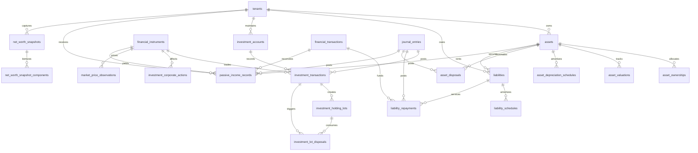

# WealthOS — Stage 3 Technical Design Specification
## Enterprise Asset, Liability, Investment, Portfolio & Passive Income Management Engine

**Document Version:** 1.0.0  
**Status:** Under Architectural Review  
**Date:** 2026-11-07  
**Author:** Google DeepMind / Antigravity Agentic Engineering  
**Approved Baseline:** Phase 4 Double-Entry Engine (`e4fe49b`) & Stage 2 Specification (`af55bfc`)

---

## 1. Executive Summary & Architecture Principles

Stage 3 implements the comprehensive wealth aggregation and intelligence core of WealthOS. While Stage 2 establishes operational accounts and day-to-day cashflow (income/expense), Stage 3 provides the macro balance sheet of the user's financial life: physical assets, real estate, vehicles, gold, fixed deposits, loans/liabilities, equity/fund investments, deterministic FIFO cost basis, corporate actions, passive income (dividends/rent), and unified net worth calculations.

### Core Architectural Invariants:
1. **Ledger as the Single Source of Financial Truth:** Every transaction with balance-sheet impact (acquisitions, loan repayments, security purchases, realized capital gains, dividend deposits) creates and posts a double-entry journal entry via `PostingService.create_and_post`.
2. **Off-Ledger vs. On-Ledger Delineation:** 
   - **On-Ledger:** Acquisition costs, principal repayments, realized capital gains/losses, dividend receipts, depreciation expenses.
   - **Off-Ledger:** Mark-to-market estimated valuations, unrealized gains/losses, indicative market prices. Estimated asset appreciation is NEVER recognized as revenue in the general ledger until realized.
3. **Deterministic FIFO Engine:** Disposals match acquisition lots strictly chronologically (`acquisition_date ASC`, `created_at ASC`, `id ASC`). Multi-currency transactions record both local and functional currencies with locked exchange rates.
4. **Numeric Precision:** Binary floating-point arithmetic is strictly forbidden. Monetary amounts use `NUMERIC(18, 4)` and Python `Decimal`. Security quantities use `NUMERIC(24, 8)`. Exchange rates use `NUMERIC(18, 8)`.
5. **Multi-Tenant Row-Level Security:** Every tenant-scoped table enforces PostgreSQL `ROW LEVEL SECURITY` and `FORCE ROW LEVEL SECURITY`. Application queries run under `wealthos_app` (`NOSUPERUSER NOBYPASSRLS`).
6. **Zero Double-Counting:** Passive income and loan repayments explicitly reconcile against `financial_transactions(id)` and `journal_entries(id)` to prevent duplicating cash movements.

---

## 2. Entity Relationship Diagram (ERD)



---

## 3. Database Schema Design (20 Stage 3 Tables)

All tables use `UUID` primary keys (`gen_random_uuid()`), explicit `tenant_id` foreign keys to `tenants(id)`, `created_at`/`updated_at` timestamps with timezones, and PostgreSQL `FORCE ROW LEVEL SECURITY`.

### 3.1 Asset Management Domain

#### Table: `assets`
Primary catalog for all tangible, real estate, physical, and business holdings.
```sql
CREATE TABLE assets (
    id UUID PRIMARY KEY DEFAULT gen_random_uuid(),
    tenant_id UUID NOT NULL REFERENCES tenants(id) ON DELETE CASCADE,
    account_id UUID REFERENCES financial_accounts(id) ON DELETE SET NULL, -- optional parent link
    ledger_account_id UUID NOT NULL REFERENCES accounting_accounts(id), -- e.g. 1500, 1510, 1520
    name VARCHAR(255) NOT NULL,
    asset_class VARCHAR(50) NOT NULL, -- REAL_ESTATE, VEHICLE, PRECIOUS_METAL, FIXED_INCOME, BUSINESS, ART, OTHER
    category VARCHAR(100) NOT NULL, -- e.g., RESIDENTIAL_APARTMENT, COMMERCIAL_OFFICE, GOLD_BULLION, FOUR_WHEELER
    acquisition_date DATE NOT NULL,
    acquisition_cost NUMERIC(18, 4) NOT NULL CHECK (acquisition_cost >= 0),
    currency VARCHAR(3) NOT NULL DEFAULT 'INR',
    current_value NUMERIC(18, 4) NOT NULL CHECK (current_value >= 0),
    valuation_date DATE NOT NULL,
    depreciation_method VARCHAR(50) NOT NULL DEFAULT 'NONE', -- NONE, STRAIGHT_LINE, REDUCING_BALANCE
    useful_life_months INTEGER CHECK (useful_life_months >= 0),
    salvage_value NUMERIC(18, 4) DEFAULT 0 CHECK (salvage_value >= 0),
    location JSONB, -- city, state, country, postal_code, address_lines
    metadata JSONB DEFAULT '{}'::jsonb, -- property size, vehicle VIN, registration, purity
    status VARCHAR(50) NOT NULL DEFAULT 'ACTIVE', -- ACTIVE, UNDER_MAINTENANCE, DISPOSED, WRITTEN_OFF
    document_ids UUID[] DEFAULT '{}',
    created_at TIMESTAMPTZ NOT NULL DEFAULT NOW(),
    updated_at TIMESTAMPTZ NOT NULL DEFAULT NOW()
);
CREATE INDEX idx_assets_tenant ON assets(tenant_id);
CREATE INDEX idx_assets_tenant_class ON assets(tenant_id, asset_class);
CREATE INDEX idx_assets_tenant_status ON assets(tenant_id, status);
```

#### Table: `asset_ownerships`
Tracks fractional and co-ownership percentages across entities or family members.
```sql
CREATE TABLE asset_ownerships (
    id UUID PRIMARY KEY DEFAULT gen_random_uuid(),
    tenant_id UUID NOT NULL REFERENCES tenants(id) ON DELETE CASCADE,
    asset_id UUID NOT NULL REFERENCES assets(id) ON DELETE CASCADE,
    owner_name VARCHAR(255) NOT NULL,
    owner_type VARCHAR(50) NOT NULL DEFAULT 'INDIVIDUAL', -- INDIVIDUAL, JOINT, HUF, TRUST, COMPANY
    ownership_percentage NUMERIC(7, 4) NOT NULL CHECK (ownership_percentage > 0 AND ownership_percentage <= 100),
    tax_identifier VARCHAR(100), -- PAN, SSN, Tax ID
    is_primary BOOLEAN NOT NULL DEFAULT FALSE,
    notes TEXT,
    created_at TIMESTAMPTZ NOT NULL DEFAULT NOW(),
    updated_at TIMESTAMPTZ NOT NULL DEFAULT NOW(),
    CONSTRAINT uq_asset_owner UNIQUE (tenant_id, asset_id, owner_name)
);
CREATE INDEX idx_asset_ownerships_asset ON asset_ownerships(tenant_id, asset_id);
```

#### Table: `asset_valuations`
Chronological valuation appraisals for tracking real estate, vehicles, and precious metals over time.
```sql
CREATE TABLE asset_valuations (
    id UUID PRIMARY KEY DEFAULT gen_random_uuid(),
    tenant_id UUID NOT NULL REFERENCES tenants(id) ON DELETE CASCADE,
    asset_id UUID NOT NULL REFERENCES assets(id) ON DELETE CASCADE,
    valuation_date DATE NOT NULL,
    valuation_amount NUMERIC(18, 4) NOT NULL CHECK (valuation_amount >= 0),
    valuation_type VARCHAR(50) NOT NULL, -- MANUAL, APPRAISAL, MARKET_FEED, ALGORITHMIC, BOOK_VALUE
    appraiser_name VARCHAR(255),
    source_reference VARCHAR(255),
    document_id UUID,
    notes TEXT,
    created_at TIMESTAMPTZ NOT NULL DEFAULT NOW(),
    CONSTRAINT uq_asset_valuation_date UNIQUE (tenant_id, asset_id, valuation_date)
);
CREATE INDEX idx_asset_valuations_asset ON asset_valuations(tenant_id, asset_id, valuation_date DESC);
```

#### Table: `asset_depreciation_schedules`
Parameters and planned depreciation amortizations.
```sql
CREATE TABLE asset_depreciation_schedules (
    id UUID PRIMARY KEY DEFAULT gen_random_uuid(),
    tenant_id UUID NOT NULL REFERENCES tenants(id) ON DELETE CASCADE,
    asset_id UUID NOT NULL REFERENCES assets(id) ON DELETE CASCADE,
    schedule_version INTEGER NOT NULL DEFAULT 1,
    depreciation_method VARCHAR(50) NOT NULL, -- STRAIGHT_LINE, REDUCING_BALANCE
    useful_life_months INTEGER NOT NULL CHECK (useful_life_months > 0),
    salvage_value NUMERIC(18, 4) NOT NULL DEFAULT 0,
    annual_rate NUMERIC(7, 4), -- for reducing balance
    is_active BOOLEAN NOT NULL DEFAULT TRUE,
    created_at TIMESTAMPTZ NOT NULL DEFAULT NOW(),
    updated_at TIMESTAMPTZ NOT NULL DEFAULT NOW(),
    CONSTRAINT uq_asset_depr_version UNIQUE (tenant_id, asset_id, schedule_version)
);
```

#### Table: `asset_depreciation_records`
Executed period-by-period depreciation entries, linked to general ledger depreciation entries.
```sql
CREATE TABLE asset_depreciation_records (
    id UUID PRIMARY KEY DEFAULT gen_random_uuid(),
    tenant_id UUID NOT NULL REFERENCES tenants(id) ON DELETE CASCADE,
    asset_id UUID NOT NULL REFERENCES assets(id) ON DELETE CASCADE,
    schedule_id UUID NOT NULL REFERENCES asset_depreciation_schedules(id) ON DELETE RESTRICT,
    journal_entry_id UUID REFERENCES journal_entries(id) ON DELETE RESTRICT,
    period_start_date DATE NOT NULL,
    period_end_date DATE NOT NULL,
    depreciation_amount NUMERIC(18, 4) NOT NULL CHECK (depreciation_amount >= 0),
    accumulated_depreciation NUMERIC(18, 4) NOT NULL CHECK (accumulated_depreciation >= 0),
    net_book_value NUMERIC(18, 4) NOT NULL CHECK (net_book_value >= 0),
    created_at TIMESTAMPTZ NOT NULL DEFAULT NOW()
);
CREATE INDEX idx_asset_depr_asset ON asset_depreciation_records(tenant_id, asset_id, period_end_date);
```

#### Table: `asset_disposals`
Terminal event capturing sale, scrap, or write-off, computing realized gain/loss and GL posting.
```sql
CREATE TABLE asset_disposals (
    id UUID PRIMARY KEY DEFAULT gen_random_uuid(),
    tenant_id UUID NOT NULL REFERENCES tenants(id) ON DELETE CASCADE,
    asset_id UUID NOT NULL REFERENCES assets(id) ON DELETE RESTRICT,
    journal_entry_id UUID NOT NULL REFERENCES journal_entries(id) ON DELETE RESTRICT,
    financial_transaction_id UUID REFERENCES financial_transactions(id) ON DELETE SET NULL,
    disposal_date DATE NOT NULL,
    disposal_type VARCHAR(50) NOT NULL, -- SALE, SCRAP, GIFT, LOSS_DAMAGE
    gross_proceeds NUMERIC(18, 4) NOT NULL DEFAULT 0 CHECK (gross_proceeds >= 0),
    disposal_fees NUMERIC(18, 4) NOT NULL DEFAULT 0 CHECK (disposal_fees >= 0),
    net_proceeds NUMERIC(18, 4) NOT NULL DEFAULT 0,
    cost_basis NUMERIC(18, 4) NOT NULL CHECK (cost_basis >= 0),
    accumulated_depreciation NUMERIC(18, 4) NOT NULL DEFAULT 0,
    net_book_value NUMERIC(18, 4) NOT NULL CHECK (net_book_value >= 0),
    realized_gain_loss NUMERIC(18, 4) NOT NULL,
    buyer_counterparty VARCHAR(255),
    notes TEXT,
    created_at TIMESTAMPTZ NOT NULL DEFAULT NOW()
);
CREATE INDEX idx_asset_disposals_asset ON asset_disposals(tenant_id, asset_id);
```

---

### 3.2 Liabilities & Loan Amortization Domain

#### Table: `liabilities`
Loans, mortgages, lines of credit, and debts owed.
```sql
CREATE TABLE liabilities (
    id UUID PRIMARY KEY DEFAULT gen_random_uuid(),
    tenant_id UUID NOT NULL REFERENCES tenants(id) ON DELETE CASCADE,
    ledger_account_id UUID NOT NULL REFERENCES accounting_accounts(id), -- e.g. 2100 (Home Loan), 2110 (Auto)
    collateral_asset_id UUID REFERENCES assets(id) ON DELETE SET NULL,
    name VARCHAR(255) NOT NULL,
    liability_type VARCHAR(50) NOT NULL, -- HOME_LOAN, PERSONAL_LOAN, AUTO_LOAN, EDUCATION_LOAN, MORTGAGE, CREDIT_LINE, LAP, OTHER
    lender_name VARCHAR(255) NOT NULL,
    loan_account_number VARCHAR(100),
    principal_amount NUMERIC(18, 4) NOT NULL CHECK (principal_amount > 0),
    current_balance NUMERIC(18, 4) NOT NULL CHECK (current_balance >= 0),
    currency VARCHAR(3) NOT NULL DEFAULT 'INR',
    interest_rate NUMERIC(7, 4) NOT NULL CHECK (interest_rate >= 0),
    interest_type VARCHAR(50) NOT NULL DEFAULT 'FLOATING', -- FIXED, FLOATING
    repayment_model VARCHAR(50) NOT NULL DEFAULT 'EMI', -- EMI, BULLET, PRINCIPAL_PLUS_INTEREST
    tenure_months INTEGER NOT NULL CHECK (tenure_months > 0),
    emi_amount NUMERIC(18, 4) NOT NULL CHECK (emi_amount >= 0),
    start_date DATE NOT NULL,
    maturity_date DATE NOT NULL,
    status VARCHAR(50) NOT NULL DEFAULT 'ACTIVE', -- ACTIVE, REPAID, SETTLED, DEFAULTED
    metadata JSONB DEFAULT '{}'::jsonb,
    created_at TIMESTAMPTZ NOT NULL DEFAULT NOW(),
    updated_at TIMESTAMPTZ NOT NULL DEFAULT NOW()
);
CREATE INDEX idx_liabilities_tenant ON liabilities(tenant_id);
CREATE INDEX idx_liabilities_tenant_status ON liabilities(tenant_id, status);
```

#### Table: `liability_schedules`
Deterministic amortization table generated for every loan installment.
```sql
CREATE TABLE liability_schedules (
    id UUID PRIMARY KEY DEFAULT gen_random_uuid(),
    tenant_id UUID NOT NULL REFERENCES tenants(id) ON DELETE CASCADE,
    liability_id UUID NOT NULL REFERENCES liabilities(id) ON DELETE CASCADE,
    installment_number INTEGER NOT NULL CHECK (installment_number > 0),
    due_date DATE NOT NULL,
    opening_balance NUMERIC(18, 4) NOT NULL CHECK (opening_balance >= 0),
    principal_due NUMERIC(18, 4) NOT NULL CHECK (principal_due >= 0),
    interest_due NUMERIC(18, 4) NOT NULL CHECK (interest_due >= 0),
    total_due NUMERIC(18, 4) NOT NULL CHECK (total_due >= 0),
    closing_balance NUMERIC(18, 4) NOT NULL CHECK (closing_balance >= 0),
    status VARCHAR(50) NOT NULL DEFAULT 'PENDING', -- PENDING, PAID, PARTIALLY_PAID, OVERDUE, WAIVED
    created_at TIMESTAMPTZ NOT NULL DEFAULT NOW(),
    CONSTRAINT uq_liability_installment UNIQUE (tenant_id, liability_id, installment_number)
);
CREATE INDEX idx_liability_schedules_due ON liability_schedules(tenant_id, liability_id, due_date);
```

#### Table: `liability_repayments`
Actual repayments linking cash debit to liability reduction and interest expense.
```sql
CREATE TABLE liability_repayments (
    id UUID PRIMARY KEY DEFAULT gen_random_uuid(),
    tenant_id UUID NOT NULL REFERENCES tenants(id) ON DELETE CASCADE,
    liability_id UUID NOT NULL REFERENCES liabilities(id) ON DELETE RESTRICT,
    schedule_id UUID REFERENCES liability_schedules(id) ON DELETE SET NULL,
    journal_entry_id UUID NOT NULL REFERENCES journal_entries(id) ON DELETE RESTRICT,
    financial_transaction_id UUID REFERENCES financial_transactions(id) ON DELETE SET NULL,
    payment_date DATE NOT NULL,
    total_amount NUMERIC(18, 4) NOT NULL CHECK (total_amount > 0),
    principal_portion NUMERIC(18, 4) NOT NULL CHECK (principal_portion >= 0),
    interest_portion NUMERIC(18, 4) NOT NULL CHECK (interest_portion >= 0),
    fee_penalty_portion NUMERIC(18, 4) NOT NULL DEFAULT 0 CHECK (fee_penalty_portion >= 0),
    payment_type VARCHAR(50) NOT NULL DEFAULT 'REGULAR_EMI', -- REGULAR_EMI, PREPAYMENT, PARTIAL, FORECLOSURE
    reference_number VARCHAR(100),
    notes TEXT,
    created_at TIMESTAMPTZ NOT NULL DEFAULT NOW(),
    CONSTRAINT chk_repayment_sum CHECK (total_amount = (principal_portion + interest_portion + fee_penalty_portion))
);
CREATE INDEX idx_liability_repayments_liability ON liability_repayments(tenant_id, liability_id, payment_date);
```

---

### 3.3 Investment Instruments & Accounts

#### Table: `financial_instruments`
Security master catalog for stocks, ETFs, mutual funds, sovereign gold bonds, and fixed income.
```sql
CREATE TABLE financial_instruments (
    id UUID PRIMARY KEY DEFAULT gen_random_uuid(),
    tenant_id UUID NOT NULL REFERENCES tenants(id) ON DELETE CASCADE,
    symbol VARCHAR(50) NOT NULL, -- e.g., RELIANCE, INFOSYS, NIFTYBEES
    name VARCHAR(255) NOT NULL,
    isin VARCHAR(12), -- International Securities Identification Number
    exchange VARCHAR(50) NOT NULL, -- NSE, BSE, NASDAQ, NYSE, AMFI
    asset_class VARCHAR(50) NOT NULL, -- EQUITY, MUTUAL_FUND, ETF, BOND, SGB, T_BILL, REIT, OTHER
    instrument_type VARCHAR(50) NOT NULL, -- COMMON_STOCK, EQUITY_MF, DEBT_MF, INDEX_ETF, GOVT_BOND, GOLD_BOND
    currency VARCHAR(3) NOT NULL DEFAULT 'INR',
    lot_size NUMERIC(18, 4) NOT NULL DEFAULT 1 CHECK (lot_size > 0),
    face_value NUMERIC(18, 4) DEFAULT 10,
    expense_ratio NUMERIC(7, 4),
    is_active BOOLEAN NOT NULL DEFAULT TRUE,
    created_at TIMESTAMPTZ NOT NULL DEFAULT NOW(),
    updated_at TIMESTAMPTZ NOT NULL DEFAULT NOW(),
    CONSTRAINT uq_instrument_symbol_ex UNIQUE (tenant_id, symbol, exchange)
);
CREATE INDEX idx_instruments_tenant_isin ON financial_instruments(tenant_id, isin);
```

#### Table: `instrument_identifiers`
Alternate mapping identifiers (CUSIP, SEDOL, Bloomberg Ticker, AMFI Scheme Code).
```sql
CREATE TABLE instrument_identifiers (
    id UUID PRIMARY KEY DEFAULT gen_random_uuid(),
    tenant_id UUID NOT NULL REFERENCES tenants(id) ON DELETE CASCADE,
    instrument_id UUID NOT NULL REFERENCES financial_instruments(id) ON DELETE CASCADE,
    identifier_type VARCHAR(50) NOT NULL, -- ISIN, CUSIP, SEDOL, BLOOMBERG, AMFI_CODE, YAHOO_TICKER
    identifier_value VARCHAR(100) NOT NULL,
    created_at TIMESTAMPTZ NOT NULL DEFAULT NOW(),
    CONSTRAINT uq_instrument_identifier UNIQUE (tenant_id, identifier_type, identifier_value)
);
```

#### Table: `investment_accounts`
Brokerage accounts, Demat folios, Mutual Fund investor folios, and NPS accounts.
```sql
CREATE TABLE investment_accounts (
    id UUID PRIMARY KEY DEFAULT gen_random_uuid(),
    tenant_id UUID NOT NULL REFERENCES tenants(id) ON DELETE CASCADE,
    institution_id UUID NOT NULL REFERENCES financial_institutions(id) ON DELETE RESTRICT,
    financial_account_id UUID REFERENCES financial_accounts(id) ON DELETE SET NULL, -- linked cash settlement bank account
    ledger_account_id UUID NOT NULL REFERENCES accounting_accounts(id), -- e.g. 1200 (Equities), 1210 (MF)
    name VARCHAR(255) NOT NULL,
    account_number VARCHAR(100) NOT NULL,
    account_type VARCHAR(50) NOT NULL, -- BROKERAGE, DEMAT, MUTUAL_FUND_FOLIO, RETIREMENT_NPS, CRYPTO_WALLET
    currency VARCHAR(3) NOT NULL DEFAULT 'INR',
    broker_name VARCHAR(255) NOT NULL,
    depository_participant VARCHAR(100), -- NSDL, CDSL
    status VARCHAR(50) NOT NULL DEFAULT 'ACTIVE', -- ACTIVE, SUSPENDED, CLOSED
    metadata JSONB DEFAULT '{}'::jsonb,
    created_at TIMESTAMPTZ NOT NULL DEFAULT NOW(),
    updated_at TIMESTAMPTZ NOT NULL DEFAULT NOW(),
    CONSTRAINT uq_inv_account_num UNIQUE (tenant_id, institution_id, account_number)
);
CREATE INDEX idx_inv_accounts_tenant ON investment_accounts(tenant_id);
```

---

### 3.4 Investment Transactions, FIFO Lots & Disposals

#### Table: `investment_transactions`
Individual trade operations and events executed within an investment account.
```sql
CREATE TABLE investment_transactions (
    id UUID PRIMARY KEY DEFAULT gen_random_uuid(),
    tenant_id UUID NOT NULL REFERENCES tenants(id) ON DELETE CASCADE,
    investment_account_id UUID NOT NULL REFERENCES investment_accounts(id) ON DELETE RESTRICT,
    instrument_id UUID NOT NULL REFERENCES financial_instruments(id) ON DELETE RESTRICT,
    journal_entry_id UUID REFERENCES journal_entries(id) ON DELETE RESTRICT,
    financial_transaction_id UUID REFERENCES financial_transactions(id) ON DELETE SET NULL, -- cash leg
    transaction_type VARCHAR(50) NOT NULL, -- BUY, SELL, DIVIDEND_REINVEST, SPLIT, BONUS, RIGHTS, TRANSFER_IN, TRANSFER_OUT
    transaction_date DATE NOT NULL,
    settlement_date DATE NOT NULL,
    quantity NUMERIC(24, 8) NOT NULL CHECK (quantity > 0),
    unit_price NUMERIC(18, 4) NOT NULL CHECK (unit_price >= 0),
    gross_amount NUMERIC(18, 4) NOT NULL CHECK (gross_amount >= 0),
    brokerage_fees NUMERIC(18, 4) NOT NULL DEFAULT 0 CHECK (brokerage_fees >= 0),
    taxes_stt NUMERIC(18, 4) NOT NULL DEFAULT 0 CHECK (taxes_stt >= 0),
    net_amount NUMERIC(18, 4) NOT NULL CHECK (net_amount >= 0),
    currency VARCHAR(3) NOT NULL DEFAULT 'INR',
    exchange_rate NUMERIC(18, 8) NOT NULL DEFAULT 1.0,
    cost_basis_method VARCHAR(50) NOT NULL DEFAULT 'FIFO',
    status VARCHAR(50) NOT NULL DEFAULT 'SETTLED', -- PENDING, EXECUTED, SETTLED, REVERSED
    order_id VARCHAR(100),
    trade_id VARCHAR(100),
    notes TEXT,
    created_at TIMESTAMPTZ NOT NULL DEFAULT NOW(),
    updated_at TIMESTAMPTZ NOT NULL DEFAULT NOW()
);
CREATE INDEX idx_inv_tx_account_date ON investment_transactions(tenant_id, investment_account_id, transaction_date);
CREATE INDEX idx_inv_tx_instrument ON investment_transactions(tenant_id, instrument_id);
```

#### Table: `investment_holding_lots`
Acquisition lots created upon `BUY` or `TRANSFER_IN`. The core of deterministic FIFO.
```sql
CREATE TABLE investment_holding_lots (
    id UUID PRIMARY KEY DEFAULT gen_random_uuid(),
    tenant_id UUID NOT NULL REFERENCES tenants(id) ON DELETE CASCADE,
    investment_account_id UUID NOT NULL REFERENCES investment_accounts(id) ON DELETE RESTRICT,
    instrument_id UUID NOT NULL REFERENCES financial_instruments(id) ON DELETE RESTRICT,
    buy_transaction_id UUID NOT NULL REFERENCES investment_transactions(id) ON DELETE RESTRICT,
    acquisition_date DATE NOT NULL,
    original_quantity NUMERIC(24, 8) NOT NULL CHECK (original_quantity > 0),
    remaining_quantity NUMERIC(24, 8) NOT NULL CHECK (remaining_quantity >= 0 AND remaining_quantity <= original_quantity),
    cost_per_unit NUMERIC(18, 4) NOT NULL CHECK (cost_per_unit >= 0),
    total_cost NUMERIC(18, 4) NOT NULL CHECK (total_cost >= 0),
    fees_allocated NUMERIC(18, 4) NOT NULL DEFAULT 0 CHECK (fees_allocated >= 0),
    currency VARCHAR(3) NOT NULL DEFAULT 'INR',
    is_exhausted BOOLEAN NOT NULL DEFAULT FALSE,
    created_at TIMESTAMPTZ NOT NULL DEFAULT NOW(),
    updated_at TIMESTAMPTZ NOT NULL DEFAULT NOW()
);
CREATE INDEX idx_inv_lots_fifo ON investment_holding_lots(tenant_id, investment_account_id, instrument_id, is_exhausted, acquisition_date ASC, created_at ASC);
```

#### Table: `investment_lot_disposals`
Maps `SELL` transactions to consumed lots, recording deterministic cost basis and realized gain/loss.
```sql
CREATE TABLE investment_lot_disposals (
    id UUID PRIMARY KEY DEFAULT gen_random_uuid(),
    tenant_id UUID NOT NULL REFERENCES tenants(id) ON DELETE CASCADE,
    sell_transaction_id UUID NOT NULL REFERENCES investment_transactions(id) ON DELETE RESTRICT,
    lot_id UUID NOT NULL REFERENCES investment_holding_lots(id) ON DELETE RESTRICT,
    disposal_date DATE NOT NULL,
    quantity_disposed NUMERIC(24, 8) NOT NULL CHECK (quantity_disposed > 0),
    unit_cost_basis NUMERIC(18, 4) NOT NULL CHECK (unit_cost_basis >= 0),
    total_cost_basis NUMERIC(18, 4) NOT NULL CHECK (total_cost_basis >= 0),
    sell_unit_price NUMERIC(18, 4) NOT NULL CHECK (sell_unit_price >= 0),
    gross_proceeds NUMERIC(18, 4) NOT NULL CHECK (gross_proceeds >= 0),
    allocated_disposal_fees NUMERIC(18, 4) NOT NULL DEFAULT 0 CHECK (allocated_disposal_fees >= 0),
    realized_gain_loss NUMERIC(18, 4) NOT NULL,
    holding_period_days INTEGER NOT NULL CHECK (holding_period_days >= 0),
    term_classification VARCHAR(50) NOT NULL, -- SHORT_TERM, LONG_TERM
    created_at TIMESTAMPTZ NOT NULL DEFAULT NOW()
);
CREATE INDEX idx_lot_disposals_sell ON investment_lot_disposals(tenant_id, sell_transaction_id);
CREATE INDEX idx_lot_disposals_lot ON investment_lot_disposals(tenant_id, lot_id);
```

---

### 3.5 Corporate Actions & Market Data

#### Table: `investment_corporate_actions`
Stock splits, bonus issues, mergers, demergers, and capital reorganizations.
```sql
CREATE TABLE investment_corporate_actions (
    id UUID PRIMARY KEY DEFAULT gen_random_uuid(),
    tenant_id UUID NOT NULL REFERENCES tenants(id) ON DELETE CASCADE,
    instrument_id UUID NOT NULL REFERENCES financial_instruments(id) ON DELETE RESTRICT,
    event_type VARCHAR(50) NOT NULL, -- STOCK_SPLIT, BONUS_ISSUE, RIGHTS_ISSUE, MERGER, DEMERGER, CASH_DIVIDEND
    announcement_date DATE NOT NULL,
    ex_date DATE NOT NULL,
    record_date DATE NOT NULL,
    effective_date DATE NOT NULL,
    ratio_numerator NUMERIC(18, 4) NOT NULL CHECK (ratio_numerator > 0),
    ratio_denominator NUMERIC(18, 4) NOT NULL CHECK (ratio_denominator > 0),
    cash_amount NUMERIC(18, 4) DEFAULT 0,
    currency VARCHAR(3) NOT NULL DEFAULT 'INR',
    source VARCHAR(100) NOT NULL, -- NSE_CORPORATE, BSE_CORPORATE, MANUAL
    verification_status VARCHAR(50) NOT NULL DEFAULT 'VERIFIED', -- PENDING, VERIFIED, REJECTED
    status VARCHAR(50) NOT NULL DEFAULT 'APPLIED', -- PENDING, APPLIED, CANCELLED
    notes TEXT,
    created_at TIMESTAMPTZ NOT NULL DEFAULT NOW(),
    updated_at TIMESTAMPTZ NOT NULL DEFAULT NOW(),
    CONSTRAINT uq_corporate_action UNIQUE (tenant_id, instrument_id, event_type, ex_date)
);
CREATE INDEX idx_corp_actions_inst ON investment_corporate_actions(tenant_id, instrument_id, ex_date);
```

#### Table: `market_price_observations`
Auditable price feed records with full data provenance.
```sql
CREATE TABLE market_price_observations (
    id UUID PRIMARY KEY DEFAULT gen_random_uuid(),
    tenant_id UUID NOT NULL REFERENCES tenants(id) ON DELETE CASCADE,
    instrument_id UUID NOT NULL REFERENCES financial_instruments(id) ON DELETE CASCADE,
    price_date DATE NOT NULL,
    price_timestamp TIMESTAMPTZ NOT NULL,
    close_price NUMERIC(18, 4) NOT NULL CHECK (close_price >= 0),
    open_price NUMERIC(18, 4),
    high_price NUMERIC(18, 4),
    low_price NUMERIC(18, 4),
    volume NUMERIC(24, 4),
    currency VARCHAR(3) NOT NULL DEFAULT 'INR',
    source VARCHAR(50) NOT NULL, -- NSE, BSE, YAHOO, AMFI, MANUAL
    is_stale BOOLEAN NOT NULL DEFAULT FALSE,
    created_at TIMESTAMPTZ NOT NULL DEFAULT NOW(),
    CONSTRAINT uq_market_price_daily UNIQUE (tenant_id, instrument_id, price_date, source)
);
CREATE INDEX idx_market_prices_latest ON market_price_observations(tenant_id, instrument_id, price_date DESC);
```

---

### 3.6 Passive Income Domain

#### Table: `passive_income_records`
Tracks announced and received dividends, interest, bond coupons, and rental income.
```sql
CREATE TABLE passive_income_records (
    id UUID PRIMARY KEY DEFAULT gen_random_uuid(),
    tenant_id UUID NOT NULL REFERENCES tenants(id) ON DELETE CASCADE,
    instrument_id UUID REFERENCES financial_instruments(id) ON DELETE RESTRICT,
    asset_id UUID REFERENCES assets(id) ON DELETE RESTRICT,
    bank_account_id UUID REFERENCES financial_accounts(id) ON DELETE SET NULL,
    financial_transaction_id UUID REFERENCES financial_transactions(id) ON DELETE SET NULL,
    journal_entry_id UUID REFERENCES journal_entries(id) ON DELETE SET NULL,
    income_type VARCHAR(50) NOT NULL, -- DIVIDEND, BOND_INTEREST, FD_INTEREST, SAVINGS_INTEREST, RENTAL_INCOME, ROYALTY, OTHER
    ex_date DATE,
    record_date DATE,
    payment_date DATE NOT NULL,
    gross_amount NUMERIC(18, 4) NOT NULL CHECK (gross_amount > 0),
    tax_deducted_source NUMERIC(18, 4) NOT NULL DEFAULT 0 CHECK (tax_deducted_source >= 0),
    other_deductions NUMERIC(18, 4) NOT NULL DEFAULT 0 CHECK (other_deductions >= 0),
    net_amount NUMERIC(18, 4) NOT NULL CHECK (net_amount > 0),
    currency VARCHAR(3) NOT NULL DEFAULT 'INR',
    status VARCHAR(50) NOT NULL DEFAULT 'RECEIVED', -- ANNOUNCED, RECEIVED, RECONCILED, CANCELLED
    notes TEXT,
    created_at TIMESTAMPTZ NOT NULL DEFAULT NOW(),
    updated_at TIMESTAMPTZ NOT NULL DEFAULT NOW(),
    CONSTRAINT chk_passive_net CHECK (net_amount = (gross_amount - tax_deducted_source - other_deductions))
);
CREATE INDEX idx_passive_income_tenant ON passive_income_records(tenant_id, payment_date DESC);
CREATE INDEX idx_passive_income_instrument ON passive_income_records(tenant_id, instrument_id);
```

---

### 3.7 Unified Net Worth Snapshots

#### Table: `net_worth_snapshots`
Macro summary of net worth across all wealth domains at a point in time.
```sql
CREATE TABLE net_worth_snapshots (
    id UUID PRIMARY KEY DEFAULT gen_random_uuid(),
    tenant_id UUID NOT NULL REFERENCES tenants(id) ON DELETE CASCADE,
    snapshot_date DATE NOT NULL,
    functional_currency VARCHAR(3) NOT NULL DEFAULT 'INR',
    total_assets NUMERIC(18, 4) NOT NULL CHECK (total_assets >= 0),
    total_liabilities NUMERIC(18, 4) NOT NULL CHECK (total_liabilities >= 0),
    net_worth NUMERIC(18, 4) NOT NULL,
    liquid_cash_assets NUMERIC(18, 4) NOT NULL DEFAULT 0,
    investment_assets NUMERIC(18, 4) NOT NULL DEFAULT 0,
    physical_real_estate_assets NUMERIC(18, 4) NOT NULL DEFAULT 0,
    fixed_income_deposits NUMERIC(18, 4) NOT NULL DEFAULT 0,
    short_term_liabilities NUMERIC(18, 4) NOT NULL DEFAULT 0,
    long_term_liabilities NUMERIC(18, 4) NOT NULL DEFAULT 0,
    valuation_coverage_pct NUMERIC(7, 4) NOT NULL CHECK (valuation_coverage_pct >= 0 AND valuation_coverage_pct <= 100),
    freshness_summary JSONB DEFAULT '{}'::jsonb,
    calculation_version VARCHAR(20) NOT NULL DEFAULT '1.0',
    created_at TIMESTAMPTZ NOT NULL DEFAULT NOW(),
    CONSTRAINT uq_net_worth_date UNIQUE (tenant_id, snapshot_date)
);
CREATE INDEX idx_net_worth_date ON net_worth_snapshots(tenant_id, snapshot_date DESC);
```

#### Table: `net_worth_snapshot_components`
Breakdown items backing every aggregated snapshot value.
```sql
CREATE TABLE net_worth_snapshot_components (
    id UUID PRIMARY KEY DEFAULT gen_random_uuid(),
    tenant_id UUID NOT NULL REFERENCES tenants(id) ON DELETE CASCADE,
    snapshot_id UUID NOT NULL REFERENCES net_worth_snapshots(id) ON DELETE CASCADE,
    category VARCHAR(50) NOT NULL, -- CASH, INVESTMENT, REAL_ESTATE, VEHICLE, PRECIOUS_METAL, LOAN, CREDIT_CARD
    source_table VARCHAR(50) NOT NULL, -- financial_accounts, assets, investment_holding_lots, liabilities
    source_id UUID NOT NULL,
    name VARCHAR(255) NOT NULL,
    gross_value NUMERIC(18, 4) NOT NULL,
    ownership_percentage NUMERIC(7, 4) NOT NULL DEFAULT 100.0,
    attributable_value NUMERIC(18, 4) NOT NULL,
    currency VARCHAR(3) NOT NULL DEFAULT 'INR',
    fx_rate NUMERIC(18, 8) NOT NULL DEFAULT 1.0,
    functional_value NUMERIC(18, 4) NOT NULL,
    is_valuation_stale BOOLEAN NOT NULL DEFAULT FALSE,
    valuation_date DATE NOT NULL,
    created_at TIMESTAMPTZ NOT NULL DEFAULT NOW()
);
CREATE INDEX idx_nw_components_snapshot ON net_worth_snapshot_components(tenant_id, snapshot_id);
```

---

## 4. Numeric Policy & Standards

All numerical values strictly follow these specifications:
- **Currency Amounts (Valuations, Balances, Prices, Fees):** `NUMERIC(18, 4)` and Python `Decimal`. Rounding method: `ROUND_HALF_UP` to the nearest cent/paisa (2 decimal places for cash settlement, 4 decimal places for internal accounting).
- **Quantities (Shares, Mutual Fund Units, Gold Grams):** `NUMERIC(24, 8)` and Python `Decimal`. Zero truncation on fractional shares.
- **FX & Exchange Rates:** `NUMERIC(18, 8)` and Python `Decimal`.
- **Percentages & Ratios (Interest Rates, Ownership, Stock Splits):** `NUMERIC(7, 4)` and Python `Decimal`.
- **Zero Floating-Point Arithmetic:** `float` and `double precision` are strictly banned from all domain logic, schemas, and API serializations.

---

## 5. Lifecycles & State Transitions

### 5.1 Asset Lifecycle
```
[DRAFT] ──> [ACTIVE] ──> [UNDER_MAINTENANCE] ──> [ACTIVE]
               │
               ├──> [DISPOSED] (Sold with Realized Gain/Loss posted to GL)
               └──> [WRITTEN_OFF] (Impaired with Loss posted to GL)
```

### 5.2 Liability Lifecycle
```
[DRAFT] ──> [ACTIVE] ──> [IN_DEFAULT] ──> [ACTIVE]
               │
               ├──> [REPAID] (All principal settled through amortization)
               └──> [SETTLED] (Foreclosed or settled via negotiated payoff)
```

### 5.3 Investment Transaction Lifecycle
```
[DRAFT] ──> [PENDING] ──> [EXECUTED] ──> [SETTLED] (Lots allocated, GL posted)
                                            │
                                            └──> [REVERSED] (Mirror reversal entry)
```

### 5.4 Passive Income Lifecycle
```
[ANNOUNCED] ──> [RECEIVED] ──> [RECONCILED] (Matched to bank deposit transaction)
      │
      └──> [CANCELLED]
```

---

## 6. Deterministic FIFO Cost Basis Engine

When an investment `SELL` transaction of quantity $Q_{sell}$ occurs:
1. **Lot Discovery:** Query open lots for the specific `(tenant_id, investment_account_id, instrument_id)`:
   ```sql
   SELECT * FROM investment_holding_lots 
   WHERE tenant_id = :tenant_id 
     AND investment_account_id = :account_id 
     AND instrument_id = :instrument_id 
     AND is_exhausted = FALSE 
   ORDER BY acquisition_date ASC, created_at ASC, id ASC
   FOR UPDATE;
   ```
2. **Deterministic Consumption:**
   - Iterate through sorted lots.
   - For each lot with remaining quantity $Q_{rem}$:
     - If $Q_{sell} \ge Q_{rem}$:
       - Consume full lot: $Q_{disp} = Q_{rem}$.
       - Update lot: $Q_{rem} = 0, \text{is\_exhausted} = \text{TRUE}$.
       - Decrement: $Q_{sell} = Q_{sell} - Q_{disp}$.
     - If $Q_{sell} < Q_{rem}$:
       - Consume partial lot: $Q_{disp} = Q_{sell}$.
       - Update lot: $Q_{rem} = Q_{rem} - Q_{disp}, \text{is\_exhausted} = \text{FALSE}$.
       - $Q_{sell} = 0$.
     - Record `investment_lot_disposals`:
       $$\text{Unit Cost Basis} = \text{lot.cost\_per\_unit}$$
       $$\text{Total Cost Basis} = Q_{disp} \times \text{Unit Cost Basis}$$
       $$\text{Allocated Gross Proceeds} = Q_{disp} \times \text{sell\_unit\_price}$$
       $$\text{Allocated Fees} = \text{total\_fees} \times \frac{Q_{disp}}{\text{total\_quantity\_sold}}$$
       $$\text{Realized Gain/Loss} = \text{Allocated Gross Proceeds} - \text{Total Cost Basis} - \text{Allocated Fees}$$
       $$\text{Holding Period Days} = \text{sell\_date} - \text{lot.acquisition\_date}$$
       $$\text{Term} = \begin{cases} \text{LONG\_TERM} & \text{if Days} \ge 365 \\ \text{SHORT\_TERM} & \text{otherwise} \end{cases}$$
   - If after iterating all lots, $Q_{sell} > 0$, raise `InsufficientHoldingQuantityException` (Overselling / Naked Shorting is forbidden).
3. **General Ledger Posting:**
   - Call `PostingService.create_and_post`:
     - **Debit:** Cash / Bank Account (`1020`) with Net Proceeds.
     - **Credit:** Investment Asset (`1200`) with Total Cost Basis.
     - **Credit (if gain):** Realized Capital Gains (`4310`) with $(\text{Gross Proceeds} - \text{Cost Basis} - \text{Fees})$.
     - **Debit (if loss):** Realized Capital Losses (`5310`) with $(\text{Cost Basis} + \text{Fees} - \text{Gross Proceeds})$.

---

## 7. Corporate Action Processing Engine

1. **Stock Split (e.g., 2-for-1 Split):**
   - $\text{Ratio} = \frac{\text{ratio\_numerator}}{\text{ratio\_denominator}} = \frac{2}{1} = 2.0$.
   - For every active lot:
     - New Quantity: $Q_{new} = Q_{old} \times 2.0$.
     - New Unit Cost: $C_{new} = C_{old} \div 2.0$.
     - Invariant: $Q_{new} \times C_{new} = Q_{old} \times C_{old} = \text{Total Cost Basis}$ (Preserved).
   - Off-ledger event; General ledger balance sheet value of total holding remains unchanged.
2. **Bonus Issue (e.g., 1-for-5 Bonus):**
   - Issues 1 new share for every 5 held.
   - Creates a new holding lot:
     - Acquisition Date = Ex-date.
     - Quantity = $\lfloor Q_{total} \div 5 \rfloor$.
     - Cost Basis = 0 (under standard Indian income tax provisions, where bonus shares have zero cost basis and acquisition date is the date of allotment).
     - Fractional shares: settled via cash-in-lieu payment recorded in `passive_income_records`.
3. **Replayability & Idempotency:**
   - Corporate action record checks `status = 'APPLIED'`. Applying twice raises `DuplicateCorporateActionException`.
   - Lineage is recorded on `investment_transactions` with `transaction_type = 'SPLIT'` or `'BONUS'`.

---

## 8. Market Data & External Provider Architecture

```
┌────────────────────────────────────────────────────────┐
│               MarketDataProvider (Interface)           │
│   + fetch_latest_price(symbol, exchange)               │
│   + fetch_historical_prices(symbol, start_date, end)   │
└───────────┬───────────────────┬───────────────────┬────┘
            │                   │                   │
            ▼                   ▼                   ▼
    ┌───────────────┐   ┌───────────────┐   ┌───────────────┐
    │  NSEProvider  │   │  AMFIProvider │   │ YahooProvider │
    │ (Equities)    │   │ (Mutual Funds)│   │ (Global/ETFs) │
    └───────────────┘   └───────────────┘   └───────────────┘
```

1. **Freshness Invariant:**
   - If `NOW() - latest_price_timestamp > 24 hours` (excluding weekends and market exchange holidays), mark `is_stale = TRUE`.
   - Valuations flag stale quotes in net worth calculations rather than failing silently.
2. **Separation of Concerns:**
   - Market prices feed `market_price_observations`.
   - Portfolio valuation calculates: $\text{Current Value} = \sum (\text{lot.remaining\_quantity} \times \text{latest\_close\_price})$.
   - $\text{Unrealized P&L} = \text{Current Value} - \text{Total Remaining Cost Basis}$.
   - **General Ledger Isolation:** Unrealized P&L is displayed on portfolio analytics and net worth dashboards, but is NEVER posted to the general ledger as revenue until actual disposal.

---

## 9. Passive Income & Double-Counting Prevention

Passive income presents a critical double-counting trap in wealth tracking systems:
1. When a user receives a ₹1,000 dividend, ₹900 cash arrives in their bank account and ₹100 TDS is withheld.
2. If the bank transaction is imported as `INCOME`, AND a dividend record of ₹1,000 is created, a naive aggregation will count ₹1,900 of wealth or double-record the cash.
3. **WealthOS Single-Transaction Resolution:**
   - The user records the passive income via `/api/v1/passive-income`.
   - The service creates the `passive_income_record`.
   - The service calls `PostingService.create_and_post`:
     - **Debit:** Bank Checking Account (`1020`) — ₹900 (Net cash received).
     - **Debit:** Tax Deducted at Source (TDS) Receivable Asset (`1410`) — ₹100.
     - **Credit:** Dividend Income (`4110`) — ₹1,000 (Gross income).
   - If an imported bank transaction already exists for ₹900, the user matches it; the `passive_income_records.financial_transaction_id` foreign key is linked, and the bank transaction is marked `RECONCILED`.

---

## 10. Unified Net Worth Engine

### Core Calculation Specification:
$$\text{Net Worth} = \sum_{a \in \text{Assets}} (\text{Valuation}(a) \times \text{OwnershipPct}(a)) - \sum_{l \in \text{Liabilities}} (\text{Balance}(l) \times \text{OwnershipPct}(l))$$

Where:
- **Cash & Bank Balances:** Derived from general ledger trial balance for accounts `1010`, `1020`, `1030`, `1040`.
- **Physical & Real Estate Assets:** Latest approved appraisal from `asset_valuations` (or `acquisition_cost - accumulated_depreciation` if no market appraisal exists).
- **Investment Holdings:** $\sum (\text{remaining\_quantity} \times \text{latest\_verified\_market\_price})$.
- **Outstanding Liabilities:** Exact principal balance remaining on active loans in `liabilities.current_balance` plus credit card payables (`2010`).

### Valuation Coverage Metric:
$$\text{Coverage Pct} = \frac{\text{Value of Assets with Fresh Valuations (<30 days)}}{\text{Total Asset Value}} \times 100\%$$
If coverage $< 80\%$, the UI displays an **"Estimated Net Worth (Partial Coverage)"** pill with a list of assets requiring updated valuation.

---

## 11. Accounting Integration Matrix (Phase 4 GL Postings)

| Scenario | Event Trigger | Debit Account | Credit Account | Explanation |
| :--- | :--- | :--- | :--- | :--- |
| **1. Physical Asset Purchase** | Asset Acquired via Cash | Asset (`1500` / `1510`) | Bank Checking (`1020`) | Balance sheet asset swap. |
| **2. Asset with Loan** | Property Acquired with Mortgage | Real Estate Asset (`1500`) | Mortgage Loan (`2100`) & Bank Checking (`1020`) | Multi-line compound entry. |
| **3. Asset Disposal (Gain)** | Vehicle Sold Above Book Value | Bank Checking (`1020`) & Acc. Depr. (`1519`) | Vehicle Asset (`1510`) & Gain on Disposal (`4320`) | Removes asset & recognizes gain. |
| **4. Loan Disbursement** | Loan Principal Received | Bank Checking (`1020`) | Loan Liability (`2100`) | Debt proceeds are not income. |
| **5. EMI Loan Repayment** | Monthly EMI Debit | Loan Liability (`2100`) & Interest Expense (`5080`) | Bank Checking (`1020`) | Splits principal from interest. |
| **6. Investment Purchase** | Equities / MF Bought | Marketable Securities (`1200`) | Bank Checking (`1020`) | Capital asset swap; zero operating expense. |
| **7. Investment Sale (Gain)** | Equities Sold at Profit | Bank Checking (`1020`) | Marketable Securities (`1200`) & Realized Gain (`4310`) | Relieves cost basis & recognizes gain. |
| **8. Dividend Receipt** | Net Cash Received with TDS | Bank Checking (`1020`) & TDS Receivable (`1410`) | Dividend Income (`4110`) | Gross income recognized; TDS recorded as asset. |
| **9. FD Interest Accrual** | Term Deposit Interest Credited | Fixed Deposit (`1220`) & TDS Asset (`1410`) | Interest Income (`4120`) | Increases FD balance & records income. |

---

## 12. REST API Specification

### Assets (`/api/v1/assets`)
- `GET /api/v1/assets`: List tenant assets with filtering by class and status.
- `POST /api/v1/assets`: Create asset and post initial acquisition journal entry if requested.
- `GET /api/v1/assets/{id}`: Detailed asset view with valuation history, ownership, and documents.
- `PUT /api/v1/assets/{id}`: Update asset metadata and location.
- `POST /api/v1/assets/{id}/valuations`: Record new valuation appraisal.
- `POST /api/v1/assets/{id}/depreciate`: Calculate and post period depreciation entry.
- `POST /api/v1/assets/{id}/dispose`: Execute asset disposal with realized gain/loss GL posting.

### Liabilities (`/api/v1/liabilities`)
- `GET /api/v1/liabilities`: List all liabilities and current balances.
- `POST /api/v1/liabilities`: Register a loan or debt.
- `GET /api/v1/liabilities/{id}/schedule`: Retrieve generated amortization schedule.
- `POST /api/v1/liabilities/{id}/repayments`: Record repayment with principal/interest split and GL posting.
- `POST /api/v1/liabilities/{id}/recalculate`: Recompute schedule following rate change or prepayment.

### Investments (`/api/v1/investments`)
- `GET /api/v1/investments/instruments`: Search instrument catalog (NSE/BSE/AMFI).
- `POST /api/v1/investments/instruments`: Register custom or private instrument.
- `GET /api/v1/investments/accounts`: List investment & demat accounts.
- `POST /api/v1/investments/accounts`: Create investment account.
- `GET /api/v1/investments/holdings`: Get consolidated holdings, quantities, cost basis, and current market values.
- `GET /api/v1/investments/lots`: Inspect active acquisition lots for an instrument.
- `POST /api/v1/investments/transactions`: Record trade (`BUY`, `SELL`). Triggers FIFO allocation and GL posting.
- `POST /api/v1/investments/corporate-actions`: Apply stock split or bonus issue across lots.

### Passive Income (`/api/v1/passive-income`)
- `GET /api/v1/passive-income`: List passive income records with date and type filters.
- `POST /api/v1/passive-income`: Record dividend, coupon, or rental income with TDS and GL posting.
- `POST /api/v1/passive-income/{id}/reconcile`: Match passive income to an existing bank transaction.

### Net Worth (`/api/v1/net-worth`)
- `GET /api/v1/net-worth/current`: Real-time net worth computation with category breakdown and coverage score.
- `GET /api/v1/net-worth/history`: Historical net worth snapshots.
- `POST /api/v1/net-worth/snapshots`: Generate and persist an auditable net worth snapshot.

---

## 13. Tenant Security Model & RBAC

1. **Row-Level Security Policies:**
   ```sql
   ALTER TABLE assets ENABLE ROW LEVEL SECURITY;
   ALTER TABLE assets FORCE ROW LEVEL SECURITY;
   CREATE POLICY assets_tenant_isolation ON assets
       FOR ALL
       USING (NULLIF(current_setting('app.current_tenant_id', true), '') IS NOT NULL 
              AND tenant_id = NULLIF(current_setting('app.current_tenant_id', true), '')::uuid)
       WITH CHECK (NULLIF(current_setting('app.current_tenant_id', true), '') IS NOT NULL 
                   AND tenant_id = NULLIF(current_setting('app.current_tenant_id', true), '')::uuid);
   ```
   *(Applied identically across all 20 Stage 3 tables).*
2. **RBAC Permissions Matrix:**
   - `assets:read`, `assets:create`, `assets:update`, `assets:dispose`
   - `liabilities:read`, `liabilities:create`, `liabilities:repay`
   - `investments:read`, `investments:trade`, `investments:corporate_actions`
   - `passive_income:read`, `passive_income:record`
   - `net_worth:read`, `net_worth:snapshot`

---

## 14. Test Strategy & Verification Plan

1. **Deterministic FIFO Unit Tests:**
   - Test sequence: Buy 10 @ 100, Buy 10 @ 120, Sell 12 @ 150.
   - Assert: 10 units consumed from Lot 1, 2 units consumed from Lot 2.
   - Assert: Total cost basis = ₹1,240. Gross proceeds = ₹1,800. Realized gain = ₹560.
   - Assert: Lot 1 is exhausted; Lot 2 has 8 units remaining.
2. **Corporate Action Stock Split Tests:**
   - Test: 2-for-1 split on 10 units @ 100.
   - Assert: Lot units become 20, unit cost becomes 50, total cost remains 1,000.
3. **Loan Amortization & Repayment Tests:**
   - Verify EMI formula against standard financial formula.
   - Verify principal reduction and interest expense split on every repayment.
4. **Passive Income & TDS Tests:**
   - Verify ₹1,000 dividend with ₹100 TDS credits bank with ₹900, debits TDS asset ₹100, credits dividend income ₹1,000.
5. **Net Worth Aggregation Tests:**
   - Test asset co-ownership: 50% ownership of ₹1,00,00,000 property contributes exactly ₹50,00,000.
   - Verify zero double counting across cash and investment purchases.
6. **PostgreSQL RLS Multi-Tenant Isolation Tests:**
   - Verify Tenant B cannot view or modify Tenant A's assets, lots, liabilities, or net worth snapshots.
7. **Regression Guarantee:**
   - Full 127 existing backend regression tests must remain 100% passing.
