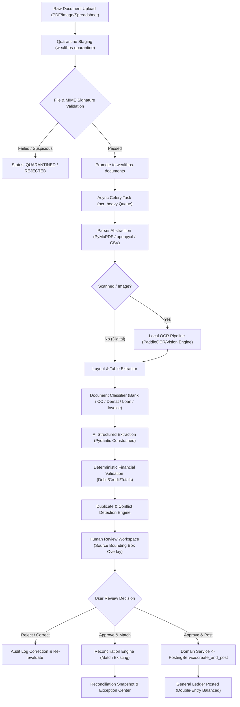

# WealthOS — Stage 4 Technical Design Specification
## Universal Financial Document Intelligence, AI Extraction & Financial Reconciliation Engine

**Document Version:** 1.0.0  
**Status:** Under Architectural Review  
**Date:** 2026-11-07  
**Author:** Google DeepMind / Antigravity Agentic Engineering  
**Approved Baseline:** Phase 4 Double-Entry Engine (`e4fe49b`), Stage 2 (`af55bfc`), Stage 3 (`4bcb4b1`)

---

## 1. Executive Summary & Core Architectural Principles

Stage 4 establishes the universal financial ingestion and reconciliation backbone of WealthOS. Financial data in the real world rarely arrives in tidy, pre-formatted CSV files. It exists in scanned bank statements, multi-page PDF credit card bills, mutual fund CAS statements, broker contract notes, loan repayment schedules, payslips, invoices, and physical receipts.

This engine transforms raw, untrusted documents into structured, deterministically validated financial intelligence without compromising security or general ledger integrity.

### Non-Negotiable Invariants:
1. **Financial Documents Are Untrusted Inputs:** Every uploaded file is quarantined, validated for MIME magic bytes, inspected for malicious payload structures, and processed within isolated resource limits.
2. **AI Extraction Is Never an Uncontrolled Financial Write Path:** AI models produce candidate extractions. They cannot directly invoke database mutations, execute arbitrary SQL, or post journal entries.
3. **Field-Level Source Provenance:** Every extracted value maintains an immutable pointer to its origin: Document ID, version, page number, table index, row, column, cell, and bounding box `[x0, y0, x1, y1]`.
4. **Deterministic Arithmetic Validation:** Financial logic is validated by deterministic backend services using `Decimal` and `NUMERIC(18, 4)`. A model cannot hallucinate or force an unbalanced statement to reconcile.
5. **Conflict Preservation Over Silent Overwrites:** If extracted statement data conflicts with an existing recorded transaction, both records are retained, flagged as a `CONFLICT`, and surfaced to the user for explicit resolution.
6. **Reconciliation Without Duplicate Financial Movements:** A statement transaction that matches an existing ledger record is linked via `reconciliation_matches`. It is NEVER posted as a second transaction or expense.
7. **Single Accounting Write Path:** Approved financial movements post exclusively through `PostingService.create_and_post` with durable idempotency keys and period validation.

---

## 2. Document Processing & Reconciliation Lifecycle



---

## 3. Storage, Ingestion & Security Architecture

### 3.1 Object Storage Layout
Reuses MinIO S3-compatible private buckets established in Phase 2:
- `wealthos-quarantine`: Untrusted landing zone. Direct download URLs are strictly disabled.
- `wealthos-documents`: Canonical encrypted document repository.
- `wealthos-vault`: Encrypted storage for statement passwords and sensitive credentials.

Storage Key Convention:
`tenants/{tenant_id}/documents/{document_id}/versions/{version_id}/{sha256_hash}.bin`

### 3.2 Upload Pipeline & Security Guardrails
1. **Magic Bytes Validation:** Header bytes are inspected against strict magic signatures (`%PDF-`, `PK\x03\x04` for XLSX, `\xFF\xD8\xFF` for JPEG, `\x89PNG\r\n\x1a\n` for PNG). Extension spoofing results in immediate `REJECTED` status.
2. **Resource Bounds:**
   - Max file size: 50 MB (`MAX_DOCUMENT_SIZE_BYTES`).
   - Celery worker CPU timeout: 300 seconds hard limit, 270 seconds soft limit.
   - Max image resolution: $10,000 \times 10,000$ pixels (prevents decompression bombs).
   - Spreadsheet max rows: 50,000 rows.
3. **Path Traversal Protection:** User-supplied filenames are sanitized with UUID substitution; internal keys are strictly validated with regex `^[a-zA-Z0-9_\-\./]+$`.
4. **Presigned Download URLs:** URLs expire after a maximum of 900 seconds (15 minutes) and require active tenant-scoped authorization.

---

## 4. Parser & OCR Abstraction Layer

```
┌────────────────────────────────────────────────────────┐
│               DocumentParser (Interface)               │
│   + parse_document(file_bytes, mime_type)              │
│   + extract_tables(page_number)                        │
│   + get_bounding_boxes()                               │
└───────────┬───────────────────┬───────────────────┬────┘
            │                   │                   │
            ▼                   ▼                   ▼
    ┌───────────────┐   ┌───────────────┐   ┌───────────────┐
    │  PyMuPDFParser│   │SpreadsheetPars│   │   CSVParser   │
    │ (Digital PDF) │   │ (XLSX / XLS)  │   │ (Delimited)   │
    └───────────────┘   └───────────────┘   └───────────────┘
```

### 4.1 Digital PDF & Table Parsing
- **Table Preservation:** Table structures are extracted maintaining 2D grid coordinates `(row_idx, col_idx)` rather than concatenating into flat strings.
- **Header Tracking:** Identifies repeated table headers across multi-page statements.

### 4.2 OCR Engine for Scanned Documents
- **Provider Interface:** `OCRProvider` interface implemented with a local engine (e.g. PaddleOCR / Tesseract abstraction) executing on the Celery `ocr_heavy` queue.
- **Preprocessing Pipeline:**
  1. Grayscale conversion and Otsu binarization.
  2. Deskewing and orientation correction (-90°, +90°, 180°).
  3. Noise filtering and contrast stretching.
- **Output Geometry:** Preserves word-level bounding boxes `[x0, y0, x1, y1]` and normalized confidence scores `[0.0, 1.0]`.

---

## 5. Classification & Canonical Extraction Engine

### 5.1 Document Classification Hierarchy
1. **Banking:** Bank Statement, Savings Statement, Current Account Statement, Deposit Advice.
2. **Credit:** Credit Card Statement, Loan Sanction Letter, Loan Repayment Schedule.
3. **Investments:** Demat Holding Statement (NSDL/CDSL), Stock Broker Contract Note, Mutual Fund Consolidated Account Statement (CAS), Portfolio Valuation Report.
4. **Income:** Salary Payslip, Form 16 / Tax Withholding Certificate, Dividend Advice, Rental Receipt.
5. **Assets & Expenses:** Property Deed / Sale Agreement, Vehicle Registration / Invoice, Utility Bill, Commercial Invoice.
6. **Fallback:** `UNKNOWN_FINANCIAL_DOCUMENT` (Requires manual user classification).

### 5.2 Canonical Financial Schemas (Pydantic v2 Models)
All extracted data normalizes into versioned, schema-constrained canonical representations:

```python
class CanonicalFinancialAmount(BaseModel):
    amount: Decimal = Field(..., description="Absolute monetary amount")
    currency: str = Field(default="INR", max_length=3)
    sign: Literal["DEBIT", "CREDIT", "POSITIVE", "NEGATIVE"]

class FieldProvenance(BaseModel):
    document_id: UUID
    page_number: int
    table_index: int | None = None
    row_index: int | None = None
    column_name: str | None = None
    bounding_box: list[float] | None = None # [x0, y0, x1, y1]
    raw_text: str
    confidence_score: Decimal # 0.0000 - 1.0000
    extractor_version: str

class ExtractedTransaction(BaseModel):
    record_id: UUID
    transaction_date: date
    value_date: date | None = None
    description: str
    reference_number: str | None = None
    amount: CanonicalFinancialAmount
    running_balance: Decimal | None = None
    counterparty: str | None = None
    provenance: FieldProvenance
```

### 5.3 Prompt Injection & AI Safety Boundaries
1. **Document as Untrusted Data:** Extracted text is injected into model prompts as escaped, read-only data blocks.
2. **Schema-Constrained Generation:** Models emit structured JSON strictly conforming to Pydantic schemas. Unparseable output triggers fail-closed error handling.
3. **Zero Tool Invocation:** The extraction model has zero tools, zero database connections, and zero network access. It is a pure transformer mapping unstructured text to structured JSON.

---

## 6. Deterministic Financial Validation Engine

Before any extraction enters the Human Review queue, deterministic backend validators execute:

1. **Bank Statement Integrity:**
   $$\text{Opening Balance} + \sum \text{Credits} - \sum \text{Debits} = \text{Closing Balance}$$
   $$\text{Previous Balance} + \text{Credit}_i - \text{Debit}_i = \text{Next Balance}_{i}$$
   Discrepancies trigger `VALIDATION_FAILED` with an itemized variance report.
2. **Credit Card Statement Integrity:**
   $$\text{Previous Balance} + \text{Purchases} + \text{Fees} + \text{Interest} - \text{Payments} - \text{Credits} = \text{New Balance}$$
3. **Contract Note Integrity:**
   $$\text{Gross Amount} = \text{Quantity} \times \text{Unit Price}$$
   $$\text{Net Settlement} = \text{Gross Amount} \pm \text{Brokerage} \pm \text{STT/Taxes} \pm \text{Exchange Charges}$$
4. **Invoice Arithmetic:**
   $$\text{Subtotal} + \sum \text{Taxes} + \text{Shipping} - \text{Discounts} = \text{Total Due}$$

---

## 7. Duplicate & Conflict Detection Engine

Matching evaluates four hierarchical levels:
1. **Exact File Hash:** SHA-256 byte comparison against `financial_documents.file_hash` within the same tenant.
2. **Statement Overlap:** Identifies if the uploaded statement period `[start_date, end_date]` for `account_id` has already been ingested.
3. **Transaction Matching:**
   - Exact: Same `account_id`, `transaction_date`, `amount`, and `reference_number`.
   - Fuzzy: Same `account_id`, `transaction_date` ($\pm 2$ days), `amount`, and normalized counterparty text similarity score $\ge 0.85$.
4. **Conflict Resolution Policy:**
   - If a statement reports a transaction on date $D$ with amount $A$, but the ledger records amount $B$, mark as `CONFLICT`.
   - Never overwrite the ledger balance silently. Present both records side-by-side with source timestamps.

---

## 8. Multi-Domain Reconciliation Engine

```
┌────────────────────────────────────────────────────────┐
│                   ReconciliationEngine                 │
└───────────┬───────────────────┬───────────────────┬────┘
            │                   │                   │
            ▼                   ▼                   ▼
    ┌───────────────┐   ┌───────────────┐   ┌───────────────┐
    │ Bank Statement│   │  Credit Card  │   │  Investment   │
    │ Reconciliation│   │ Reconciliation│   │ Reconciliation│
    └───────────────┘   └───────────────┘   └───────────────┘
            │                   │                   │
            ▼                   ▼                   ▼
    ┌───────────────┐   ┌───────────────┐   ┌───────────────┐
    │Asset/Liability│   │ Passive Income│   │  Exceptions   │
    │ Reconciliation│   │ Reconciliation│   │   Management  │
    └───────────────┘   └───────────────┘   └───────────────┘
```

1. **Bank Reconciliation:** Matches statement lines against `financial_transactions` and `journal_entries(1020)`. Matches are tagged `MATCHED`. Missing statement lines can be approved to create new transactions.
2. **Credit Card Reconciliation:** Disregards double-counting: statement purchases match existing card transactions; bank payments toward card balance match transfer transactions (`1020` credit $\to$ `2010` debit).
3. **Investment & Demat Reconciliation:** Compares holding units in Demat CAS statements against `investment_holding_lots.remaining_quantity`. Discrepancies identify missing dividends, unrecorded corporate actions, or timing differences.
4. **Loan Statement Reconciliation:** Compares outstanding principal on loan statement against `liabilities.current_balance`. Segregates unexpected lender interest rate hikes or penalty fees into `reconciliation_exceptions`.
5. **Passive Income Reconciliation:** Links dividend advice to bank account credits (`1020`) and TDS receivable records (`1410`).

---

## 9. Database Architecture (14 Relational Tables)

All tables include UUID primary keys, explicit `tenant_id` foreign keys, `created_at`/`updated_at` timestamps, and PostgreSQL `FORCE ROW LEVEL SECURITY`.

### 9.1 Document Lifecycle & Versions

#### Table: `financial_documents`
Primary catalog for uploaded financial documents.
```sql
CREATE TABLE financial_documents (
    id UUID PRIMARY KEY DEFAULT gen_random_uuid(),
    tenant_id UUID NOT NULL REFERENCES tenants(id) ON DELETE CASCADE,
    uploaded_by_user_id UUID NOT NULL REFERENCES users(id),
    original_filename VARCHAR(255) NOT NULL,
    sanitized_filename VARCHAR(255) NOT NULL,
    file_extension VARCHAR(20) NOT NULL,
    declared_mime_type VARCHAR(100) NOT NULL,
    detected_mime_type VARCHAR(100) NOT NULL,
    file_size_bytes BIGINT NOT NULL CHECK (file_size_bytes > 0),
    file_hash VARCHAR(64) NOT NULL, -- SHA-256
    storage_bucket VARCHAR(100) NOT NULL,
    storage_object_key VARCHAR(500) NOT NULL,
    document_category VARCHAR(50) NOT NULL DEFAULT 'UNKNOWN',
    document_subtype VARCHAR(50),
    processing_status VARCHAR(50) NOT NULL DEFAULT 'UPLOADED', -- UPLOADED, VALIDATING, QUARANTINED, PROCESSING, PROCESSED, REVIEW_REQUIRED, APPROVED, FAILED, ARCHIVED
    quarantine_reason VARCHAR(255),
    source_account_id UUID REFERENCES financial_accounts(id) ON DELETE SET NULL,
    current_version_number INTEGER NOT NULL DEFAULT 1,
    metadata JSONB DEFAULT '{}'::jsonb,
    created_at TIMESTAMPTZ NOT NULL DEFAULT NOW(),
    updated_at TIMESTAMPTZ NOT NULL DEFAULT NOW()
);
CREATE INDEX idx_fin_docs_tenant ON financial_documents(tenant_id);
CREATE INDEX idx_fin_docs_hash ON financial_documents(tenant_id, file_hash);
CREATE INDEX idx_fin_docs_status ON financial_documents(tenant_id, processing_status);
```

#### Table: `financial_document_versions`
Audit history of document revisions, replacements, and re-scans.
```sql
CREATE TABLE financial_document_versions (
    id UUID PRIMARY KEY DEFAULT gen_random_uuid(),
    tenant_id UUID NOT NULL REFERENCES tenants(id) ON DELETE CASCADE,
    document_id UUID NOT NULL REFERENCES financial_documents(id) ON DELETE CASCADE,
    version_number INTEGER NOT NULL,
    storage_object_key VARCHAR(500) NOT NULL,
    file_size_bytes BIGINT NOT NULL,
    file_hash VARCHAR(64) NOT NULL,
    change_reason VARCHAR(255),
    created_by_user_id UUID NOT NULL REFERENCES users(id),
    created_at TIMESTAMPTZ NOT NULL DEFAULT NOW(),
    CONSTRAINT uq_doc_version UNIQUE (tenant_id, document_id, version_number)
);
```

#### Table: `financial_document_processing_jobs`
Asynchronous background Celery task tracking.
```sql
CREATE TABLE financial_document_processing_jobs (
    id UUID PRIMARY KEY DEFAULT gen_random_uuid(),
    tenant_id UUID NOT NULL REFERENCES tenants(id) ON DELETE CASCADE,
    document_id UUID NOT NULL REFERENCES financial_documents(id) ON DELETE CASCADE,
    celery_task_id VARCHAR(255) NOT NULL,
    job_type VARCHAR(50) NOT NULL, -- SECURITY_SCAN, PARSE_OCR, CLASSIFY_EXTRACT, RECONCILE
    status VARCHAR(50) NOT NULL DEFAULT 'PENDING', -- PENDING, RUNNING, COMPLETED, FAILED, RETRIED
    attempt_count INTEGER NOT NULL DEFAULT 1,
    error_message TEXT,
    execution_duration_ms INTEGER,
    created_at TIMESTAMPTZ NOT NULL DEFAULT NOW(),
    completed_at TIMESTAMPTZ
);
CREATE INDEX idx_doc_jobs_doc ON financial_document_processing_jobs(tenant_id, document_id);
```

---

### 9.2 Parsing, Pages & Extracted Content

#### Table: `financial_document_pages`
Page-level layout, dimensions, and text cache.
```sql
CREATE TABLE financial_document_pages (
    id UUID PRIMARY KEY DEFAULT gen_random_uuid(),
    tenant_id UUID NOT NULL REFERENCES tenants(id) ON DELETE CASCADE,
    document_id UUID NOT NULL REFERENCES financial_documents(id) ON DELETE CASCADE,
    page_number INTEGER NOT NULL CHECK (page_number > 0),
    width_pts NUMERIC(10, 2),
    height_pts NUMERIC(10, 2),
    rotation_degrees INTEGER NOT NULL DEFAULT 0,
    has_images BOOLEAN NOT NULL DEFAULT FALSE,
    is_scanned BOOLEAN NOT NULL DEFAULT FALSE,
    ocr_confidence NUMERIC(5, 4),
    raw_text TEXT,
    created_at TIMESTAMPTZ NOT NULL DEFAULT NOW(),
    CONSTRAINT uq_doc_page UNIQUE (tenant_id, document_id, page_number)
);
```

#### Table: `financial_document_tables`
Structured 2D tables extracted from PDFs or spreadsheets.
```sql
CREATE TABLE financial_document_tables (
    id UUID PRIMARY KEY DEFAULT gen_random_uuid(),
    tenant_id UUID NOT NULL REFERENCES tenants(id) ON DELETE CASCADE,
    document_id UUID NOT NULL REFERENCES financial_documents(id) ON DELETE CASCADE,
    page_number INTEGER NOT NULL,
    table_index INTEGER NOT NULL,
    row_count INTEGER NOT NULL,
    col_count INTEGER NOT NULL,
    headers JSONB NOT NULL DEFAULT '[]'::jsonb,
    grid_data JSONB NOT NULL DEFAULT '[]'::jsonb,
    bounding_box NUMERIC(10, 2)[] DEFAULT '{}',
    created_at TIMESTAMPTZ NOT NULL DEFAULT NOW(),
    CONSTRAINT uq_doc_table UNIQUE (tenant_id, document_id, page_number, table_index)
);
```

---

### 9.3 Extracted Records & Field Provenance

#### Table: `financial_document_extracted_records`
Canonical record representations (Transactions, Holdings, Repayments, Invoices).
```sql
CREATE TABLE financial_document_extracted_records (
    id UUID PRIMARY KEY DEFAULT gen_random_uuid(),
    tenant_id UUID NOT NULL REFERENCES tenants(id) ON DELETE CASCADE,
    document_id UUID NOT NULL REFERENCES financial_documents(id) ON DELETE CASCADE,
    record_type VARCHAR(50) NOT NULL, -- TRANSACTION, HOLDING, TRADE, LOAN_REPAYMENT, INVOICE, DIVIDEND
    record_date DATE,
    entity_name VARCHAR(255),
    reference_identifier VARCHAR(100),
    amount NUMERIC(18, 4),
    currency VARCHAR(3) NOT NULL DEFAULT 'INR',
    direction VARCHAR(20), -- DEBIT, CREDIT, BUY, SELL, NONE
    canonical_payload JSONB NOT NULL,
    overall_confidence NUMERIC(5, 4) NOT NULL CHECK (overall_confidence >= 0 AND overall_confidence <= 1),
    validation_status VARCHAR(50) NOT NULL DEFAULT 'VALID', -- VALID, VALID_WITH_WARNINGS, REVIEW_REQUIRED, INVALID
    review_status VARCHAR(50) NOT NULL DEFAULT 'PENDING_REVIEW', -- PENDING_REVIEW, APPROVED, REJECTED, CORRECTED, POSTED
    reconciliation_status VARCHAR(50) NOT NULL DEFAULT 'UNRECONCILED', -- UNRECONCILED, MATCHED, CONFLICT
    created_at TIMESTAMPTZ NOT NULL DEFAULT NOW(),
    updated_at TIMESTAMPTZ NOT NULL DEFAULT NOW()
);
CREATE INDEX idx_extracted_records_doc ON financial_document_extracted_records(tenant_id, document_id, record_type);
```

#### Table: `financial_document_field_provenance`
Field-by-field geometric and contextual audit lineage.
```sql
CREATE TABLE financial_document_field_provenance (
    id UUID PRIMARY KEY DEFAULT gen_random_uuid(),
    tenant_id UUID NOT NULL REFERENCES tenants(id) ON DELETE CASCADE,
    record_id UUID NOT NULL REFERENCES financial_document_extracted_records(id) ON DELETE CASCADE,
    field_name VARCHAR(100) NOT NULL,
    extracted_value TEXT NOT NULL,
    original_text TEXT NOT NULL,
    page_number INTEGER NOT NULL,
    table_index INTEGER,
    row_index INTEGER,
    column_name VARCHAR(100),
    bounding_box NUMERIC(10, 2)[] DEFAULT '{}', -- [x0, y0, x1, y1]
    confidence_score NUMERIC(5, 4) NOT NULL,
    extraction_engine VARCHAR(100) NOT NULL,
    created_at TIMESTAMPTZ NOT NULL DEFAULT NOW()
);
CREATE INDEX idx_field_prov_record ON financial_document_field_provenance(tenant_id, record_id);
```

---

### 9.4 Review, Conflicts & Duplicate Tracking

#### Table: `financial_document_conflicts`
Tracks discrepancies between extracted records and existing financial database state.
```sql
CREATE TABLE financial_document_conflicts (
    id UUID PRIMARY KEY DEFAULT gen_random_uuid(),
    tenant_id UUID NOT NULL REFERENCES tenants(id) ON DELETE CASCADE,
    document_id UUID NOT NULL REFERENCES financial_documents(id) ON DELETE CASCADE,
    extracted_record_id UUID NOT NULL REFERENCES financial_document_extracted_records(id) ON DELETE CASCADE,
    existing_entity_type VARCHAR(50) NOT NULL, -- financial_transactions, investment_transactions, liabilities
    existing_entity_id UUID NOT NULL,
    conflict_type VARCHAR(50) NOT NULL, -- AMOUNT_MISMATCH, DATE_MISMATCH, DUPLICATE_ENTRY, BALANCE_DISCREPANCY
    extracted_value JSONB NOT NULL,
    existing_value JSONB NOT NULL,
    resolution_status VARCHAR(50) NOT NULL DEFAULT 'UNRESOLVED', -- UNRESOLVED, RESOLVED_USE_EXTRACTED, RESOLVED_USE_EXISTING, DISMISSED
    resolved_by_user_id UUID REFERENCES users(id),
    resolution_notes TEXT,
    resolved_at TIMESTAMPTZ,
    created_at TIMESTAMPTZ NOT NULL DEFAULT NOW()
);
CREATE INDEX idx_doc_conflicts_doc ON financial_document_conflicts(tenant_id, document_id, resolution_status);
```

#### Table: `financial_document_review_actions`
Audit trail of all human-in-the-loop decisions.
```sql
CREATE TABLE financial_document_review_actions (
    id UUID PRIMARY KEY DEFAULT gen_random_uuid(),
    tenant_id UUID NOT NULL REFERENCES tenants(id) ON DELETE CASCADE,
    document_id UUID NOT NULL REFERENCES financial_documents(id) ON DELETE CASCADE,
    record_id UUID REFERENCES financial_document_extracted_records(id) ON DELETE CASCADE,
    user_id UUID NOT NULL REFERENCES users(id),
    action_type VARCHAR(50) NOT NULL, -- APPROVE, REJECT, EDIT_FIELD, RECLASSIFY, RESOLVE_CONFLICT, POST_LEDGER
    field_name VARCHAR(100),
    previous_value TEXT,
    new_value TEXT,
    notes TEXT,
    created_at TIMESTAMPTZ NOT NULL DEFAULT NOW()
);
CREATE INDEX idx_review_actions_doc ON financial_document_review_actions(tenant_id, document_id);
```

---

### 9.5 Multi-Domain Reconciliation & Exceptions

#### Table: `reconciliation_sessions`
Macro reconciliation runs (e.g. Monthly Bank Reconciliation, Quarterly Demat CAS Audit).
```sql
CREATE TABLE reconciliation_sessions (
    id UUID PRIMARY KEY DEFAULT gen_random_uuid(),
    tenant_id UUID NOT NULL REFERENCES tenants(id) ON DELETE CASCADE,
    document_id UUID REFERENCES financial_documents(id) ON DELETE SET NULL,
    reconciliation_type VARCHAR(50) NOT NULL, -- BANK, CREDIT_CARD, INVESTMENT, ASSET, LIABILITY, PASSIVE_INCOME
    account_id UUID REFERENCES financial_accounts(id) ON DELETE SET NULL,
    investment_account_id UUID REFERENCES investment_accounts(id) ON DELETE SET NULL,
    liability_id UUID REFERENCES liabilities(id) ON DELETE SET NULL,
    period_start_date DATE NOT NULL,
    period_end_date DATE NOT NULL,
    opening_statement_balance NUMERIC(18, 4),
    closing_statement_balance NUMERIC(18, 4),
    opening_ledger_balance NUMERIC(18, 4),
    closing_ledger_balance NUMERIC(18, 4),
    net_variance NUMERIC(18, 4) NOT NULL DEFAULT 0,
    total_statement_records INTEGER NOT NULL DEFAULT 0,
    matched_records_count INTEGER NOT NULL DEFAULT 0,
    unmatched_statement_records_count INTEGER NOT NULL DEFAULT 0,
    unmatched_ledger_records_count INTEGER NOT NULL DEFAULT 0,
    status VARCHAR(50) NOT NULL DEFAULT 'IN_PROGRESS', -- IN_PROGRESS, MATCHED, REVIEW_REQUIRED, CLOSED
    closed_at TIMESTAMPTZ,
    closed_by_user_id UUID REFERENCES users(id),
    created_at TIMESTAMPTZ NOT NULL DEFAULT NOW(),
    updated_at TIMESTAMPTZ NOT NULL DEFAULT NOW()
);
CREATE INDEX idx_rec_sessions_tenant ON reconciliation_sessions(tenant_id, reconciliation_type);
```

#### Table: `reconciliation_matches`
Item-by-item matches linking extracted document lines to WealthOS financial entities.
```sql
CREATE TABLE reconciliation_matches (
    id UUID PRIMARY KEY DEFAULT gen_random_uuid(),
    tenant_id UUID NOT NULL REFERENCES tenants(id) ON DELETE CASCADE,
    session_id UUID NOT NULL REFERENCES reconciliation_sessions(id) ON DELETE CASCADE,
    extracted_record_id UUID REFERENCES financial_document_extracted_records(id) ON DELETE SET NULL,
    matched_entity_type VARCHAR(50) NOT NULL, -- financial_transactions, investment_transactions, liability_repayments, journal_entries
    matched_entity_id UUID NOT NULL,
    match_type VARCHAR(50) NOT NULL, -- EXACT_MATCH, REFERENCE_MATCH, AMOUNT_DATE_MATCH, FUZZY_MATCH, MANUAL_MATCH
    match_score NUMERIC(5, 4) NOT NULL CHECK (match_score >= 0 AND match_score <= 1),
    amount_difference NUMERIC(18, 4) NOT NULL DEFAULT 0,
    date_difference_days INTEGER NOT NULL DEFAULT 0,
    status VARCHAR(50) NOT NULL DEFAULT 'CONFIRMED', -- PROPOSED, CONFIRMED, REJECTED
    created_at TIMESTAMPTZ NOT NULL DEFAULT NOW()
);
CREATE INDEX idx_rec_matches_session ON reconciliation_matches(tenant_id, session_id);
```

#### Table: `reconciliation_exceptions`
Discrepancies, missing entries, and unexplained variances requiring investigation.
```sql
CREATE TABLE reconciliation_exceptions (
    id UUID PRIMARY KEY DEFAULT gen_random_uuid(),
    tenant_id UUID NOT NULL REFERENCES tenants(id) ON DELETE CASCADE,
    session_id UUID NOT NULL REFERENCES reconciliation_sessions(id) ON DELETE CASCADE,
    document_id UUID REFERENCES financial_documents(id) ON DELETE CASCADE,
    extracted_record_id UUID REFERENCES financial_document_extracted_records(id) ON DELETE SET NULL,
    exception_type VARCHAR(50) NOT NULL, -- MISSING_IN_LEDGER, MISSING_IN_STATEMENT, AMOUNT_MISMATCH, DATE_MISMATCH, UNRECOGNIZED_FEE
    severity VARCHAR(20) NOT NULL DEFAULT 'MEDIUM', -- LOW, MEDIUM, HIGH, CRITICAL
    description TEXT NOT NULL,
    expected_value TEXT,
    observed_value TEXT,
    variance_amount NUMERIC(18, 4),
    status VARCHAR(50) NOT NULL DEFAULT 'OPEN', -- OPEN, UNDER_REVIEW, RESOLVED, DISMISSED, ESCALATED
    assigned_user_id UUID REFERENCES users(id),
    resolution_notes TEXT,
    resolved_at TIMESTAMPTZ,
    created_at TIMESTAMPTZ NOT NULL DEFAULT NOW()
);
CREATE INDEX idx_rec_exceptions_session ON reconciliation_exceptions(tenant_id, session_id, status);
```

---

## 10. Accounting Integration Matrix (Phase 4 GL Postings)

| Scenario | Trigger / Approval | Action on General Ledger | Duplicate Safeguard |
| :--- | :--- | :--- | :--- |
| **Statement line matches existing transaction** | Bank Statement Recon | Zero posting. Mark record as `RECONCILED` and link `reconciliation_matches`. | Strictly prevents creating duplicate expenses or revenues. |
| **Missing legitimate bank fee on statement** | User Approves New Record | Debit Bank Service Charges (`5060`), Credit Bank Checking (`1020`) via `PostingService.create_and_post`. | Requires user approval; idempotency key locked to statement line hash. |
| **Credit card payment from bank account** | CC Statement Recon | Match against existing transfer (`1020` credit $\to$ `2010` debit). | Never record as an operating expense. |
| **Demat CAS statement shows holding variance** | Investment CAS Recon | Zero GL posting. Log discrepancy in `reconciliation_exceptions` to identify missing trades. | Holdings observations are not balance sheet journal entries. |
| **Loan statement shows higher interest deduction** | Loan Statement Recon | User approves adjustment entry: Debit Loan Interest (`5080`), Credit Loan Liability (`2100`). | Explicit user review; adjusts amortization schedule. |
| **Dividend advice with net credit and TDS** | Passive Income Recon | Debit Bank (`1020`, net), Debit TDS (`1410`), Credit Dividend Income (`4110`). | Matched to bank deposit transaction if already imported. |

---

## 11. REST API Specification

### Documents (`/api/v1/documents`)
- `POST /api/v1/documents/upload`: Multipart upload to quarantine, MIME/hash verification, metadata storage.
- `GET /api/v1/documents`: List uploaded documents with filters for category, status, and account.
- `GET /api/v1/documents/{id}`: Detailed view including pages, processing jobs, and extracted records.
- `GET /api/v1/documents/{id}/preview-url`: Generates 15-minute presigned download URL.
- `POST /api/v1/documents/{id}/process`: Enqueue Celery task for parsing, OCR, and extraction.
- `POST /api/v1/documents/{id}/reprocess`: Reprocess document with version increment and audit history.

### Review Workspace (`/api/v1/document-review`)
- `GET /api/v1/document-review/queue`: List records awaiting human review with confidence scores.
- `GET /api/v1/document-review/records/{record_id}`: Record detail with full bounding box field provenance.
- `PATCH /api/v1/document-review/records/{record_id}`: Edit extracted field value with audit log.
- `POST /api/v1/document-review/records/{record_id}/approve`: Approve record for reconciliation or posting.
- `POST /api/v1/document-review/records/{record_id}/reject`: Reject extracted line item.
- `POST /api/v1/document-review/records/{record_id}/resolve-conflict`: Explicitly select extracted vs existing data.

### Reconciliation Workspace (`/api/v1/reconciliations`)
- `POST /api/v1/reconciliations`: Initialize reconciliation session for an account and period.
- `GET /api/v1/reconciliations`: List sessions and status.
- `GET /api/v1/reconciliations/{id}`: Session summary with variance, matched count, and progress.
- `POST /api/v1/reconciliations/{id}/run`: Execute automated matching algorithm.
- `GET /api/v1/reconciliations/{id}/matches`: List itemized matches.
- `POST /api/v1/reconciliations/{id}/matches`: Confirm or break manual match.
- `GET /api/v1/reconciliations/{id}/exceptions`: List exceptions and variances.
- `POST /api/v1/reconciliations/{id}/close`: Formally close reconciliation session (preserves snapshot).

### Exceptions Center (`/api/v1/reconciliation-exceptions`)
- `GET /api/v1/reconciliation-exceptions`: Query open exceptions by severity, account, or document.
- `POST /api/v1/reconciliation-exceptions/{id}/resolve`: Resolve discrepancy with documented notes.
- `POST /api/v1/reconciliation-exceptions/{id}/dismiss`: Dismiss false positive with justification.

---

## 12. Tenant Security & PostgreSQL Row-Level Security

All 14 Stage 4 tables enforce PostgreSQL `ROW LEVEL SECURITY` and `FORCE ROW LEVEL SECURITY`.

```sql
ALTER TABLE financial_documents ENABLE ROW LEVEL SECURITY;
ALTER TABLE financial_documents FORCE ROW LEVEL SECURITY;
CREATE POLICY financial_documents_tenant_isolation ON financial_documents
    FOR ALL
    USING (NULLIF(current_setting('app.current_tenant_id', true), '') IS NOT NULL 
           AND tenant_id = NULLIF(current_setting('app.current_tenant_id', true), '')::uuid)
    WITH CHECK (NULLIF(current_setting('app.current_tenant_id', true), '') IS NOT NULL 
                AND tenant_id = NULLIF(current_setting('app.current_tenant_id', true), '')::uuid);
```
*(Applied identically across all 14 Stage 4 tables).*

App DB role `wealthos_app` has `NOSUPERUSER NOBYPASSRLS`. Missing or mismatched tenant context fails closed.

---

## 13. Test Strategy & Acceptance Matrix

1. **Upload & Security Tests:**
   - Magic bytes detection across valid PDF, PNG, JPEG, XLSX, and CSV.
   - Rejection of spoofed files (e.g. executable renamed to `.pdf`).
   - Rejection of oversized files (> 50 MB) and malformed images.
   - Tenant isolation: User in Tenant A cannot upload, preview, or download Tenant B documents.
2. **Parser & Table Extraction Tests:**
   - Digital PDF 2D table extraction with preserved row/column geometry.
   - XLSX multi-sheet extraction and cell coordinate provenance.
3. **Deterministic Financial Validation Tests:**
   - Bank statement running balance verification.
   - Credit card statement calculation validation.
   - Arithmetic check failure on forged or corrupted statement lines.
4. **Duplicate & Conflict Tests:**
   - SHA-256 duplicate file detection.
   - Detection of existing recorded transactions with identical date/amount.
   - Preservation of conflicting values without silent database overwrites.
5. **Reconciliation Engine Tests:**
   - Exact matching on reference numbers.
   - Date-tolerance matching ($\pm 2$ days).
   - Zero duplicate journal entry creation on matched items.
   - Discrepancy logging into `reconciliation_exceptions`.
6. **Accounting Regression:**
   - All 127 existing backend regression tests remain 100% passing.
