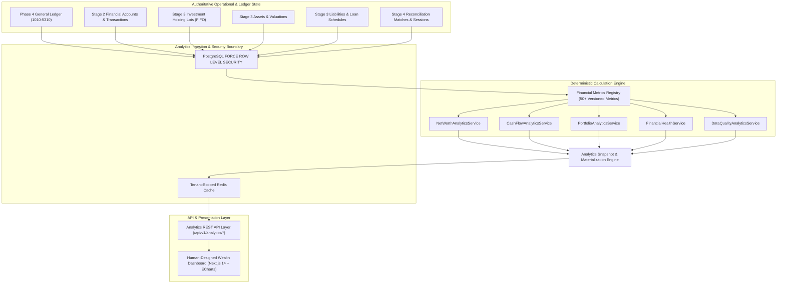

# WealthOS — Stage 5 Technical Design Specification
## Enterprise Financial Analytics, Unified Wealth Dashboard & Financial Intelligence Engine

**Document Version:** 1.0.0  
**Status:** Under Architectural Review  
**Date:** 2026-11-07  
**Author:** Google DeepMind / Antigravity Agentic Engineering  
**Approved Baseline:** Phase 4 Double-Entry Engine (`e4fe49b`), Stage 2 (`af55bfc`), Stage 3 (`4bcb4b1`), Stage 4 (`d35b13b`)

---

## 1. Executive Summary & Core Architectural Principles

Stage 5 transforms the operational, transactional, and document data of WealthOS into a high-performance, deterministic financial analytics and intelligence platform. It provides users and wealth managers with a unified, explainable view of their complete financial health without introducing fake metrics, hardcoded values, or unverified shortcuts.

### Non-Negotiable Invariants:
1. **General Ledger as the Immutable Monetary Source of Truth:** Operational records provide domain context; all monetary balances, realized income, expenses, and loan repayments derive strictly from general ledger journal entries.
2. **Deterministic Financial Math:** Every formula is calculated using Python `Decimal` and PostgreSQL `NUMERIC(18, 4)`. Binary floating-point arithmetic is strictly banned.
3. **No Independent Financial Mutation:** The analytics engine is strictly read-only. It cannot create, alter, or delete underlying financial transactions or general ledger lines.
4. **Data Quality Transparency Over Cosmetic Completeness:** If an asset valuation is stale, an account is unreconciled, or an FX rate is missing, the metric explicitly reports `status = 'PARTIAL'` with itemized warnings. Missing data NEVER becomes ₹0.00.
5. **Clean Separation of Financial Concepts:**
   - Unrealized portfolio gains are never reported as realized income.
   - Internal transfers between owned accounts are neutralized (zero P&L impact).
   - Investment purchases are asset swaps, never operating expenses.
   - Investment sale proceeds are segregated into cost basis return vs realized capital gains.
6. **Multi-Tenant Cache & Query Isolation:** All database queries enforce PostgreSQL `FORCE ROW LEVEL SECURITY`. Redis cache keys explicitly include the tenant ID, permission scope, and data watermarks.
7. **Human-Designed UI:** Adheres to Phase 1 fintech design tokens and Apache ECharts visualizations. Generic AI dashboard styling is banned.

---

## 2. Analytics Architecture & Data Pipeline



---

## 3. Canonical Financial Metrics Registry

Every metric in WealthOS is centrally registered with an immutable formula, data source, currency policy, and completeness rule.

### 3.1 Metric Definitions Table

| Metric ID | Display Name | Category | Calculation Formula | Source of Truth | Freshness Policy |
| :--- | :--- | :--- | :--- | :--- | :--- |
| `wealth.net_worth` | Total Net Worth | Wealth | $\sum (\text{Assets} \times \text{Own\%}) - \sum (\text{Liabilities} \times \text{Own\%})$ | GL (`1010-1040`), `asset_valuations`, `holding_lots` $\times$ price, `liabilities` | Real-time / Daily |
| `wealth.total_assets` | Consolidated Assets | Wealth | Cash + Investments + Physical/Real Estate Assets | GL, `asset_valuations`, `holding_lots` | Real-time / Daily |
| `wealth.total_liabilities`| Total Liabilities | Wealth | Outstanding Principal on Loans + Credit Card Payables | `liabilities.current_balance` + GL (`2010`) | Real-time / Daily |
| `wealth.liquid_cash` | Available Cash | Wealth | Sum of balances in GL accounts `1010`, `1020`, `1030`, `1040` | `accounting_accounts` Trial Balance | Instantaneous |
| `cashflow.net_cash_flow` | Net Cash Flow | Cash Flow | Total Cash Inflows $-$ Total Cash Outflows (Excluding Transfers) | `financial_transactions`, `journal_entries` | Period-based |
| `cashflow.operating` | Operating Cash Flow | Cash Flow | Operating Inflows $-$ Operating Outflows | Classified `financial_transactions` | Period-based |
| `income.total_received` | Received Cash Income | Income | Sum of credited cash transactions categorized as Income | `financial_transactions(INCOME)` linked to GL | Period-based |
| `expense.total_operating`| Operating Expenses | Expense | Sum of debited transactions categorized as Expenses | `financial_transactions(EXPENSE)` linked to GL | Period-based |
| `portfolio.market_value`| Portfolio Market Value| Investment | $\sum (\text{lot.remaining\_quantity} \times \text{latest\_close\_price})$ | `investment_holding_lots` + `market_price_observations` | EOD / Real-time |
| `portfolio.unrealized_pnl`| Unrealized P&L | Investment | $\text{Market Value} - \sum \text{lot.total\_cost}$ | `investment_holding_lots` | Real-time |
| `portfolio.realized_pnl` | Realized P&L | Investment | $\sum \text{lot\_disposals.realized\_gain\_loss}$ | `investment_lot_disposals` | YTD / Period |
| `debt.dti_ratio` | Debt-to-Income | Health | $(\text{Monthly Debt Payments} \div \text{Gross Monthly Income}) \times 100$ | `liability_schedules` + `financial_transactions` | Monthly |
| `health.savings_rate` | Savings Rate | Health | $[(\text{Income} - \text{Expenses}) \div \text{Income}] \times 100$ | Ledger Income (`4000-4999`) & Expenses (`5000-5999`) | Monthly / YTD |
| `health.emergency_fund` | Emergency Fund (Mo) | Health | $\text{Liquid Cash} \div \text{Avg Monthly Essential Expenses}$ | GL Liquid Cash $\div$ 3-month expense rolling average | Monthly |
| `data_quality.coverage` | Reconciliation Coverage| Quality | $(\text{Matched Records} \div \text{Total Statement Records}) \times 100$| `reconciliation_sessions` | Daily |

### 3.2 Canonical Metric Response Schema
All analytics endpoints return this standardized payload structure:

```json
{
  "metric_id": "wealth.net_worth",
  "name": "Total Net Worth",
  "value": "12540000.0000",
  "currency": "INR",
  "as_of": "2026-11-07T18:30:00Z",
  "period": {
    "start_date": "2026-11-01",
    "end_date": "2026-11-07",
    "interval": "DAY"
  },
  "calculation_version": "1.0",
  "status": "VERIFIED",
  "coverage": {
    "total_sources": 10,
    "included_sources": 10,
    "coverage_percentage": "100.00"
  },
  "warnings": []
}
```

---

## 4. Source-of-Truth Mapping & Core Calculation Policies

### 4.1 Internal Transfer Neutralization
Transfers between accounts owned by the same tenant (e.g., Bank Checking to Savings, or Bank to Demat Cash) are neutralized in all cash-flow and income/expense metrics:
$$\Delta \text{Bank A} = -X, \quad \Delta \text{Bank B} = +X \implies \text{Net Cash Flow} = 0$$
Internal transfers are strictly excluded from income, expense, and savings calculations.

### 4.2 Investment Purchase vs Operating Expense
- Purchasing shares/units for ₹50,000 is an **Asset Swap** (Cash Asset $\to$ Investment Asset).
- It is classified under **Investing Cash Outflow**, NEVER as an Operating Expense.
- Operating expenses include only transaction fees, STT, and brokerage.

### 4.3 Multi-Currency Normalization Policy
- Every tenant has an immutable reporting functional currency (default `INR`).
- Point-in-time metrics (Net Worth, Portfolio Value, Account Balances) convert foreign holdings using the latest spot exchange rate from `foreign_exchange_rates`.
- Period flow metrics (Monthly Income, Quarterly Expenses) convert using historical transaction exchange rates recorded at execution time.
- If an exchange rate is missing, the metric cannot guess; it sets `status = 'PARTIAL'` and lists the unconverted currencies in `warnings`.

---

## 5. Historical Analytics & Time-Series Engine

### 5.1 Time-Series Intervals & Boundaries
Supports `DAILY`, `WEEKLY`, `MONTHLY`, `QUARTERLY`, and `YEARLY` aggregations with consistent UTC timezone boundaries.
- **Point-in-Time Metrics (Stock):** Balance at interval close (e.g. Net Worth at 23:59:59 on last day of month). Past values use historical valuations and holding quantities on that date.
- **Period Flow Metrics (Flow):** Cumulative sum over the interval (e.g. Total Income received between day 1 and day 30).

### 5.2 Percentage Change & Comparison Engine
Period-over-period changes handle mathematical edge cases gracefully:
$$\text{Change \%} = \begin{cases} 
\frac{V_{curr} - V_{prev}}{|V_{prev}|} \times 100 & \text{if } V_{prev} \ne 0 \\
\text{NULL (with explanation "Zero baseline")} & \text{if } V_{prev} = 0 
\end{cases}$$
Misleading infinite percentages ($+\infty\%$) are strictly suppressed in the API and UI.

---

## 6. Financial Health & Data Quality Engine

### 6.1 Financial Health Indicators (Descriptive, Non-Advisory)
- **Savings Rate:** $\frac{\text{Income} - \text{Expenses}}{\text{Income}} \times 100$. (Thresholds: $>30\%$ Strong, $15-30\%$ Moderate, $<15\%$ Needs Attention).
- **Emergency Fund Coverage:** $\frac{\text{Liquid Cash}}{\text{Rolling 3-Month Average Essential Expense}}$. (Target: $\ge 6\text{ months}$).
- **Debt Servicing Ratio (DSR):** $\frac{\text{Total Monthly EMI Obligation}}{\text{Net Monthly Income}} \times 100$. (Healthy: $<40\%$).
- **Portfolio Concentration:** Proportion of largest asset / stock holding to total portfolio value (Highlights risk if single holding $> 25\%$).

### 6.2 Data Quality & Provenance Analytics
Monitors the integrity of the user's financial digital twin:
- **Reconciliation Coverage:** Percentage of transactions cross-verified with bank/demat statements.
- **Stale Valuation Count:** Assets with appraisals older than 365 days.
- **Stale Market Price Count:** Securities whose latest market quote is older than 24 business hours.
- **Unresolved Discrepancies:** Count of open items in `reconciliation_exceptions`.

---

## 7. Database Architecture (5 Relational Tables)

All tables use UUID primary keys, explicit `tenant_id` foreign keys, `created_at`/`updated_at` timestamps, and PostgreSQL `FORCE ROW LEVEL SECURITY`.

### 7.1 Table: `analytics_metric_definitions`
Master registry for all financial metrics supported by the engine.
```sql
CREATE TABLE analytics_metric_definitions (
    id VARCHAR(100) PRIMARY KEY, -- e.g. 'wealth.net_worth', 'cashflow.operating'
    display_name VARCHAR(255) NOT NULL,
    category VARCHAR(50) NOT NULL, -- WEALTH, CASH_FLOW, INCOME, EXPENSE, INVESTMENT, DEBT, HEALTH, QUALITY
    description TEXT NOT NULL,
    calculation_formula TEXT NOT NULL,
    source_domains VARCHAR(100)[] NOT NULL,
    aggregation_method VARCHAR(50) NOT NULL, -- POINT_IN_TIME, PERIOD_SUM, AVERAGE, RATIO
    precision_policy VARCHAR(50) NOT NULL DEFAULT 'DECIMAL_4',
    calculation_version VARCHAR(20) NOT NULL DEFAULT '1.0',
    is_active BOOLEAN NOT NULL DEFAULT TRUE,
    created_at TIMESTAMPTZ NOT NULL DEFAULT NOW()
);
```

### 7.2 Table: `analytics_snapshots`
Periodic materializations of macro financial metrics (Net Worth, Monthly Cash Flow, Portfolio Valuation).
```sql
CREATE TABLE analytics_snapshots (
    id UUID PRIMARY KEY DEFAULT gen_random_uuid(),
    tenant_id UUID NOT NULL REFERENCES tenants(id) ON DELETE CASCADE,
    snapshot_type VARCHAR(50) NOT NULL, -- DAILY_NET_WORTH, MONTHLY_CASH_FLOW, PORTFOLIO_VALUATION, FINANCIAL_HEALTH
    period_start DATE NOT NULL,
    period_end DATE NOT NULL,
    as_of_timestamp TIMESTAMPTZ NOT NULL,
    metric_values JSONB NOT NULL, -- structured map of metric_id -> numeric string
    functional_currency VARCHAR(3) NOT NULL DEFAULT 'INR',
    status VARCHAR(50) NOT NULL DEFAULT 'VERIFIED', -- VERIFIED, PARTIAL, STALE
    coverage_score NUMERIC(5, 4) NOT NULL DEFAULT 1.0,
    calculation_version VARCHAR(20) NOT NULL DEFAULT '1.0',
    data_watermark TIMESTAMPTZ NOT NULL,
    created_at TIMESTAMPTZ NOT NULL DEFAULT NOW(),
    CONSTRAINT uq_analytics_snapshot UNIQUE (tenant_id, snapshot_type, period_end)
);
CREATE INDEX idx_analytics_snapshots_date ON analytics_snapshots(tenant_id, snapshot_type, period_end DESC);
```

### 7.3 Table: `analytics_snapshot_components`
Underlying itemized components backing an aggregated snapshot (e.g. individual asset values inside a Net Worth snapshot).
```sql
CREATE TABLE analytics_snapshot_components (
    id UUID PRIMARY KEY DEFAULT gen_random_uuid(),
    tenant_id UUID NOT NULL REFERENCES tenants(id) ON DELETE CASCADE,
    snapshot_id UUID NOT NULL REFERENCES analytics_snapshots(id) ON DELETE CASCADE,
    component_category VARCHAR(50) NOT NULL, -- LIQUID_CASH, INVESTMENT, REAL_ESTATE, VEHICLE, LOAN, CREDIT_CARD
    source_entity_type VARCHAR(50) NOT NULL, -- financial_accounts, assets, investment_holding_lots, liabilities
    source_entity_id UUID NOT NULL,
    entity_name VARCHAR(255) NOT NULL,
    gross_value NUMERIC(18, 4) NOT NULL,
    ownership_percentage NUMERIC(7, 4) NOT NULL DEFAULT 100.0,
    attributable_value NUMERIC(18, 4) NOT NULL,
    currency VARCHAR(3) NOT NULL DEFAULT 'INR',
    fx_rate NUMERIC(18, 8) NOT NULL DEFAULT 1.0,
    functional_value NUMERIC(18, 4) NOT NULL,
    is_stale BOOLEAN NOT NULL DEFAULT FALSE,
    created_at TIMESTAMPTZ NOT NULL DEFAULT NOW()
);
CREATE INDEX idx_snapshot_components_snap ON analytics_snapshot_components(tenant_id, snapshot_id);
```

### 7.4 Table: `financial_health_snapshots`
Historical audit trail of financial health indicators and ratios.
```sql
CREATE TABLE financial_health_snapshots (
    id UUID PRIMARY KEY DEFAULT gen_random_uuid(),
    tenant_id UUID NOT NULL REFERENCES tenants(id) ON DELETE CASCADE,
    snapshot_date DATE NOT NULL,
    savings_rate_pct NUMERIC(7, 4),
    expense_to_income_pct NUMERIC(7, 4),
    debt_to_income_pct NUMERIC(7, 4),
    debt_servicing_ratio_pct NUMERIC(7, 4),
    emergency_fund_months NUMERIC(6, 2),
    liquid_cash_amount NUMERIC(18, 4) NOT NULL,
    monthly_burn_rate NUMERIC(18, 4) NOT NULL,
    health_status VARCHAR(50) NOT NULL, -- STRONG, MODERATE, NEEDS_ATTENTION, INCOMPLETE_DATA
    health_indicators JSONB NOT NULL DEFAULT '{}'::jsonb,
    created_at TIMESTAMPTZ NOT NULL DEFAULT NOW(),
    CONSTRAINT uq_fin_health_date UNIQUE (tenant_id, snapshot_date)
);
CREATE INDEX idx_fin_health_date ON financial_health_snapshots(tenant_id, snapshot_date DESC);
```

### 7.5 Table: `dashboard_preferences`
User and tenant level layout and presentation configurations.
```sql
CREATE TABLE dashboard_preferences (
    id UUID PRIMARY KEY DEFAULT gen_random_uuid(),
    tenant_id UUID NOT NULL REFERENCES tenants(id) ON DELETE CASCADE,
    user_id UUID NOT NULL REFERENCES users(id) ON DELETE CASCADE,
    default_currency VARCHAR(3) NOT NULL DEFAULT 'INR',
    default_date_range VARCHAR(50) NOT NULL DEFAULT 'YTD', -- MTD, QTD, YTD, 1Y, ALL
    primary_kpis VARCHAR(50)[] NOT NULL DEFAULT ARRAY['wealth.net_worth', 'wealth.total_assets', 'wealth.total_liabilities', 'wealth.liquid_cash'],
    visible_cards JSONB NOT NULL DEFAULT '["net_worth", "cash_flow", "portfolio", "expenses", "financial_health"]'::jsonb,
    chart_theme VARCHAR(50) NOT NULL DEFAULT 'navy_slate',
    created_at TIMESTAMPTZ NOT NULL DEFAULT NOW(),
    updated_at TIMESTAMPTZ NOT NULL DEFAULT NOW(),
    CONSTRAINT uq_dashboard_pref UNIQUE (tenant_id, user_id)
);
```

---

## 8. Redis Caching & Invalidation Architecture

- **Cache Key Schema:**
  `analytics:{tenant_id}:{metric_id}:{start_date}:{end_date}:{currency}:{watermark_hash}`
- **TTL Strategy:**
  - Real-time overview KPIs: 300 seconds (5 minutes).
  - Historical time-series: 86,400 seconds (24 hours).
- **Targeted Invalidation Triggers:**
  - Event `transaction.posted` $\to$ Invalidates `cashflow:*`, `expenses:*`, `income:*`, `accounts:*`.
  - Event `market_price.updated` $\to$ Invalidates `portfolio:*`, `net_worth:*`.
  - Event `asset_valuation.created` $\to$ Invalidates `assets:*`, `net_worth:*`.
  - Event `reconciliation.completed` $\to$ Invalidates `data_quality:*`.
- **Zero Cross-Tenant Leakage:** All cache operations strictly encapsulate the validated `tenant_id` from the authenticated request session.

---

## 9. REST API Specification

### Executive Overview & Net Worth (`/api/v1/analytics`)
- `GET /api/v1/analytics/overview`: High-level executive dashboard summary (KPI cards, recent activity, data freshness).
- `GET /api/v1/analytics/net-worth`: Current net worth with asset/liability composition and coverage score.
- `GET /api/v1/analytics/net-worth/history`: Historical net worth time-series (`interval=MONTH`, `range=1Y`).

### Cash Flow, Income & Expenses
- `GET /api/v1/analytics/cash-flow`: Net cash flow decomposed into Operating, Investing, and Financing flows.
- `GET /api/v1/analytics/income`: Income breakdown by category, source, and passive vs active split.
- `GET /api/v1/analytics/expenses`: Expense analytics by category, merchant, and recurring status.

### Investments & Holdings
- `GET /api/v1/analytics/portfolio`: Portfolio market valuation, unrealized P&L, realized P&L, and asset allocation.
- `GET /api/v1/analytics/portfolio/allocation`: Asset-class, sector, and currency allocation distributions.
- `GET /api/v1/analytics/portfolio/holdings`: Enriched holdings list with cost basis, current price, and P&L.

### Assets, Liabilities & Debt
- `GET /api/v1/analytics/assets`: Tangible and physical asset valuation breakdowns and appreciation/depreciation.
- `GET /api/v1/analytics/liabilities`: Loan balances, EMI schedules, and principal reduction trends.
- `GET /api/v1/analytics/debt`: Debt-to-income, loan-to-value, and debt servicing ratios.

### Financial Health & Data Quality
- `GET /api/v1/analytics/financial-health`: Savings rate, emergency fund coverage, liquidity score, and concentration flags.
- `GET /api/v1/analytics/data-quality`: Reconciliation coverage %, stale valuation count, and unreviewed documents.

### Preferences & Snapshots
- `GET /api/v1/dashboard/preferences`: Retrieve user dashboard layout and default currency.
- `PATCH /api/v1/dashboard/preferences`: Update widget visibility and default period.
- `POST /api/v1/analytics/refresh`: Trigger asynchronous Celery snapshot recomputation.

---

## 10. Human-Designed Frontend Architecture

### 10.1 Visual & Token Palette
Implemented in `apps/web/src/app/dashboard/` using `@wealthos/design-tokens`:
- **Surfaces:** Dark Navy (`bg-slate-950`), Card Surface (`bg-slate-900/60`), Card Border (`border-slate-800`).
- **Semantic Accents:**
  - Positive / Inflow / Assets: Emerald (`text-emerald-400`, `bg-emerald-950/40`).
  - Negative / Outflow / Liabilities: Rose (`text-rose-400`, `bg-rose-950/40`).
  - Neutral / Info / Brand: Indigo (`text-indigo-400`, `bg-indigo-950/40`).
  - Warning / Stale / Partial: Amber (`text-amber-400`, `bg-amber-950/40`).

### 10.2 Apache ECharts Integration
- Standardized dark theme configuration matching WealthOS tokens.
- Interactive tooltip formatter with currency symbols, thousand separators (`en-IN`), and percentage changes.
- Responsive container resizing via `ResizeObserver`.
- Accessible HTML table alternatives provided for screen readers (`sr-only`).

---

## 11. Tenant Security & PostgreSQL Row-Level Security

All 5 analytics tables enforce PostgreSQL `ROW LEVEL SECURITY` and `FORCE ROW LEVEL SECURITY`.

```sql
ALTER TABLE analytics_snapshots ENABLE ROW LEVEL SECURITY;
ALTER TABLE analytics_snapshots FORCE ROW LEVEL SECURITY;
CREATE POLICY analytics_snapshots_tenant_isolation ON analytics_snapshots
    FOR ALL
    USING (NULLIF(current_setting('app.current_tenant_id', true), '') IS NOT NULL 
           AND tenant_id = NULLIF(current_setting('app.current_tenant_id', true), '')::uuid)
    WITH CHECK (NULLIF(current_setting('app.current_tenant_id', true), '') IS NOT NULL 
                AND tenant_id = NULLIF(current_setting('app.current_tenant_id', true), '')::uuid);
```
*(Applied identically to all tenant-scoped analytics tables).*

Runtime database role: `wealthos_app` has `NOSUPERUSER NOBYPASSRLS`. Queries without valid tenant context return 0 rows.

---

## 12. Test Strategy & Acceptance Matrix

1. **Metrics Registry Tests:**
   - Verify all 15 core financial metrics evaluate with deterministic precision.
   - Assert division-by-zero protection on Savings Rate and Debt-to-Income when income is zero.
2. **Double-Counting & Neutralization Tests:**
   - Verify internal bank transfers do not increase or decrease Net Cash Flow.
   - Verify investment purchases are excluded from Operating Expenses.
3. **Multi-Currency Normalization Tests:**
   - Verify USD position is converted using spot FX rate for Net Worth.
   - Assert `status = 'PARTIAL'` if a foreign currency has no FX observation.
4. **Historical Snapshot & Reproducibility Tests:**
   - Generate snapshot, verify idempotency on re-run.
   - Verify past snapshots remain immutable when new transactions are added today.
5. **Cache Isolation Tests:**
   - Verify Tenant B cannot retrieve Tenant A's cached metrics.
   - Verify cache invalidation triggers when a transaction is posted.
6. **Full Regression Guarantee:**
   - All 127 existing backend regression tests across Phases 0–4 remain 100% passing.
