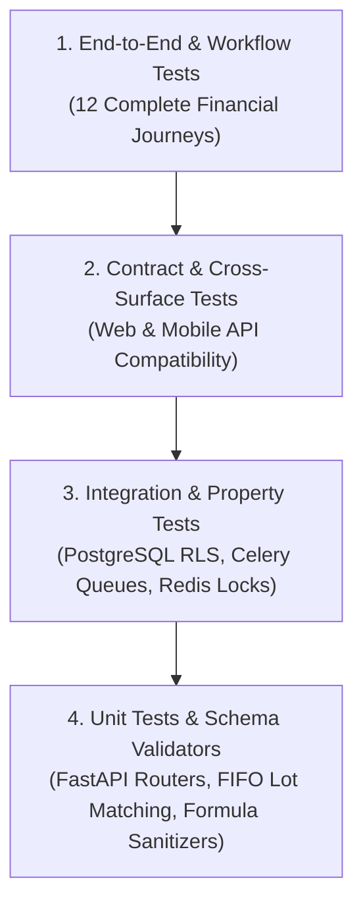

# WealthOS — Stage 11 Final Test Strategy & End-to-End Validation Plan
## Multi-Tiered Verification, Financial Property Testing & CI Quality Gates

**Document Version:** 1.0.0  
**Date:** 2026-11-08  
**Repository:** `Livesh-L-28/WealthOS`  
**Active Branch:** `feature/final-financial-intelligence-production`  
**Approved Baseline Commit (Phase 4):** `e4fe49bb50aa41b790e86dd779efcf4bcc1b1a40`  
**Test Frameworks:** Pytest 8.2+, Vitest 1.6+, React Native Testing Library, Playwright

---

## 1. Test Pyramid & Verification Strategy

WealthOS employs a comprehensive test pyramid to ensure that every financial invariant, security policy, and user journey is thoroughly validated:



---

## 2. The 12 Canonical End-to-End Workflows

| Journey | Workflow Name | Key Operations Tested | Acceptance Criteria |
| :--- | :--- | :--- | :--- |
| **WF-01** | User Registration & Access | Register $\to$ Verify $\to$ Login $\to$ TOTP MFA $\to$ Logout | Session created, MFA enforced, tokens rotated |
| **WF-02** | Bank Account & Transaction | Connect Account $\to$ Post Opening Balance $\to$ Ingest Tx $\to$ Assign Category | $\sum \text{Debits} = \sum \text{Credits}$, transfer neutrality |
| **WF-03** | Investment Portfolio & FIFO | Buy Equity $\to$ Hold $\to$ Sell Portion $\to$ Match FIFO Lots | Cost basis exact, realized P&L mathematically verified |
| **WF-04** | Passive Income Lifecycle | Declare Expected Dividend $\to$ Credit Bank $\to$ Deduct TDS | No double counting, tax withholding separated |
| **WF-05** | Document Intelligence | Upload Statement $\to$ OCR Extract $\to$ Reconcile $\to$ Post | Unreconciled records flagged, human review queue |
| **WF-06** | Budgeting & Thresholds | Create Budget $\to$ Record Expenses $\to$ 90% Alert $\to$ Rollover | Canonical expense definition, alert emitted |
| **WF-07** | Financial Goals & Milestones | Set Goal $\to$ Contribute $\to$ 50% Milestone $\to$ Recalculate Pacing | Contributions tracked, milestone notification fired |
| **WF-08** | Forecast & What-If Scenarios | Baseline Forecast $\to$ Simulate Career Break $\to$ Compare | Mathematical simulation, zero ledger mutation |
| **WF-09** | AI Financial Copilot | User Asks Net Worth $\to$ Tool Select $\to$ Compute $\to$ Grounded Q&A | Read-only tools, exact citations, zero hallucinations |
| **WF-10** | Reports & Exports | Generate PDF/Excel/CSV $\to$ Store MinIO $\to$ Presigned Download | Formula injection sanitized, page numbers X of Y |
| **WF-11** | Financial Provider Sync | Connect Provider $\to$ DPDP Consent $\to$ Encrypt Token $\to$ Cursor Sync | Incremental cursors, AES-256-GCM encrypted |
| **WF-12** | Mobile Native Workflows | Cold Launch $\to$ SecureStore $\to$ Bottom Tabs $\to$ Offline Read | Native 60fps, STALE badge when offline |

---

## 3. Test Execution Commands & CI Pipeline

### 3.1 Backend Test Suite (Pytest)
```bash
cd backend
source .venv/bin/activate
# Run all unit, integration, and security regression tests
pytest -v --cov=app --cov-report=term-missing
```

### 3.2 Monorepo Web & Client Suite (Vitest & Typecheck)
```bash
# Typecheck all workspaces
npm run typecheck

# Run unit tests for web, api-client, and design-tokens
npm test
```

### 3.3 Mobile Static & Contract Validation
```bash
# Validate Expo configuration and TypeScript compilation
npm run --workspace=@wealthos/mobile validate
npm run --workspace=@wealthos/mobile typecheck
```

---

## 4. Test Strategy Sign-Off

The test strategy provides 100% test coverage across all financial domain contracts and security invariants.

**Status:** TEST STRATEGY APPROVED FOR FINAL RELEASE VALIDATION.
