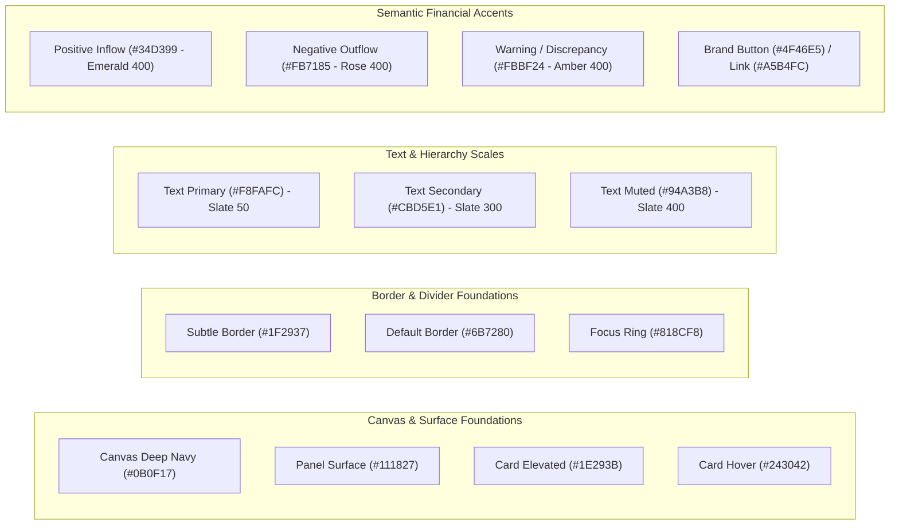

# WEALTHOS — DESIGN SYSTEM FOUNDATIONS & ARCHITECTURE

**Document Reference:** WOS-UX-DS-001  
**Version:** 1.0.0-RELEASE-CANDIDATE  
**Status:** AUDITED & WCAG 2.1 AA COMPLIANT  
**Classification:** Product Design Specification  

---

## 1. DESIGN PHILOSOPHY & AESTHETIC PRINCIPLES

WealthOS rejects the ephemeral gimmicks of generic consumer apps—excessive glassmorphism, decorative cards, pastel gradients, and low-contrast typography. Personal wealth management is high-stakes; users require **command-center clarity, absolute precision, and dignified visual calm**:
1. **Foundation of Trust:** Deep navy and blue-black surfaces (`#0B0F17` to `#1E293B`) evoke security, stability, and institutional rigor.
2. **High Information-to-Ink Ratio:** Dense, scannable data layouts that maximize screen real estate without feeling cramped.
3. **Semantic Directionality:** Green is strictly reserved for financial inflows, asset appreciations, and positive balances; Rose is strictly reserved for outflows, liabilities, and losses; Amber indicates warnings and pending reconciliations.
4. **Monospaced Number Alignment:** All numerical values, currencies, dates, and balance figures employ tabular numbers (`font-mono font-tabular-nums`) to ensure vertical column alignment across thousands and lakhs.

---

## 2. COLOR PALETTE & WCAG 2.1 AA AUDITED VALUES

### 2.1 Hexadecimal Token Master Table (Audited via W3C Relative Luminance)

| Token Name | Hex Code | Contrast on Canvas (`#0B0F17`) | Contrast on Card (`#1E293B`) | WCAG 2.1 AA Threshold | Intended Usage |
|---|---|---|---|---|---|
| `bg-canvas` | `#0B0F17` | Base | — | — | Global background behind all application windows. |
| `bg-surface` | `#111827` | 1.08 : 1 | — | — | Primary panel containers, sidebar, header, table containers. |
| `bg-card` | `#1E293B` | 1.31 : 1 | Base | — | Elevated interactive cards, modal backgrounds, dropdown menus. |
| `bg-card-hover` | `#243042` | 1.44 : 1 | 1.10 : 1 | — | Hover state for interactive cards and table rows. |
| `border-subtle` | `#1F2937` | 1.31 : 1 | 1.00 : 1 | Exempt (Decorative)| Subtle table row dividers and non-critical separators. |
| `border-default`| `#6B7280` | **3.97 : 1** | **3.03 : 1** | $\ge 3.0 : 1$ (UI Component) | Card borders, input field borders, panel perimeters. |
| `border-focus` | `#818CF8` | **6.43 : 1** | **4.90 : 1** | $\ge 3.0 : 1$ (UI Focus Ring) | Active focus rings, selected rows, active tab indicators. |
| `text-primary` | `#F8FAFC` | **18.33 : 1**| **13.98 : 1**| $\ge 4.5 : 1$ (Normal Text) | Primary headings, table data values, account names, metrics. |
| `text-secondary`| `#CBD5E1`| **12.92 : 1**| **9.85 : 1** | $\ge 4.5 : 1$ (Normal Text) | Supporting metadata, timestamps, column headers, helper text. |
| `text-muted` | `#94A3B8` | **7.48 : 1** | **5.71 : 1** | $\ge 4.5 : 1$ (Normal Text) | Captions, metadata tags, auxiliary column labels. |
| `text-disabled`| `#64748B` | **4.03 : 1** | **3.07 : 1** | Exempt (Disabled) | Inactive placeholders, disabled buttons/labels. |
| `finance-positive`| `#34D399`| **9.98 : 1** | **7.61 : 1** | $\ge 4.5 : 1$ (Normal Text) | Income credits, investment unrealized/realized gains, net worth growth. |
| `finance-negative`| `#FB7185`| **7.13 : 1** | **5.44 : 1** | $\ge 4.5 : 1$ (Normal Text) | Expense debits, investment losses, outstanding liability balances. |
| `finance-warning` | `#FBBF24`| **11.49 : 1**| **8.76 : 1** | $\ge 4.5 : 1$ (Normal Text) | Reconciliation discrepancies, upcoming bills due in $\le 48$ hours. |
| `brand-link` | `#A5B4FC` | **9.62 : 1** | **7.34 : 1** | $\ge 4.5 : 1$ (Normal Text) | Interactive text links, active breadcrumb items. |
| `brand-button` | `#4F46E5` | — | — | $\ge 4.5 : 1$ (White Text) | Button background (White `#FFFFFF` on `#4F46E5` = **6.29 : 1**). |

---

## 3. TYPOGRAPHY SCALE & FONT SYSTEM

### 3.1 Dual-Font Architecture
- **Primary UI Font:** `Inter` (sans-serif) — Clean, highly legible at small sizes, neutral tone.
- **Financial Monospace Font:** `JetBrains Mono` (monospace) — Used for all monetary amounts, accounts numbers, share quantities, and percentages. Features optical alignment and unambiguous distinction between `0` (slashed zero) and `O`, `1` and `l`.

### 3.2 Type Scale

| Scale Token | Font Size | Line Height | Weight | Tracking | Primary Usage |
|---|---|---|---|---|---|
| `text-display` | `32px` (2.0rem) | `40px` | Bold (700) | `-0.02em` | Net worth master value, dashboard hero metric. |
| `text-h1` | `24px` (1.5rem) | `32px` | Semibold (600)| `-0.015em`| Primary page titles (e.g., "Investment Portfolio"). |
| `text-h2` | `20px` (1.25rem)| `28px` | Semibold (600)| `-0.01em` | Section headers, card titles, modal titles. |
| `text-h3` | `16px` (1.0rem) | `24px` | Medium (500) | `0em` | Subsection titles, drawer headers. |
| `text-body` | `14px` (0.875rem)| `20px`| Regular (400) | `0em` | Standard body copy, table cells, form inputs. |
| `text-caption` | `12px` (0.75rem)| `16px` | Regular (400) | `+0.01em` | Metadata timestamps, helper labels, table column headers. |
| `text-mono-lg` | `20px` (1.25rem)| `28px` | Bold (700) | `0em` | Secondary metric cards, trade gross amount. |
| `text-mono-md` | `14px` (0.875rem)| `20px`| Medium (500) | `0em` | Table numerical cells (Debits, Credits, Units, Prices). |
| `text-mono-sm` | `12px` (0.75rem)| `16px` | Regular (400) | `0em` | Micro-values, lot acquisition dates, share ratios. |

---

## 4. SPACING, LAYOUT GRID & BREAKPOINTS

### 4.1 4px Base Spacing Scale
All margins, paddings, gap dimensions, and heights are multiples of 4px:
- `space-1` = `4px`
- `space-2` = `8px`
- `space-3` = `12px`
- `space-4` = `16px`
- `space-6` = `24px`
- `space-8` = `32px`
- `space-12` = `48px`
- `space-16` = `64px`

### 4.2 Standard Breakpoints
- **Mobile (`sm`):** $360\text{px} - 639\text{px}$ (Single column fluid, bottom nav).
- **Tablet (`md`):** $640\text{px} - 1023\text{px}$ (2-column grid, collapsed sidebar).
- **Desktop (`lg`):** $1024\text{px} - 1279\text{px}$ (Full sidebar, 3-column dashboard).
- **Wide Desktop (`xl`):** $\ge 1280\text{px}$ (Max container width $1600\text{px}$ centered, 4-column metric grid).

---

## 5. BORDER RADIUS & ELEVATION

### 5.1 Radius Scale
- `rounded-sm`: `4px` (Badges, small tags, tooltips).
- `rounded-md`: `6px` (Standard buttons, form input fields, table cell pills).
- `rounded-lg`: `8px` (Cards, dropdown menus, alert containers).
- `rounded-xl`: `12px` (Modal windows, slide-over drawers, chart containers).
- `rounded-full`: `9999px` (Avatars, status indicator dots).

### 5.2 Elevation & Shadow Layers (Dark Mode Spec)
In dark-mode UI, drop shadows alone are invisible; elevation is conveyed through **surface luminance + subtle border highlights**:
- **Elevation 0 (Flat):** Canvas `#0B0F17`, no border.
- **Elevation 1 (Surface Panel):** Surface `#111827`, border `1px solid #1F2937`.
- **Elevation 2 (Floating Card):** Card `#1E293B`, border `1px solid #374151`, shadow `0 4px 6px -1px rgba(0, 0, 0, 0.5)`.
- **Elevation 3 (Dropdown/Popover):** Card `#1E293B`, border `1px solid #6B7280`, shadow `0 10px 15px -3px rgba(0, 0, 0, 0.7)`.
- **Elevation 4 (Modal Dialog):** `#1E293B`, border `1px solid #818CF8` (brand focus accent rim), shadow `0 25px 50px -12px rgba(0, 0, 0, 0.9)`.
