# WEALTHOS — INFORMATION ARCHITECTURE & NAVIGATION HIERARCHY

**Document Reference:** WOS-UX-IA-001  
**Version:** 1.0.0-RELEASE-CANDIDATE  
**Status:** APPROVED / FROZEN BASELINE  
**Classification:** Product Design Specification  

---

## 1. INFORMATION ARCHITECTURE PHILOSOPHY

Enterprise wealth management platforms fail when they either dump 25 items into an unorganized sidebar or hide essential financial controls behind obscure submenus. WealthOS solves this via **progressive disclosure** and **task-oriented grouping**:
1. **Cognitive Chunking:** Grouping 20 domains into 6 primary operational zones that match the mental models of investors and household wealth managers.
2. **Context-Aware Sub-Navigation:** Secondary tabs and view switchers appear in context within each domain rather than cluttering global navigation.
3. **Command Palette (`Cmd+K`):** Power users can instantly access any account, transaction, holding, or action via keyboard shortcuts.
4. **Persistent Workspace Context:** The active workspace (Personal vs Household) is visibly anchored in the header with one-click switching.

---

## 2. SITE MAP & PROGRESSIVE NAVIGATION GROUPINGS

```mermaid
graph TD
    AppShell["WealthOS Shell"]
    
    subgraph "Group 1: Executive Command"
        N1["1. Overview (/dashboard)"]
        N2["2. Net Worth (/net-worth)"]
        N3["3. Financial Copilot (/copilot)"]
    end

    subgraph "Group 2: Banking & Cash Flow"
        N4["4. Accounts & Balances (/accounts)"]
        N5["5. Transactions & Splits (/transactions)"]
        N6["6. Income & Salary (/income)"]
        N7["7. Expenses & Spending (/expenses)"]
        N8["8. Budgets & Envelopes (/budgets)"]
    end

    subgraph "Group 3: Capital Markets & Yield"
        N9["9. Investment Overview (/investments)"]
        N10["10. Portfolio Holdings (/investments/holdings)"]
        N11["11. Dividends & Interest (/dividends)"]
    end

    subgraph "Group 4: Balance Sheet (Real Assets & Debt)"
        N12["12. Assets & Valuations (/assets)"]
        N13["13. Liabilities & Loans (/liabilities)"]
    end

    subgraph "Group 5: Vault & Integrity"
        N14["14. Document Vault (/documents)"]
        N15["15. Reconciliation (/reconciliation)"]
    end

    subgraph "Group 6: Intelligence & Administration"
        N16["16. Analytics & Cashflow (/analytics)"]
        N17["17. Goals & Forecasting (/goals)"]
        N18["18. Tax & Financial Reports (/reports)"]
        N19["19. Alerts & Notifications (/notifications)"]
        N20["20. Settings & Security (/settings)"]
    end

    AppShell --> N1 & N2 & N3
    AppShell --> N4 & N5 & N6 & N7 & N8
    AppShell --> N9 & N10 & N11
    AppShell --> N12 & N13
    AppShell --> N14 & N15
    AppShell --> N16 & N17 & N18 & N19 & N20
```

---

## 3. DETAILED ROUTING & TAXONOMY SPECIFICATION

| Primary Group | Module # | Domain | URL Route | Description & Sub-Views |
|---|---|---|---|---|
| **Executive** | 1 | **Overview** | `/dashboard` | Master financial summary, net worth sparkline, cash flow gauge, recent activity, alerts. |
| | 2 | **Net Worth** | `/net-worth` | Historical net worth curve, asset vs liability balance sheet, point-in-time calculation snapshots. |
| | 3 | **Copilot** | `/copilot` | Natural language conversational interface, deterministic tool execution logs, citation panel. |
| **Cash Flow** | 4 | **Accounts** | `/accounts` | Bank accounts, cash repositories, wallets, credit card accounts. Sub-view: `/accounts/[id]`. |
| | 5 | **Transactions**| `/transactions` | Full double-entry transaction ledger, category filtering, search, split transactions drawer. |
| | 6 | **Income** | `/income` | Salary breakdown (gross, deductions, net), bonuses, freelance invoices, rental income. |
| | 7 | **Expenses** | `/expenses` | Discretionary vs non-discretionary spending, merchant normalization, recurring bills. |
| | 8 | **Budgets** | `/budgets` | Zero-based envelope budgeting, monthly category limits, proactive overspending alerts. |
| **Capital Markets**| 9 | **Investments** | `/investments` | Market summary, watchlist, brokerage account connectivity status. |
| | 10 | **Portfolio** | `/investments/holdings`| Aggregated holdings, XIRR/CAGR returns, FIFO purchase lots (`/investments/lots`), trades (`/investments/trades`). |
| | 11 | **Dividends** | `/dividends` | Dividend declarations, expected income, bank credit matching, Section 194 TDS tracking. |
| **Balance Sheet** | 12 | **Assets** | `/assets` | Real estate, gold bullion/jewelry, motor vehicles, private equity, appraisal history. |
| | 13 | **Liabilities** | `/liabilities` | Home loans, auto loans, personal loans, EMI amortization schedules, credit card limits. |
| **Vault & Integrity**| 14 | **Documents** | `/documents` | Vault library, PDF/Excel uploads, OCR status, side-by-side review (`/documents/[id]/review`). |
| | 15 | **Reconciliation**| `/reconciliation`| Bank statement vs ledger matching, duplicate transaction rule engine, unposted items. |
| **Intelligence** | 16 | **Analytics** | `/analytics` | Monthly cash flow waterfall, spending trend graphs, category distribution sunburst. |
| | 17 | **Goals** | `/goals` | Goal creation wizard, required SIP calculators, Monte Carlo wealth projection models. |
| | 18 | **Reports** | `/reports` | Capital gains tax schedules (LTCG / STCG), Form 26AS reconciliation, net worth PDF export. |
| **Platform** | 19 | **Notifications**| `/notifications`| Financial anomaly alerts, upcoming bill due dates, dividend payout notifications. |
| | 20 | **Settings** | `/settings` | Workspace switcher, household members (`/settings/workspace`), MFA & security (`/settings/security`), audit logs (`/settings/audit`). |

---

## 4. GLOBAL HEADER, BREADCRUMBS & WORKSPACE CONTROLS

### 4.1 Global Header Architecture
The top header (`64px` height, fixed) provides global contextual awareness:
1. **Workspace Switcher (Left):**
   - Displays active workspace badge (`Aditya's Personal` or `Sharma Family Office`).
   - Dropdown displays all user memberships with role badge (`Owner`, `Admin`, `Member`, `Auditor`).
   - Quick action: `+ Create Household Workspace`.
2. **Global Search / Command Bar (`Cmd+K`) (Center):**
   - Omnibox allowing search across accounts, transactions, stock symbols (INFY, TCS), categories, documents, and quick commands (*"Add Expense"*, *"Upload Statement"*, *"Ask Copilot"*).
3. **System Controls (Right):**
   - **Market Freshness Indicator:** Pill showing market data status (`● Live (NSE)` or `○ Closed (EOD)`).
   - **Quick Action Button (`+`):** Fast access to Record Income, Add Expense, Record Trade, Upload Doc.
   - **Notifications Center:** Bell icon with unread badge counter.
   - **User Profile Menu:** Avatar, user full name, current role, Security & MFA link, Sign Out button.

### 4.2 Breadcrumb Conventions
All nested screens feature structured, clickable breadcrumbs:
- Example 1: `Dashboard > Accounts > HDFC Salary Account (•••• 4892)`
- Example 2: `Investments > Portfolio Holdings > Infosys Ltd (INFY) > FIFO Lots`
- Example 3: `Documents > ICICI_Nov_2026.pdf > Side-by-Side Review`

---

## 5. MOBILE & TABLET ADAPTIVE NAVIGATION

### 5.1 Desktop ($\ge 1280\text{px}$)
- Permanent left navigation sidebar (`260px` width) with grouped sections, collapsible sub-items, and active indicator bar.

### 5.2 Tablet ($768\text{px} - 1279\text{px}$)
- Collapsed slim sidebar (`72px` width) showing icon-only state with accessible hover tooltips. Expanding flyout on click for sub-navigation.

### 5.3 Mobile ($< 768\text{px}$)
- Persistent Bottom Navigation Bar (`64px` height) featuring the 5 most frequent operational destinations:
  1. **Overview** (Home icon)
  2. **Accounts** (Bank icon)
  3. **Add (+)** (Floating center action sheet)
  4. **Investments** (TrendingUp icon)
  5. **More** (Grid icon opening full mobile drawer for remaining domains)
