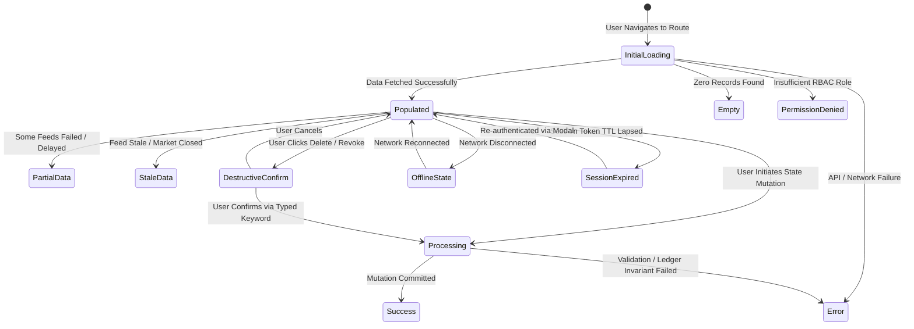

# WEALTHOS — INTERACTION STATES & EDGE CASE ARCHITECTURE

**Document Reference:** WOS-UX-STA-001  
**Version:** 1.0.0-RELEASE-CANDIDATE  
**Status:** APPROVED / FROZEN BASELINE  
**Classification:** Product Design Specification  

---

## 1. THE 12 MANDATORY INTERACTION STATES

Every data-fetching, form-submitting, and list-rendering screen in WealthOS must explicitly implement the following 12 state variations. No screen may enter an unhandled empty or unstyled error state:

---

## 2. DETAILED STATE SPECIFICATIONS & COMPONENT BEHAVIORS

### 2.1 State 1: Initial Loading (`INITIAL_LOADING`)
- **Visual Design:** Pulse-animated loading skeletons matching exact typography heights, card geometries, and table column widths.
- **Rules:** Zero Layout Shift (Cumulative Layout Shift, CLS = 0). Prohibit full-page spinning wheels that block content layout.

### 2.2 State 2: Empty State (`EMPTY_STATE`)
- **Visual Design:** Centered circular container with muted icon, clear heading (`text-h3`), descriptive helper text explaining why no data exists, and an actionable primary CTA button.
- **Example (Accounts Empty):** *"No Financial Accounts Added Yet. Add your savings account or drag-and-drop a bank statement to initialize your ledger."* CTA: `+ Add Account`.

### 2.3 State 3: Populated State (`POPULATED`)
- **Visual Design:** Full information-dense view featuring clean tabular formatting, tabular monospaced numbers, active sorting, pagination, and filter tags.

### 2.4 State 4: Error State (`ERROR_STATE`)
- **Visual Design:** Inline error container with red accent border, explicit error diagnostic code (e.g., `ERR_LEDGER_UNBALANCED`), plain-English explanation of failure cause, and a prominent **"Retry Request"** button.

### 2.5 State 5: Partial Data State (`PARTIAL_DATA`)
- **Visual Design:** When an aggregation spans multiple accounts and one external feed fails or is undergoing sync, the screen displays available numbers with an amber banner: *"HDFC balance verified. ICICI Bank sync in progress—partial totals displayed."*

### 2.6 State 6: Offline State (`OFFLINE_STATE`)
- **Visual Design:** Fixed sticky header banner: *"Network connection lost. Operating in read-only offline cache mode. Ledger writes disabled."* Form submission buttons become disabled with tooltip explaining offline state.

### 2.7 State 7: Stale Data State (`STALE_DATA`)
- **Visual Design:** When market quotes or exchange rates are older than 15 minutes during trading hours, a subtle amber pill badge displays: `● Prices as of Nov 06, 2026 (Delayed)`. Clicking pill displays last sync timestamp.

### 2.8 State 8: Permission Denied (`PERMISSION_DENIED`)
- **Visual Design:** Centered shield-alert icon with message: *"Access Restricted: Auditor accounts cannot approve statement extractions or modify ledger entries. Contact your workspace Owner for elevated permissions."*

### 2.9 State 9: Session Expiration (`SESSION_EXPIRED`)
- **Visual Design:** Non-destructive modal overlay preserves all in-progress form inputs and table draft states behind a blurred backdrop: *"Session expired for security. Re-enter password or verify biometric to continue without losing your work."*

### 2.10 State 10: Processing State (`PROCESSING`)
- **Visual Design:** Submit button displays an inline spinner; input fields disable to prevent double-submission; screen displays a progress indicator for long-running jobs (e.g., *“Verifying statement arithmetic (Page 2 of 4)...”*).

### 2.11 State 11: Success State (`SUCCESS`)
- **Visual Design:** Temporary emerald toast notification with confirmation details (e.g., *“Trade executed. Realized capital gain of ₹38,795.00 posted to ledger.”*). New or modified table row flashes with a subtle emerald highlight before settling into default background.

### 2.12 State 12: Destructive Action Confirmation (`DESTRUCTIVE_CONFIRMATION`)
- **Visual Design:** High-stakes actions (revoking an integration, deleting an asset, closing an account) require an explicit confirmation modal. The user must manually type the confirmation word (e.g., `DELETE` or `REVOKE`) into an input field before the destructive button unlocks.
