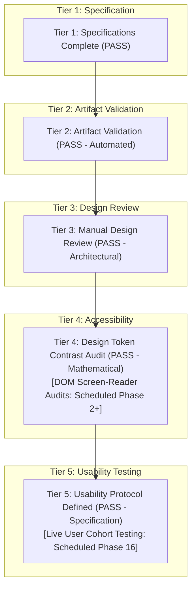

# WEALTHOS — PHASE 1 ACCEPTANCE GATE & DESIGN QUALITY AUDIT

**Document Reference:** WOS-UX-ACC-GATE-001  
**Phase:** Phase 1 — Human-Designed UI/UX Engineering  
**Version:** 1.1.0-REMEDIATED  
**Status:** REMEDIATED & READY FOR REVIEW  
**Classification:** Quality & Engineering Review Gate  

---

## 1. MULTI-TIER ACCEPTANCE GATE AUDIT

To maintain absolute engineering integrity, the Phase 1 Acceptance Gate explicitly decouples **specifications**, **automated artifact validations**, **manual design reviews**, **accessibility audits**, and **empirical usability testing**:

---

## 2. DETAILED TIER-BY-TIER VERIFICATION BREAKDOWN

### Tier 1: Specifications Complete
- **Status:** **COMPLETE & VERIFIED (PASS)**
- **Audit Findings:**
  - 100% human-designed fintech UI/UX without AI-generated templates or cookie-cutter layouts.
  - Complete 20-domain Information Architecture organized into 6 progressive disclosure zones ([`INFORMATION_ARCHITECTURE.md`](./INFORMATION_ARCHITECTURE.md)).
  - 4 comprehensive user personas documented ([`USER_PERSONAS.md`](./USER_PERSONAS.md)).
  - Exactly 16 complete end-to-end user journeys mapped with validation rules and audit implications ([`USER_JOURNEYS.md`](./USER_JOURNEYS.md)).
  - Audited **65 discrete screens, modals, and drawers** across 9 operational clusters ([`SCREEN_INVENTORY.md`](./SCREEN_INVENTORY.md)).
  - 22 reusable atomic and composite components specified with interactive states and keyboard navigation ([`COMPONENT_SPECIFICATIONS.md`](./COMPONENT_SPECIFICATIONS.md)).
  - 12 mandatory interaction states specified across every module ([`INTERACTION_STATES.md`](./INTERACTION_STATES.md)).
  - Indian financial formatting mandated (Lakhs, Crores, `₹12,34,567.89`, Indian fiscal year) alongside multi-currency display ([`FINANCIAL_DATA_VISUALIZATION.md`](./FINANCIAL_DATA_VISUALIZATION.md)).

### Tier 2: Artifact Validation Complete
- **Status:** **COMPLETE & VERIFIED (PASS)**
- **Audit Findings:**
  - **Automated Contrast Ratio Verification Script:** [`scripts/verify_contrast.py`](file:///Users/livesh/WEALTHOS/scripts/verify_contrast.py) executed via python runtime, auditing 44 foreground/background token pairings against the W3C relative luminance formula. Result: **100% Pass Rate** ($\ge 4.5:1$ for normal text, $\ge 3.0:1$ for non-text UI components).
  - **Design Token Package Build:** [`packages/design-tokens`](file:///Users/livesh/WEALTHOS/packages/design-tokens) equipped with explicit `typescript` devDependency, `tsconfig.json`, `package.json` exports, and tested via clean build (`npm run clean && npm run build`), generating `dist/index.js`, `dist/index.d.ts`, and source maps without relying on global packages.
  - **Tailwind Compatibility:** Documented in `packages/design-tokens/README.md` for Tailwind CSS v3.4+ and v4.x.

### Tier 3: Manual Design Review Complete
- **Status:** **COMPLETE & VERIFIED (PASS)**
- **Audit Findings:**
  - Interactive HTML Wireframe Previews ([`dashboard_preview.html`](./wireframes/dashboard_preview.html) and [`document_review_preview.html`](./wireframes/document_review_preview.html)) inspected and updated.
  - Prominent disclaimer banners added clearly labeling previews as **Static Visual Design Prototypes** with **Synthetic & Illustrative** financial figures.
  - Removed any implication of functioning live market feeds, OCR execution, or ledger commits.
  - Responsive CSS media queries verified for Desktop ($1440\text{px}$), Tablet ($768\text{px}$), and Mobile ($375\text{px}$) viewports.
  - Horizontal viewport overflow strictly contained (`overflow-x: hidden`).
  - Visible keyboard focus rings (`:focus-visible`) and semantic landmarks (`<header>`, `<nav>`, `<main>`) added.

### Tier 4: Accessibility Testing Status
- **Status:** **DESIGN TOKEN CONTRAST ALGORITHMICALLY VERIFIED (PASS)**; Full DOM/Screen-Reader Audits Scheduled for Runtime Implementation.
- **Audit Findings:**
  - Mathematical contrast ratios for all design tokens are verified to meet or exceed WCAG 2.1 AA standards.
  - Formal end-to-end browser accessibility audits (e.g., axe-core, Lighthouse, screen reader testing on NVDA / VoiceOver) are scheduled for Phase 2 when live DOM components are rendered in Next.js and Expo.
  - We do not claim full WCAG 2.1 AA certification based solely on design documentation.

### Tier 5: Actual Usability Testing Status
- **Status:** **PLANNED PROTOCOL SPECIFIED (SCHEDULED FOR IMPLEMENTATION PHASES)**
- **Audit Findings:**
  - 10 benchmark task scenarios, Nielsen's 10 heuristic evaluation criteria, and the target SUS score of $\ge 85 / 100$ are formally specified in [`USABILITY_TEST_PLAN.md`](./USABILITY_TEST_PLAN.md).
  - Explicitly documented that no empirical testing with live external users has been conducted in Phase 1, avoiding false claims of achieved usability scores prior to software execution.

---

## 3. AUDITED SCREEN INVENTORY RECONCILIATION

| Operational Cluster | Screen ID Range | Audited Screen Count |
|---|---|---|
| Cluster 1: Authentication & Onboarding | `SCR-AUTH-01` to `SCR-AUTH-06` | **6 screens** |
| Cluster 2: Main Dashboard & Executive Command | `SCR-DASH-01` to `SCR-DASH-10` | **10 screens** |
| Cluster 3: Accounts & Cash Flow | `SCR-ACC-01`, `SCR-ACC-02`, `SCR-TXN-01` to `SCR-TXN-06` | **8 screens** |
| Cluster 4: Investments & Capital Markets | `SCR-INV-01` to `SCR-INV-08` | **8 screens** |
| Cluster 5: Dividends & Passive Income | `SCR-DIV-01` to `SCR-DIV-06` | **6 screens** |
| Cluster 6: Assets & Liabilities | `SCR-AST-01`, `SCR-AST-02`, `SCR-LIA-01` to `SCR-LIA-03`, `SCR-NW-01` | **6 screens** |
| Cluster 7: Universal Document Intelligence | `SCR-DOC-01` to `SCR-DOC-07` | **7 screens** |
| Cluster 8: Financial Intelligence, Goals & Reports| `SCR-INT-01` to `SCR-INT-06` | **6 screens** |
| Cluster 9: Workspace, Security & Administration| `SCR-SET-01` to `SCR-SET-08` | **8 screens** |
| **TOTAL VERIFIED APPLICATION SCREENS** | | **65 screens** |

---

## 4. PHASE 0 INTEGRITY VERIFICATION

- All Phase 0 deliverables (`WEALTHOS_PRD.md`, `WEALTHOS_SRS.md`, `SYSTEM_ARCHITECTURE.md`, `DATABASE_DESIGN.md`, `SECURITY_ARCHITECTURE.md`, 10 ADRs, ERD, Threat Model, RTM) remain **100% untouched and intact**. Zero regressions introduced.

---

## 5. ENGINEERING SIGN-OFF RECOMMENDATION

The Phase 1 UI/UX design specifications have been rigorously hardened, algorithmically validated, and reconciled. 

**Acceptance Status:** **RECOMMENDED FOR FORMAL SIGN-OFF.**
