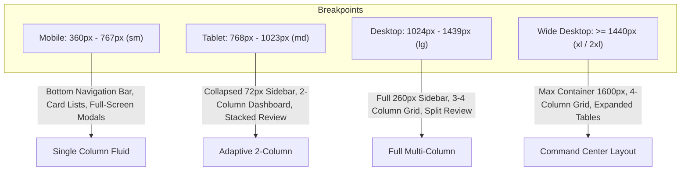

# WEALTHOS — RESPONSIVE DESIGN SPECIFICATIONS & ADAPTIVE LAYOUTS

**Document Reference:** WOS-UX-RSP-001  
**Version:** 1.0.0-RELEASE-CANDIDATE  
**Status:** APPROVED / FROZEN BASELINE  
**Classification:** Product Design Specification  

---

## 1. RESPONSIVE BREAKPOINT SYSTEM

WealthOS employs a multi-tiered responsive layout engine designed to scale seamlessly from 4K high-density desktop monitors down to compact mobile displays:

---

## 2. ADAPTIVE COMPONENT BEHAVIORS ACROSS BREAKPOINTS

| Component | Wide Desktop ($\ge 1440\text{px}$) | Desktop ($1024\text{px} - 1439\text{px}$) | Tablet ($768\text{px} - 1023\text{px}$) | Mobile ($360\text{px} - 767\text{px}$) |
|---|---|---|---|---|
| **App Navigation** | Full 260px Left Sidebar with open groupings. | Full 260px Left Sidebar with collapsible sub-sections. | Collapsed 72px Slim Sidebar (icon-only with flyout popovers). | Persistent 64px Bottom Navigation Bar (5 core icons + "More" drawer). |
| **Header** | Logo + Workspace Switcher + Omnibox Search + Actions + Avatar. | Logo + Workspace + Search Bar + Actions + Avatar. | Logo + Workspace + Compact Search Icon + Avatar. | Compact Logo + Workspace Switcher Pill + Notifications + Avatar. |
| **Financial Stat Cards** | 4-column horizontal grid (`grid-cols-4`). | 4-column horizontal grid (`grid-cols-4`). | 2-column stacked grid (`grid-cols-2`). | Single-column swipeable carousel or vertical cards (`grid-cols-1`). |
| **Financial Data Tables** | 8–10 columns visible with fixed headers and sorting. | 6–8 columns visible (secondary columns scrollable). | 5 columns visible; lower-priority columns hidden behind expandable accordion row. | Table transforms into a **Vertical Card List**; each card displays merchant, date, amount, category. |
| **Side-by-Side Review** | Split 50% PDF viewer / 50% extracted lines table. | Split 50% PDF / 50% table with collapsible controls. | Split vertical 40% PDF preview (top) / 60% table (bottom). | Tabbed Interface: Toggle between `[ Document View ]` and `[ Extracted Lines ]`. |
| **Modals / Dialogs** | Centered floating dialog (width 560px - 840px). | Centered floating dialog (width 560px - 720px). | Centered floating dialog (width 90% screen). | **Full-Screen Bottom Sheet** sliding up from bottom with sticky action footer. |
| **Slide-over Drawers** | 440px slide-in panel on right side. | 400px slide-in panel on right side. | 380px slide-in panel on right side. | 100% full-screen slide-over view. |

---

## 3. TOUCH TARGET & ERGONOMIC RULES FOR MOBILE & TABLET

1. **Minimum Touch Target Dimensions:** Every interactive control (button, icon trigger, dropdown item, checkbox, date cell) must possess an interactive boundary of **at least $44 \times 44\text{px}$** regardless of visible icon size.
2. **Thumb Zone Architecture:** On mobile devices, critical primary actions ("Add Transaction", "Confirm Posting", "Approve Statement") are positioned in the bottom 35% of the viewport (the natural ergonomic thumb sweep zone).
3. **Form Input Auto-Zoom Prevention:** Form inputs on mobile use `font-size: 16px` minimum to prevent mobile Safari and Chrome from automatically zooming the viewport upon focus.
4. **Haptic Feedback Hooks:** Primary confirmation buttons and biometric authentication triggers invoke native haptic ticks on supported mobile devices.
