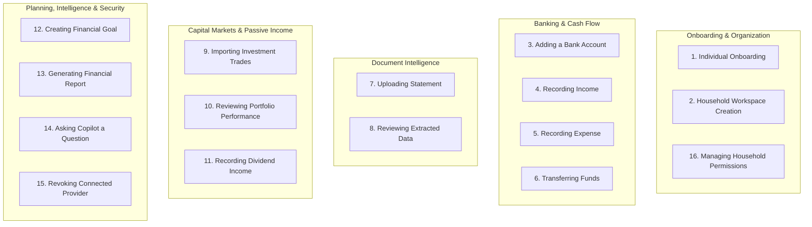

# WEALTHOS — COMPLETE USER JOURNEYS & INTERACTION FLOWS

**Document Reference:** WOS-UX-JRN-001  
**Version:** 1.0.0-RELEASE-CANDIDATE  
**Status:** APPROVED / FROZEN BASELINE  
**Classification:** Product Design Specification  

---

## 1. USER JOURNEY OVERVIEW

This document specifies the exact end-to-end user journeys for the 16 primary functional workflows in WealthOS. Every journey defines:
- **Starting point:** The exact screen or state where the user initiates action.
- **User intention:** The specific financial or administrative objective.
- **Steps:** Discrete, step-by-step user and system actions.
- **Screen transitions:** Explicit route transitions and UI modals/drawers.
- **Validation:** Frontend and backend input validation rules.
- **Error handling:** Handling of failure states, network disconnects, and invalid inputs.
- **Success state:** The resulting screen state, toasts, and visual feedback.
- **Audit implications:** Immutable ledger and audit log entries committed.

---

## 2. THE 16 CORE FINANCIAL JOURNEYS

---

### Journey 1: Individual User Onboarding
- **Starting Point:** Public Landing Page (`/`) or Direct Registration Link (`/register`).
- **User Intention:** Create an authenticated account, configure personal security (TOTP MFA), declare base currency (INR), and bootstrap the default personal workspace.
- **Steps:**
  1. User navigates to `/register`.
  2. Enters Full Name (`Aditya Sharma`), Email (`aditya@example.com`), and Password (14 characters meeting complexity rules).
  3. Clicks **"Create Account"**.
  4. System validates inputs, hashes password via Argon2id, generates Tenant `Aditya's Wealth`, assigns user as `OWNER`, and sets `wos_session` HttpOnly cookie.
  5. System navigates to Onboarding Step 1 (`/onboarding/currency`): User selects Base Currency (`INR - Indian Rupee ₹`).
  6. System navigates to Onboarding Step 2 (`/onboarding/security`): Presents TOTP MFA setup with base32 secret and QR code.
  7. User scans QR code with Google Authenticator / 1Password, enters 6-digit code `592814`, and clicks **"Verify & Activate"**.
  8. System confirms code, displays 8 emergency one-time recovery backup codes.
  9. User clicks **"Download & Continue"**.
- **Screen Transitions:** `/register` $\rightarrow$ `/onboarding/currency` $\rightarrow$ `/onboarding/security` $\rightarrow$ `/dashboard`.
- **Validation:** Email RFC 5322 regex; Password: $\ge 12$ chars, uppercase, lowercase, digit, symbol; TOTP RFC 6238 time-step window ($\pm 1$).
- **Error Handling:** If email already exists, inline alert specifies "Account already exists. [Sign In instead]". If TOTP verification fails, an inline error indicates clock skew or typo with instant retry.
- **Success State:** Redirect to `/dashboard` displaying empty-state Welcome Card: *"Your personal general ledger is active. Add your first bank account or upload a statement to begin."*
- **Audit Implications:** Append `audit_logs`: `action = 'USER_REGISTER'`, `action = 'MFA_ENABLE'`, `action = 'TENANT_CREATE'`.

---

### Journey 2: Household Workspace Creation
- **Starting Point:** Global Navigation Header $\rightarrow$ Workspace Switcher dropdown.
- **User Intention:** Create a shared multi-user household workspace ("Sharma Family") to manage joint accounts and family goals.
- **Steps:**
  1. User clicks Workspace Switcher in top navigation, clicks **"+ Create New Workspace"**.
  2. Slide-over drawer opens: Input Workspace Name (`Sharma Family Office`), Workspace Type (`HOUSEHOLD`), and Base Currency (`INR`).
  3. User clicks **"Create Household Workspace"**.
  4. System provisions new `Tenant` record, creates `tenant_memberships` linking current user as `OWNER`, and initializes standard family Chart of Accounts.
  5. System prompts: *"Would you like to invite family members now?"*
  6. User inputs spouse's email (`priya.sharma@example.com`) and selects Role (`ADMIN`).
  7. User clicks **"Send Invitation"**.
- **Screen Transitions:** Current Screen $\rightarrow$ Slide-over Drawer (`#create-workspace`) $\rightarrow$ Toast Notification $\rightarrow$ Automatic context switch to `/dashboard` under new `tenant_id`.
- **Validation:** Workspace name 3–50 chars; Valid email for invited member; Role must be one of `['ADMIN', 'MEMBER', 'AUDITOR']`.
- **Error Handling:** If invitation email delivery fails, the invite record remains in `PENDING` state with a "Copy Invite Link" manual fallback button.
- **Success State:** Global workspace badge updates to "Sharma Family Office"; Toast: *"Household workspace created. Invitation sent to priya.sharma@example.com."*
- **Audit Implications:** `audit_logs`: `action = 'TENANT_CREATE'`, `action = 'MEMBER_INVITE'`, recording inviter user ID, invitee email, and timestamp.

---

### Journey 3: Adding a Bank Account
- **Starting Point:** `/accounts` page.
- **User Intention:** Create a new savings account (e.g., HDFC Bank Salary Account) with an opening cleared balance.
- **Steps:**
  1. User navigates to `/accounts`, clicks **"+ Add Financial Account"** button.
  2. Modal opens:
     - Account Type: Selects `Savings Account`.
     - Institution: Selects `HDFC Bank`.
     - Account Name: `HDFC Salary Account`.
     - Masked Account Number: `•••• 4892`.
     - Currency: `INR (₹)`.
     - Opening Balance: `₹1,25,000.00`.
     - Opening Balance Date: `2026-11-01`.
  3. Clicks **"Create Account & Post Opening Balance"**.
  4. System creates `FinancialAccount` record linked to COA `Asset:Bank:HDFC`.
  5. System generates double-entry opening `JournalEntry`:
     - Debit: `Asset:Bank:HDFC` $\rightarrow$ `₹1,25,000.00`.
     - Credit: `Equity:Opening Balance Equity` $\rightarrow$ `₹1,25,000.00`.
  6. Modal closes, account appears in Accounts table.
- **Screen Transitions:** `/accounts` $\rightarrow$ Add Account Modal $\rightarrow$ Table reload with highlighted new row.
- **Validation:** Opening balance must be non-negative `Decimal`; Account name non-empty; Date cannot be in the future.
- **Error Handling:** If balance has invalid decimals, frontend validates inline (`NUMERIC(18, 4)`).
- **Success State:** Toast: *"HDFC Salary Account created with opening balance of ₹1,25,000.00"*. Ledger balance matches opening balance.
- **Audit Implications:** `audit_logs`: `action = 'ACCOUNT_CREATE'`, `action = 'JOURNAL_POST'`.

---

### Journey 4: Recording an Income Transaction
- **Starting Point:** `/income` or `/transactions` page.
- **User Intention:** Record monthly salary credit with detailed tax deductions (gross salary, TDS, PF deduction, net take-home).
- **Steps:**
  1. User clicks **"+ Record Income"** on `/income`.
  2. Detailed Income Modal opens:
     - Transaction Date: `2026-11-01`.
     - Deposited Into Account: `HDFC Salary Account`.
     - Income Category: `Income:Salary:Base Pay`.
     - Gross Salary: `₹3,50,000.00`.
     - Deduction Line 1: `Tax Deducted at Source (TDS)` $\rightarrow$ `₹62,000.00`.
     - Deduction Line 2: `Employee Provident Fund (EPF)` $\rightarrow$ `₹18,000.00`.
     - Deduction Line 3: `Professional Tax` $\rightarrow$ `₹200.00`.
     - Net Credit Auto-Calculated: `₹2,69,800.00`.
  3. Clicks **"Post Salary Credit"**.
  4. Ledger engine validates balance:
     - Debit `Asset:Bank:HDFC` = `₹2,69,800.00`
     - Debit `Expense:Tax:TDS Paid` = `₹62,000.00`
     - Debit `Asset:Retirement:EPF` = `₹18,000.00`
     - Debit `Expense:Taxes:Professional Tax` = `₹200.00`
     - Credit `Income:Salary` = `₹3,50,000.00`
     - **$\sum \text{Debit} (₹3,50,000) \equiv \sum \text{Credit} (₹3,50,000)$**.
  5. Journal entry posted; bank account balance increases by `₹2,69,800.00`.
- **Screen Transitions:** `/income` $\rightarrow$ Income Modal $\rightarrow$ Updated Income charts & table.
- **Validation:** Net credit formula must equal Gross minus Deductions; all deduction lines non-negative.
- **Error Handling:** Discrepancy highlights deduction line in red before submit button activates.
- **Success State:** Modal closes; Toast: *"Salary income of ₹3,50,000.00 recorded. Net take-home ₹2,69,800.00 posted to HDFC Salary."*
- **Audit Implications:** `journal_entries` posted; `audit_logs`: `action = 'INCOME_POST'`.

---

### Journey 5: Recording an Expense
- **Starting Point:** `/expenses` or Command Bar (`Cmd+K` $\rightarrow$ *"Add Expense"*).
- **User Intention:** Record an out-of-pocket medical insurance expense.
- **Steps:**
  1. User opens Expense Drawer.
  2. Date: `2026-11-05`.
  3. Paid From: `ICICI Credit Card`.
  4. Payee / Merchant: `Star Health Insurance`.
  5. Category: `Expense:Health & Medical:Health Insurance Premium`.
  6. Amount: `₹24,500.00`.
  7. Tax Deduction Tag: Toggle `Eligible for Section 80D Deduction` $\rightarrow$ `YES`.
  8. Notes: *"Annual family floater policy renewal"*.
  9. Clicks **"Save Expense"**.
  10. System creates double-entry journal entry:
      - Debit: `Expense:Health Insurance` $\rightarrow$ `₹24,500.00`.
      - Credit: `Liability:Credit Card:ICICI` $\rightarrow$ `₹24,500.00`.
- **Screen Transitions:** Drawer closes $\rightarrow$ Credit Card balance updates on sidebar $\rightarrow$ Expense table row prepended.
- **Validation:** Amount $> 0$; Payee non-empty; Category selected.
- **Error Handling:** Network failure triggers local optimistic rollback and error toast with "Retry" action.
- **Success State:** Toast: *"Expense of ₹24,500.00 recorded under Health Insurance"*.
- **Audit Implications:** `audit_logs`: `action = 'EXPENSE_POST'`.

---

### Journey 6: Transferring Money Between Accounts
- **Starting Point:** `/accounts` $\rightarrow$ **"Transfer Funds"** button.
- **User Intention:** Transfer ₹50,000 from HDFC Savings to Zerodha Demat trading account.
- **Steps:**
  1. User clicks **"Transfer Funds"**.
  2. Dialog opens:
     - Source Account: `HDFC Salary Account` (Available: `₹2,69,800.00`).
     - Destination Account: `Zerodha Trading Account` (Available: `₹12,400.00`).
     - Transfer Amount: `₹50,000.00`.
     - Date: `2026-11-06`.
     - Reference / UTR Number: `IMPS6110294829`.
  3. System displays accounting impact notice: *"Internal transfer. Income and expenses will not be affected. Net worth is unchanged."*
  4. Clicks **"Confirm Transfer"**.
  5. Ledger engine posts:
     - Debit `Asset:Broker:Zerodha Cash` $\rightarrow$ `₹50,000.00`.
     - Credit `Asset:Bank:HDFC` $\rightarrow$ `₹50,000.00`.
- **Screen Transitions:** Dialog closes $\rightarrow$ Both account balance pills update immediately in UI.
- **Validation:** Source account must not be identical to destination; Amount $\le$ available cleared balance (or triggers overdraft warning).
- **Error Handling:** If transfer amount exceeds available funds without overdraft, submission is blocked with alert: *"Insufficient funds in HDFC Salary Account."*
- **Success State:** Toast: *"₹50,000.00 transferred from HDFC Salary to Zerodha Trading"*.
- **Audit Implications:** `audit_logs`: `action = 'TRANSFER_POST'`.

---

### Journey 7: Uploading a Bank Statement
- **Starting Point:** `/documents/upload` or Drag-and-Drop Dropzone on any screen.
- **User Intention:** Upload a multi-page password-protected PDF bank statement for automated parsing.
- **Steps:**
  1. User drags `ICICI_Nov_2026.pdf` into Document Dropzone.
  2. Upload dialog displays file metadata (Size: 2.4 MB, Format: PDF).
  3. Password Prompt appears: *"This statement is encrypted. Enter PDF password (typically PAN or DOB):"*
  4. User enters password `ABCDP1234F`.
  5. User clicks **"Upload & Start Extraction"**.
  6. Frontend streams file via multipart upload to `/api/v1/documents/upload`.
  7. API validates MIME magic number, computes SHA-256 hash, stores in private MinIO vault, and queues Celery task `process_document_pipeline`.
  8. Screen navigates to `/documents`, row appears with spinning badge: `Status: Processing OCR (Page 1 of 4)`.
- **Screen Transitions:** Drag zone $\rightarrow$ Password Prompt $\rightarrow$ Uploading Progress Bar $\rightarrow$ `/documents` Table.
- **Validation:** File size $\le 35\text{ MB}$; MIME type strictly `application/pdf`; SHA-256 duplicate check.
- **Error Handling:** If PDF password is incorrect, worker fails with `INVALID_CREDENTIALS` and UI prompts for password re-entry without re-uploading file.
- **Success State:** Document status changes to `Ready for Review` with green badge. Toast: *"Statement parsed successfully. 38 transactions extracted."*
- **Audit Implications:** `documents` created; file hash logged.

---

### Journey 8: Reviewing Extracted Statement Data
- **Starting Point:** `/documents/{id}/review`.
- **User Intention:** Inspect parsed statement rows side-by-side with original PDF, correct 2 uncategorized rows, verify arithmetic, and post to ledger.
- **Steps:**
  1. User clicks **"Review Document"** on parsed statement.
  2. Dual-pane interface renders:
     - Left Pane (50% width): Interactive PDF viewer showing highlighted bounding boxes.
     - Right Pane (50% width): Editable data table with 38 rows.
  3. Header displays **Arithmetic Validation Card**:
     - Opening: `₹84,200.00`
     - Total Credits (+): `₹1,45,000.00`
     - Total Debits (-): `₹92,300.00`
     - Expected Closing: `₹1,36,900.00`
     - Statement Closing: `₹1,36,900.00`
     - Status: **ARITHMETIC VERIFIED (Zero Discrepancy)**.
  4. Row 12 has warning badge `Uncategorized Merchant: 'SWIGGY BANGALORE'`. User clicks category dropdown, selects `Food & Dining:Online Food Delivery`.
  5. Row 18 is flagged as potential duplicate of an existing manual transaction. User toggles action from `Accept` to `Skip Duplicate`.
  6. User clicks primary action: **"Approve & Post 37 Transactions to Ledger"**.
  7. Confirmation modal summarizes balances and affected accounts. User clicks **"Confirm Posting"**.
- **Screen Transitions:** `/documents` $\rightarrow$ `/documents/{id}/review` $\rightarrow$ Posting Progress Modal $\rightarrow$ `/transactions`.
- **Validation:** All accepted rows must have valid dates and amounts; Opening + Credits - Debits must reconcile.
- **Error Handling:** If discrepancy exists, user is prompted to insert an adjustment line or edit row amounts.
- **Success State:** Redirect to `/transactions` with newly committed rows highlighted in emerald; Toast: *"37 transactions posted to ledger. ICICI Bank balance updated to ₹1,36,900.00."*
- **Audit Implications:** 37 `journal_entries` created with `source = 'DOCUMENT_IMPORT'` linking `document_id`.

---

### Journey 9: Importing Investment Transactions
- **Starting Point:** `/investments` $\rightarrow$ **"Import Trades"** button.
- **User Intention:** Import Zerodha equity trade ledger CSV containing 25 buy/sell trades across Indian equities.
- **Steps:**
  1. User clicks **"Import Trades"**, selects Broker: `Zerodha Demat`.
  2. Uploads `tradebook-2026.csv`.
  3. Column Mapping screen opens: System automatically matches columns (`Trade Date`, `Symbol`, `Type`, `Quantity`, `Price`, `STT/Charges`).
  4. Clicks **"Preview Trades"**.
  5. Preview table displays 20 BUY trades and 5 SELL trades.
  6. For SELL trades, the FIFO engine preview displays matched purchase lots, holding period (LTCG vs STCG), and realized P&L.
  7. User clicks **"Commit Trades to Portfolio"**.
  8. Backend creates `investment_lots` for BUY orders, consumes lots for SELL orders, records `investment_lot_allocations`, and posts corresponding balanced ledger entries.
- **Screen Transitions:** `/investments` $\rightarrow$ Import Modal $\rightarrow$ Column Mapping $\rightarrow$ FIFO Preview $\rightarrow$ `/investments/holdings`.
- **Validation:** Trade symbols matched to `instruments.symbol`; ISIN resolution; Sell quantity cannot exceed available open lot quantity.
- **Error Handling:** If an unknown ticker is found, inline prompt requests ISIN or company name to link from master database.
- **Success State:** Holdings table updates with newly calculated average prices and total portfolio market value.
- **Audit Implications:** `investment_transactions`, `investment_lots`, and `journal_entries` posted.

---

### Journey 10: Reviewing Portfolio Performance
- **Starting Point:** `/investments/performance`.
- **User Intention:** Analyze annualized portfolio returns (XIRR), compare against NIFTY 50 benchmark, and inspect asset allocation.
- **Steps:**
  1. User navigates to `/investments/performance`.
  2. Filter bar: Selects Time Horizon `3 Years`, Asset Class `All (Equity, Mutual Funds, Gold)`.
  3. Master KPI cards update:
     - Current Portfolio Value: `₹52,50,000.00`
     - Total Invested Capital: `₹38,20,000.00`
     - Overall Unrealized Gain: `+₹14,30,000.00 (+37.43%)`
     - Portfolio XIRR: `16.82%` (vs NIFTY 50: `13.40%` $\rightarrow$ **Alpha: +3.42%**)
  4. User inspects interactive ECharts area chart showing portfolio valuation curve vs benchmark line.
  5. User scrolls down to **Asset Allocation Donut Chart**: Clicks on `Large Cap Equity (42%)` sector slice.
  6. Table below filters dynamically to show the 8 constituent holdings in that slice.
- **Screen Transitions:** In-page dynamic filter updates with URL query parameter sync (`?range=3y&class=all`).
- **Validation:** Dates must have at least 1 historical trade for XIRR calculation; handles irregular cash flows.
- **Error Handling:** If market feed has not updated today, a freshness pill displays *"Prices as of Nov 06, 2026 (Delayed)"*.
- **Success State:** Smooth chart re-rendering with accessible tabular summary below.
- **Audit Implications:** Read-only analytics; no ledger changes.

---

### Journey 11: Recording Dividend Income
- **Starting Point:** `/dividends` page.
- **User Intention:** Record a gross dividend received on Infosys (INFY) shares, capture 10% TDS withholding, and match to bank credit.
- **Steps:**
  1. User opens `/dividends`, clicks **"+ Record Dividend"**.
  2. Modal opens:
     - Instrument: `Infosys Ltd (INFY)`.
     - Payment Date: `2026-11-04`.
     - Holding Quantity on Record Date: `400 shares`.
     - Dividend Per Share: `₹21.00`.
     - Gross Dividend: `₹8,400.00` (auto-calculated: $400 \times 21$).
     - TDS Withheld (10% under Section 194): `₹840.00`.
     - Net Amount Credited: `₹7,560.00`.
     - Deposited In Account: `HDFC Salary Account`.
  3. Clicks **"Post Dividend & Link to Bank"**.
  4. System posts balanced entry:
     - Debit `Asset:Bank:HDFC` $\rightarrow$ `₹7,560.00`
     - Debit `Asset:Tax:TDS Receivable` $\rightarrow$ `₹840.00`
     - Credit `Income:Dividends:Indian Equities` $\rightarrow$ `₹8,400.00`
     - **$\sum \text{Debit} (₹8,400) \equiv \sum \text{Credit} (₹8,400)$**.
- **Screen Transitions:** Modal closes $\rightarrow$ Dividend table row added with "Reconciled" badge $\rightarrow$ Passive income tracker updates.
- **Validation:** TDS + Net must equal Gross; Holding quantity must not exceed actual historical holding on record date.
- **Error Handling:** If gross calculation does not equal TDS + Net, inline calculation error prevents submission.
- **Success State:** Toast: *"Infosys dividend of ₹8,400.00 recorded (₹7,560.00 net credited, ₹840.00 TDS captured)"*.
- **Audit Implications:** `dividend_records` and `journal_entries` posted.

---

### Journey 12: Creating a Financial Goal
- **Starting Point:** `/goals` page.
- **User Intention:** Create a long-term goal ("Child's Higher Education") with target corpus, target year, linked investment portfolios, and required monthly SIP.
- **Steps:**
  1. User navigates to `/goals`, clicks **"+ Create New Goal"**.
  2. Goal Wizard opens:
     - Goal Name: `Aarav's Higher Education`.
     - Goal Category: `Education`.
     - Target Amount: `₹50,00,000.00`.
     - Target Completion Date: `November 2038` (12 years).
     - Link Existing Accounts/Holdings: Selects `HDFC Flexi Cap Fund` and `Mirae Asset Large Cap Fund`.
     - Current Accumulated Value: `₹8,20,000.00` (16.4% completed).
  3. Wizard Step 2: **Projection & SIP Calculator**:
     - Expected Annual Return: `12.0%`
     - System calculates: **Required Monthly SIP = ₹14,250.00 / month**.
  4. User clicks **"Activate Goal Tracking"**.
- **Screen Transitions:** `/goals` $\rightarrow$ Wizard Modal $\rightarrow$ `/goals/{id}` Detail View.
- **Validation:** Target date must be in future; Target amount $> 0$; Expected return between 0% and 30%.
- **Error Handling:** If target date is too close to achieve target at reasonable SIP, an alert suggests adjusting target or timeline.
- **Success State:** Goal card renders with progress bar, completion projection chart, and monthly target checklist.
- **Audit Implications:** `financial_goals` table created; tenant scoped.

---

### Journey 13: Generating a Financial Report
- **Starting Point:** `/reports`.
- **User Intention:** Generate and download a comprehensive Capital Gains Tax Statement (LTCG / STCG) for FY 2026-27 for Chartered Accountant review.
- **Steps:**
  1. User navigates to `/reports`.
  2. Selects Report Type: `Capital Gains Tax Schedule (Schedule CG)`.
  3. Selects Period: `FY 2026-27 (Apr 1, 2026 - Mar 31, 2027)`.
  4. Selects Output Format: `PDF Report + Excel Spreadsheet (.xlsx)`.
  5. Clicks **"Generate Report"**.
  6. Progress modal opens: *"Compiling FIFO tax lots, verifying STT deductions, and formatting capital gains schedules..."*
  7. Backend compiles report, embeds verified double-entry journal proofs, and generates pre-signed download URLs.
  8. Modal updates with download buttons: **"Download PDF"** and **"Download Excel"**.
  9. User clicks to save files locally.
- **Screen Transitions:** `/reports` $\rightarrow$ Generation Modal $\rightarrow$ File Download trigger.
- **Validation:** Valid fiscal year range; ensures all trades in period have complete cost-basis allocations.
- **Error Handling:** If open unallocated trades exist, report generator warns user and links directly to unresolved trades.
- **Success State:** File downloaded; Report archived in `/reports/history` with SHA-256 hash.
- **Audit Implications:** `audit_logs`: `action = 'REPORT_GENERATE'`.

---

### Journey 14: Asking the Financial Copilot a Question
- **Starting Point:** Floating Copilot button in bottom-right corner or `Cmd+J`.
- **User Intention:** Ask *"What was my average monthly discretionary expense over the last 6 months, and which category grew the fastest?"*
- **Steps:**
  1. User presses `Cmd+J` $\rightarrow$ Copilot slide-over panel opens on the right side of the screen.
  2. Enters prompt in input box and presses Enter.
  3. System displays loading indicator: *"Analyzing tenant-scoped transactions from May 2026 to October 2026..."*
  4. Backend Copilot service validates active `tenant_id`, executes deterministic SQL aggregation tools (`get_monthly_spending`, `get_category_growth`), and formats response.
  5. Copilot returns grounded answer:
     - *"Over the last 6 months, your average monthly discretionary expense was ₹48,320.00."*
     - *"The fastest growing category was **Dining & Food Delivery**, which increased by 42% from ₹8,200.00 in May to ₹11,640.00 in October."*
     - **Citations Card:** Links to 46 underlying transactions with clickable drill-downs.
  6. User clicks on citation link: Main screen filters to those specific dining transactions.
- **Screen Transitions:** Slide-over panel opens without leaving current page.
- **Validation:** Rate limit check (max 30 queries/hour); Tenant context enforced; Model cannot modify database.
- **Error Handling:** If query is ambiguous or asks for investment advice, model displays standard disclaimer: *"I can analyze your historical records, but cannot provide regulated investment advice."*
- **Success State:** Clear, factual, mathematically verifiable text response with citation chips.
- **Audit Implications:** `copilot_conversations` and `copilot_messages` stored.

---

### Journey 15: Revoking a Connected Provider
- **Starting Point:** `/settings/providers`.
- **User Intention:** Disconnect and revoke an Account Aggregator consent artifact or broker integration (e.g., Zerodha Kite Connect).
- **Steps:**
  1. User navigates to `/settings/providers`.
  2. Locates active integration card: `Zerodha Kite Connect (Connected: 2026-08-14)`.
  3. Clicks **"Manage Provider"** $\rightarrow$ **"Revoke Access & Delete Credentials"**.
  4. Destructive Confirmation Modal appears:
     - Warning: *"Revoking access will immediately destroy stored OAuth tokens. Historical imported trades and ledger entries will be preserved."*
     - Requires user to type `REVOKE` into confirmation field.
  5. User types `REVOKE` and clicks **"Permanently Revoke Integration"**.
  6. Backend securely shreds encrypted OAuth tokens in database, calls revocation webhook on provider API if available, and invalidates scheduled sync jobs.
- **Screen Transitions:** `/settings/providers` $\rightarrow$ Confirmation Modal $\rightarrow$ Updated Provider List.
- **Validation:** Input must exactly match `REVOKE`; User must have `OWNER` or `ADMIN` role.
- **Error Handling:** If provider API is unreachable, local credentials are still destroyed and marked "Revoked Locally".
- **Success State:** Card status updates to "Disconnected"; Toast: *"Zerodha integration revoked. Stored credentials shredded."*
- **Audit Implications:** `audit_logs`: `action = 'PROVIDER_REVOKE'`, recording user ID, provider name, and timestamp.

---

### Journey 16: Managing Household Permissions
- **Starting Point:** `/settings/workspace/members`.
- **User Intention:** Change family member's permission from `ADMIN` to `AUDITOR` (read-only) and remove an inactive advisor.
- **Steps:**
  1. User (`OWNER`) navigates to `/settings/workspace/members`.
  2. Member list displays all active household members and their roles.
  3. Member 1 (`Rahul Sharma - Son`): Clicks Role dropdown, changes from `ADMIN` to `AUDITOR (Read-Only)`.
  4. System displays confirmation notice: *"Rahul will no longer be able to create transactions, edit accounts, or approve documents."*
  5. User confirms change.
  6. Member 2 (`External Tax Consultant`): Clicks `•••` action menu $\rightarrow$ **"Remove from Household"**.
  7. Confirmation dialog asks for confirmation. User clicks **"Remove Member"**.
  8. System terminates active sessions for removed user in this tenant and sets membership `is_active = FALSE`.
- **Screen Transitions:** In-page role dropdown update $\rightarrow$ Modal confirmation $\rightarrow$ Table reload.
- **Validation:** Cannot remove the sole `OWNER`; User making change must be workspace `OWNER`.
- **Error Handling:** Attempting to demote or remove the last owner raises error: *"Workspaces must have at least one active Owner."*
- **Success State:** Member role badge updates to gray "Auditor" pill; Removed user disappears from table.
- **Audit Implications:** `audit_logs`: `action = 'MEMBER_ROLE_CHANGE'`, `action = 'MEMBER_REMOVE'`.
