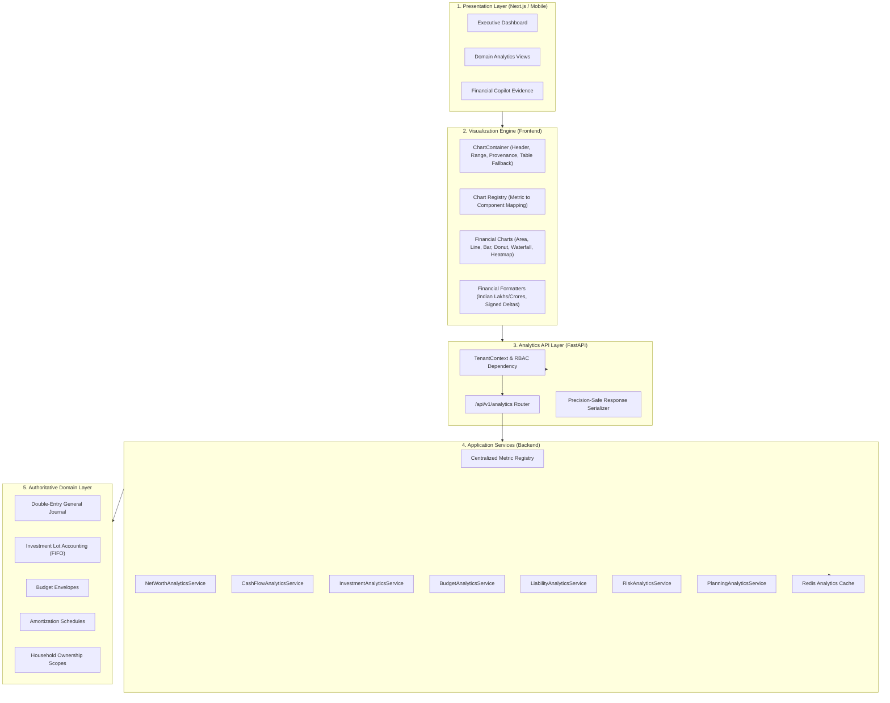

# WealthOS Enterprise Financial Visualization Engine — System Design

## 1. Architectural Overview & Responsibility Boundaries

The WealthOS Enterprise Financial Visualization Engine functions as a centralized, multi-tenant analytics layer connecting authoritative financial domain models with accessible presentation interfaces.

---

## 2. Core Subsystems

### 2.1 Backend Analytics Module (`backend/app/domains/analytics/`)
1. **Metric Registry (`domain/metric_definitions.py`)**:
   - Central dictionary of all 13 supported financial metrics.
   - Declarative metadata: metric key, domain, unit, aggregation method (`point_in_time`, `sum`, `average`, `ratio`), allowed time grains (`day`, `week`, `month`, `quarter`, `year`), precision requirements, and comparison support.
2. **Precision-Safe Response Contract (`api/schemas.py`)**:
   - Every endpoint returns:
     - `metric`: Key, name, domain, unit, currency.
     - `period`: Start date, end date, granularity.
     - `series`: Name, status (`actual`, `projected`, `estimated`, `scenario`), points (`date`, `value`, `available`).
     - `summary`: Current value, previous value, absolute change, percentage change.
     - `provenance`: Calculation timestamp, source version, data freshness status.
     - `warnings`: Explanations of stale prices or missing valuation intervals.
3. **Tenant & Household Isolation (`api/dependencies.py`)**:
   - Every request resolves `TenantContext`.
   - Optional `household_id` validates membership before aggregating shared resources.
4. **Redis Analytics Cache (`infrastructure/analytics_cache.py`)**:
   - Key format: `analytics:tenant:{tenant_id}:scope:{scope}:metric:{metric}:{hash_params}`
   - Automatic cache invalidation upon ledger mutation or manual refresh.

### 2.2 Frontend Visualization Layer (`apps/web/src/components/charts/`)
1. **Centralized Chart Registry (`chartRegistry.ts`)**:
   - Maps each metric key to its primary chart component and allowed subviews.
2. **Zero-Baseline Anchoring**:
   - Mathematical bar chart layout guaranteeing negative bars render below $Y=0$ and positive bars render above without distortion.
3. **WCAG 2.2 Level AA Accessibility**:
   - "View as Table" toggle providing a semantic HTML data table with exact figures.
   - Client-side CSV export.
   - Screen-reader aria-labels.
