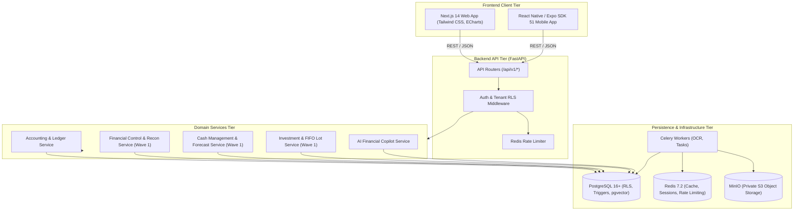

# Wave 1 — Phase 0: System Architecture Map

**Project:** WealthOS  
**Wave:** Wave 1  
**Architecture:** Modular Monolith + Async Workers + Shared Monorepo  
**Date:** 2026-11-08

---

## 1. High-Level System Architecture



---

## 2. Domain Layer Boundaries

Each domain strictly conforms to:
```
API Router (FastAPI Pydantic endpoints)
  └── Application Service (Orchestration, Permissions, Idempotency)
        └── Domain Service (Pure Financial Rules, Decimal Math, Invariants)
              └── Repository (SQLAlchemy 2.x AsyncSession with RLS enforcement)
                    └── Database Tables (PostgreSQL 16)
```

1. **Accounting Domain (`app/domains/accounting/`):**
   - General Ledger source of truth (`accounts`, `journal_entries`, `journal_lines`, `accounting_periods`).
   - Immutable posted lines, atomic balance updates.
2. **Financial Control Centre Domain (`app/domains/reconciliation/` — Wave 1 Phase 1):**
   - Bank/broker reconciliation, discrepancy lifecycle (`LOW` to `CRITICAL`), duplicate detection, ledger verification.
3. **Cash Management Domain (`app/domains/cash/` — Wave 1 Phase 2):**
   - Multi-account cash position, recurring transaction rules, deterministic 30d/90d/12m forecasting, cash scenario simulator.
4. **Investment Accounting Domain (`app/domains/investments/` — Wave 1 Phase 3):**
   - Instrument master, transaction lifecycle, FIFO lot allocation, Realized vs Unrealized P&L, corporate actions, XIRR returns.
5. **AI Copilot Domain (`app/domains/copilot/`):**
   - Read-only tools querying financial domain services with grounded source citations.

---

## 3. Financial Correctness Invariants

1. $\sum\text{Debit} - \sum\text{Credit} = 0.0000$ strictly enforced on all journal entries.
2. Money calculations strictly use `Decimal` with fixed scales (`Numeric(28, 4)` and `Numeric(38, 4)`).
3. No parallel ledgers. Cash movements and investment disposals update the single General Ledger via `PostingService`.
4. Tenant isolation is enforced at the database level by PostgreSQL RLS with `FORCE ROW LEVEL SECURITY`.
