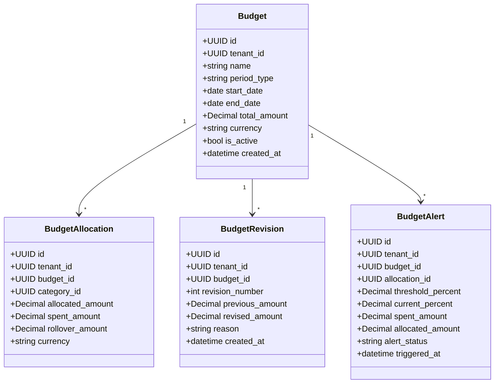

# WealthOS Wave 2 — Phase 4: Budget & Expense Intelligence Architecture

**Date:** 2026-11-08  
**Repository:** `Livesh-L-28/WealthOS`  
**Branch:** `feature/final-financial-intelligence-production`  
**Domain:** `budget` (Phase 4)  
**Status:** **APPROVED FOR IMPLEMENTATION**  

---

## 1. Executive Summary

Phase 4 delivers an institutional budgeting and deterministic expense intelligence engine for WealthOS. It allows users to create multi-period spending plans (Monthly, Quarterly, Annual, Custom), allocate budget envelopes across standard and custom categories, calculate real-time budget versus actual performance with mathematical sign clarity, manage rollovers, record revision audits, track recurring subscriptions, and receive idempotent threshold alerts (50%, 75%, 90%, 100%).

All calculations use fixed-scale `Decimal` with zero binary floating-point drift.

---

## 2. Mathematical Sign Convention & Invariants

### Budget vs Actual Variance Formula
$$\text{Variance} = \text{Budgeted Amount} - \text{Actual Spending}$$

- **Positive Variance ($> 0.0000$):** Under budget (favorable, remaining allowance available).
- **Zero Variance ($= 0.0000$):** Exactly on budget (100% consumed).
- **Negative Variance ($< 0.0000$):** Over budget (unfavorable, deficit spending).

### Spending Percentage Formula
$$\text{Consumed \%} = \begin{cases} 
\left(\frac{\text{Actual Spending}}{\text{Budgeted Amount}}\right) \times 100 & \text{if Budgeted Amount} > 0 \\
0.00 & \text{otherwise}
\end{cases}$$

### Strict Financial Rules for Actual Spending
1. **Transfer Exclusion:** Internal transfers between owned accounts (`account_transfers`) are strictly excluded.
2. **Refund Treatment:** Refunds credited to expense accounts reduce actual spending.
3. **Loan Principal vs Interest:** Only the interest expense component is counted toward budget consumption; principal reductions decrease balance sheet liabilities.
4. **Capital Assets vs Consumption:** Investment purchases (stocks, mutual funds) are asset acquisitions and are excluded from consumption expense envelopes.
5. **Idempotent Imports:** Re-imported transactions do not inflate actual spending.

---

## 3. Domain Model Architecture

---

## 4. REST API Suite (`/api/v1/budgets/*`)

| Method | Path | Description | Access Control |
| :--- | :--- | :--- | :--- |
| `GET` | `/api/v1/budgets` | List active budgets with high-level consumption metrics | Tenant Context (JWT) |
| `POST` | `/api/v1/budgets` | Create new budget envelope | Tenant Context (JWT) |
| `GET` | `/api/v1/budgets/{id}` | Retrieve budget with category allocations | Tenant Context (JWT) |
| `PUT` | `/api/v1/budgets/{id}` | Revise budget amount (records audit revision) | Tenant Context (JWT) |
| `POST` | `/api/v1/budgets/{id}/allocations` | Create or update category allocation | Tenant Context (JWT) |
| `GET` | `/api/v1/budgets/{id}/performance` | Deterministic budget vs actual performance engine | Tenant Context (JWT) |
| `POST` | `/api/v1/budgets/{id}/rollover` | Execute surplus/deficit rollover to next period | Tenant Context (JWT) |
| `GET` | `/api/v1/budgets/analytics/trends` | Monthly expense trends and category concentration | Tenant Context (JWT) |
| `GET` | `/api/v1/budgets/alerts` | List triggered budget threshold alerts | Tenant Context (JWT) |

