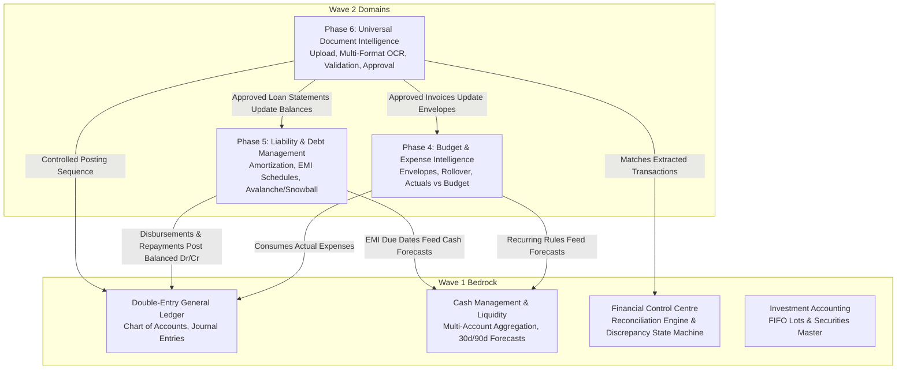

# WealthOS Wave 2 — Domain Dependency & Cross-System Integration Map

**Date:** 2026-11-08  
**Repository:** `Livesh-L-28/WealthOS`  
**Branch:** `feature/final-financial-intelligence-production`  
**Scope:** Wave 2 (Phases 4, 5, 6)  

---

## 1. Domain Interaction Architecture

---

## 2. Cross-Phase Dependency Details

### Dependency 1: Budget & Expense $\leftrightarrow$ General Ledger & Cash Management
- **Budget Actual Spending:** Sourced directly from posted expense journal entries (`account_type = 'EXPENSE'`) within the budget date range.
- **Transfers Excluded:** Transfers between owned bank accounts (`account_transfers`) are explicitly excluded from expense tallies.
- **Refund Treatment:** Credit adjustments to expense accounts decrease actual spending (correct net expense).
- **Recurring Expenses:** Recurring payment rules from `cash.recurring_transaction_rules` feed upcoming budget projections.

### Dependency 2: Liability Management $\leftrightarrow$ General Ledger & Cash Forecasting
- **Principal vs Interest:** Repayment splits principal (reduces `liabilities.current_principal` and debits liability account) and interest (debits interest expense).
- **Credit Card Treatment:** Card purchases record liabilities; card payments reduce liability from cash. Neither double counts as an extra expense.
- **Forecast Engine Integration:** Loan EMI schedules feed the 30-day, 90-day, and 12-month forward cash flow projection engine in `CashManagementService`.

### Dependency 3: Universal Document Intelligence $\leftrightarrow$ Reconciliation & Financial Control
- **No Direct Posting:** Documents flow: `Upload` $\to$ `Quarantine` $\to$ `OCR Extraction` $\to$ `Deterministic Validation` $\to$ `Reconciliation Matching` $\to$ `Human Review` $\to$ `Explicit Approval` $\to$ `Accounting Posting`.
- **Reconciliation Reuse:** Document-extracted records are matched against internal ledger and cash transactions using existing `FinancialControlService` tolerance rules ($\pm 3$ days, exact amount).
- **Audit & Provenance:** Every extracted line item retains source document ID, page number, bounding box, confidence score, and raw text.
