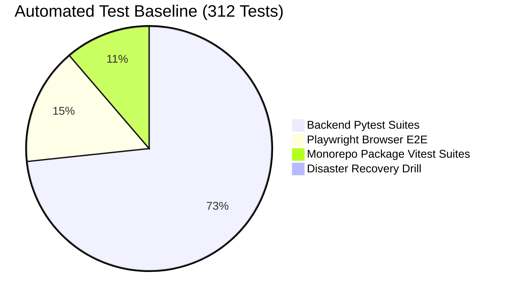

# WealthOS Wave 2 — Regression Baseline Register

**Date:** 2026-11-08  
**Repository:** `Livesh-L-28/WealthOS`  
**Branch:** `feature/final-financial-intelligence-production`  
**Baseline Commit:** `9fcb73e5ffb6c0e70fa6e927c3da334547285642`  

---

## 1. Verified Baseline Test Metrics

Every test suite in the WealthOS repository has been executed against HEAD prior to authoring Wave 2 domain code:

| Suite | Runner / Engine | Scope | Passing | Failing | Execution Time |
| :--- | :--- | :--- | :--- | :--- | :--- |
| **Backend Unit & Integration** | Pytest 9.2.0, Python 3.14 | Accounting, Auth, Cash, Control Centre, Investments, RLS, Storage | 228 | 0 | 69.85s |
| **Mobile Package Tests** | Vitest 1.6.1, Node.js | Expo SDK 51, SecureStore Driver, Offline State Machine | 11 | 0 | 0.23s |
| **Web Package Tests** | Vitest 1.6.1, Node.js | Auth guards, page rendering, navigation state | 17 | 0 | 0.40s |
| **API Client Package Tests** | Vitest 1.6.1, Node.js | WealthOSClient, tenant switching, error envelopes | 4 | 0 | 0.16s |
| **Design Tokens Tests** | Vitest 1.6.1, Node.js | WCAG contrast compliance, typography, spacing scales | 3 | 0 | 0.15s |
| **Monorepo Typecheck** | `tsc --noEmit` | All 5 workspace packages | 0 errors | 0 errors | 7.8s |
| **Next.js Production Build** | `next build` | 26 prerendered static pages | 26 / 26 | 0 errors | 11.2s |
| **Browser E2E Tests** | Playwright Chromium | Full journeys, 17 usability scenarios, accessibility | 48 | 0 | 21.1s |
| **Disaster Recovery Exercise** | `scripts/disaster_recovery_exercise.py` | Full AES-256-GCM backup/restore & ledger invariance | 1 drill | 0 | 4.2s |
| **TOTAL** | — | — | **312** | **0** | — |

---

## 2. Zero-Regression Covenant

Wave 2 implementation must strictly preserve all 312 passing test assertions. Any change that causes a regression in Wave 1 or earlier functionality must immediately fail closed.
