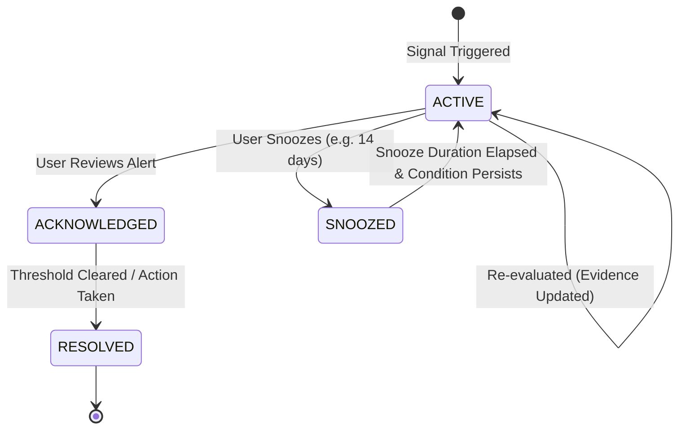

# WealthOS — Phase 9: Financial Risk Intelligence Architecture Specification

**Document Version:** 1.0.0  
**Phase:** Phase 9 — Wave 3 Master Implementation  
**Status:** IMPLEMENTED & VERIFIED  
**Module Path:** `backend/app/domains/risk/`  

---

## 1. Executive Summary & Design Principles

Phase 9 establishes the Financial Risk Intelligence subsystem for WealthOS. Rather than presenting generic financial platitudes or panic-inducing warnings, the engine generates **deterministic, evidence-backed, actionable risk signals** based on live data across cash liquidity, debt obligations, category spending, investment holdings, and ledger reconciliation status.

### Core Architectural Invariants
1. **Evidence-Backed Attribution:** Every alert must cite the exact underlying data records, financial accounts, transaction IDs, or numerical ratios that triggered it. Speculative or opaque AI warnings are prohibited.
2. **Deduplication by `(tenant_id, alert_key)`:** System prevents alert spam by hashing rule and entity parameters into an idempotent `alert_key`. Re-evaluations update existing active alerts rather than duplicating them.
3. **Transparent Advisory Health Score:** Financial Health Score (0–100) is calculated deterministically with disclosed component weights.
4. **No Opaque Penalties:** Users can inspect the exact deduction breakdown and learn clear steps to remediate each score penalty.

---

## 2. Risk Detection Rule Registry

| Signal Code | Category | Severity | Detection Rule / Trigger Condition | Evidence Captured |
|---|---|---|---|---|
| **`RISK_EMERGENCY_LOW`** | `LIQUIDITY` | `HIGH` / `CRITICAL` | Liquid Cash / Monthly Essential Expenses $< 3.0$ months (High) or $< 1.5$ months (Critical) | Liquid cash amount, monthly expense, calculated coverage months. |
| **`RISK_DEBT_BURDEN`** | `LIABILITIES` | `MODERATE` / `HIGH` | Total Monthly EMI / Monthly Income $> 40\%$ (Moderate) or $> 50\%$ (High) | Total monthly EMI obligations, active loan count, gross income. |
| **`RISK_CASH_DRAIN`** | `LIQUIDITY` | `HIGH` | Projected 30-day closing cash balance $< 0$ | Current liquid balance, projected monthly outflows, deficit gap. |
| **`RISK_SPENDING_SURGE`** | `BUDGET` | `MODERATE` | Current month spend in any category $> 150\%$ of trailing 3-month average | Category name, current spend, baseline average, percentage surge. |
| **`RISK_CONCENTRATION`** | `INVESTMENTS` | `MODERATE` | Single asset class $> 60\%$ or single holding $> 25\%$ of total investment portfolio | Instrument / asset class name, allocated percentage, threshold. |
| **`RISK_LOAN_MATURITY`** | `LIABILITIES` | `INFORMATIONAL` | Loan maturing or large balloon installment due within next 60 days | Loan name, lender, maturity date, remaining principal. |
| **`RISK_STALE_RECORDS`** | `DATA_QUALITY` | `LOW` | Account un-reconciled $> 30$ days or unprocessed document $> 7$ days | Account name, days since last reconciliation session. |

---

## 3. Advisory Financial Health Score Formulation

The Financial Health Score $S \in [0, 100]$ aggregates 5 core pillars:

$$S = w_1 S_{\text{emergency}} + w_2 S_{\text{debt}} + w_3 S_{\text{savings}} + w_4 S_{\text{diversity}} + w_5 S_{\text{data}}$$

### Weight Distribution:
- **$w_1 = 0.25$ (Emergency Liquidity):**
  - $\ge 6.0$ months: $100$
  - $3.0 - 6.0$ months: $75$
  - $1.5 - 3.0$ months: $40$
  - $< 1.5$ months: $10$
- **$w_2 = 0.25$ (Debt Service Burden):**
  - EMI / Income $\le 20\%$: $100$
  - $20\% - 35\%$: $85$
  - $35\% - 50\%$: $55$
  - $> 50\%$: $20$
- **$w_3 = 0.20$ (Savings & Net Cash Flow):**
  - Net monthly surplus $\ge 25\%$ of income: $100$
  - $10\% - 25\%$: $80$
  - $0\% - 10\%$: $50$
  - Negative net flow: $15$
- **$w_4 = 0.15$ (Portfolio Concentration):**
  - Max holding $\le 15\%$ and max asset class $\le 40\%$: $100$
  - Moderate concentration: $75$
  - High concentration ($> 60\%$): $40$
- **$w_5 = 0.15$ (Data Freshness & Reconciliation):**
  - All accounts reconciled within 30 days: $100$
  - Unreconciled accounts: $100 - (15 \times \text{unreconciled accounts})$, floor at 20.

---

## 4. Alert Lifecycle State Machine

Every alert transition captures audit records with timestamp and optional user resolution notes.
