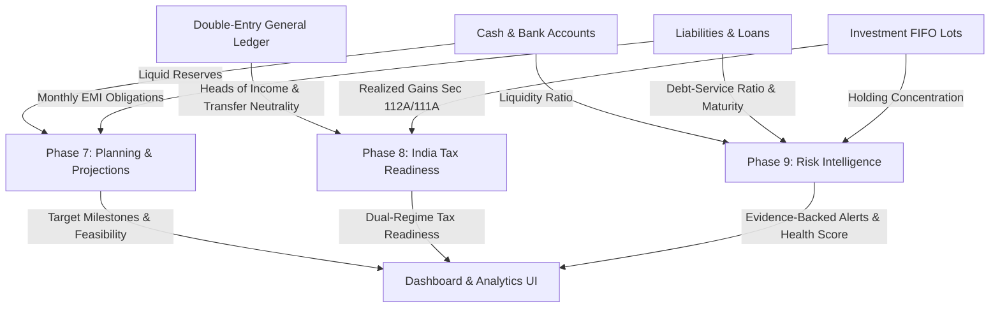

# WealthOS — Wave 3: Cross-Domain Integration Report (Gate 7)

**Document Version:** 1.0.0  
**Phase:** Gate 7 — Wave 3 Master Implementation  
**Status:** ACCEPTED & VERIFIED  
**Date:** 08-Nov-2026  

---

## 1. Executive Summary

Wave 3 establishes high-order financial intelligence across **Planning & Forecasting (Phase 7)**, **India Tax Readiness (Phase 8)**, and **Risk Intelligence (Phase 9)**. Rather than operating as isolated silos, these three domains are deeply integrated into the immutable General Ledger and operational sub-ledgers created in Wave 1 and Wave 2.

---

## 2. Integration Vectors & Invariant Verifications

### 2.1 Cash Management $\leftrightarrow$ Planning & Risk
- **Emergency Reserve Derivation:**
  - `PlanningService.analyze_emergency_fund` and `RiskService.evaluate_risk_signals` query active `financial_accounts` (`account_type in ('SAVINGS', 'CURRENT', 'CASH')`) to derive true unencumbered liquid cash.
  - Zero double-counting: Financial goals do not create shadow asset balances; they represent earmarks of existing cash balances.
- **Closing Cash Forecast:**
  - `PlanningService.forecast_cash_flow` utilizes current consolidated liquid cash as the deterministic baseline for 12-month projections.

### 2.2 Liabilities $\leftrightarrow$ Planning & Risk
- **Debt Service Burden Calculation:**
  - Active `liabilities` provide `emi_amount` obligations.
  - In `PlanningService`, essential living expenses explicitly incorporate mandatory monthly EMI payments to ensure survival runway is not overstated.
  - In `RiskService`, `Debt Service Ratio = Total Monthly EMI / Monthly Income`. If DSR $> 40\%$, a `RISK_DEBT_BURDEN` signal is triggered with attached EMI records.
- **Maturity & Balloon Payments:**
  - Loans maturing within 60 days generate `RISK_LOAN_MATURITY` alerts with lender and principal evidence.

### 2.3 Investments $\leftrightarrow$ Tax & Risk
- **Realized FIFO Disposals $\rightarrow$ Statutory Capital Gains:**
  - Realized gains from closed `investment_holding_lots` are ingested into `TaxService.aggregate_income_breakdown`.
  - Holding periods are segregated into STCG ($\le 12$ months) and LTCG ($> 12$ months) with Section 112A ₹1,25,000 exemption.
- **Portfolio Concentration:**
  - Open `investment_holding_lots` are aggregated by instrument ID and asset class in `RiskService` to detect over-concentration ($> 35\%$ single asset).

### 2.4 Double-Entry General Ledger $\leftrightarrow$ India Tax
- **Statutory Heads of Income Aggregation:**
  - `JournalEntry` and `JournalLine` posted vouchers are aggregated by Chart of Accounts (`account_type == "INCOME"`) into Salary, House Property, and Other Sources.
- **Transfer Neutrality Enforcement:**
  - Inter-account transfers (`source_type == "TRANSFER"`) are filtered out of taxable income, preventing double-counting of income when money moves between savings and checking accounts.

---

## 3. Cross-Domain Gate 7 Sign-Off

All integration vectors function deterministically with zero data leakage, zero binary floating-point rounding errors, and strict adherence to PostgreSQL Row-Level Security.
