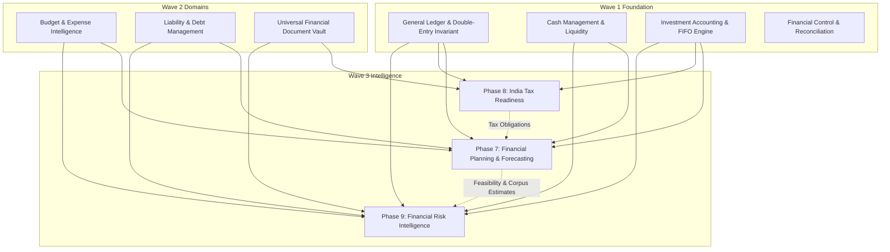

# WealthOS — Wave 3 Cross-Domain Dependency Map

**Document Version:** 1.0.0  
**Status:** ACTIVE  
**Base Commit SHA:** `fe8a727c6536399a9a3b683cb0d00f074d6f7c8b`  

---

## 1. Upstream & Inter-Domain Dependency Graph

---

## 2. Ingestion & Consumption Contracts

| Wave 3 Phase | Consumed Source Domain | Consumed Artifacts / Models | Purpose in Wave 3 |
| :--- | :--- | :--- | :--- |
| **Phase 7: Planning** | Cash Management (`cash`) | Liquid cash balances, cash forecasts | Emergency fund coverage, liquid savings capacity |
| **Phase 7: Planning** | Liabilities (`liabilities`) | Amortization schedules, monthly EMIs | Debt-service burden, disposable surplus calculation |
| **Phase 7: Planning** | Investments (`investments`)| Portfolio current values, historical cost | Current wealth baseline, retirement assets |
| **Phase 7: Planning** | Budgeting (`budget`) | Category envelopes, monthly expense burn | Expense projections, living cost inflation |
| **Phase 8: Tax** | Investment Accounting (`investments`)| `investment_holding_lots`, disposal transactions | Accurate FIFO capital gains computation (STCG/LTCG) |
| **Phase 8: Tax** | General Ledger (`accounting`) | Posted journal lines, income/expense accounts | Salary, interest, and dividend income aggregation |
| **Phase 8: Tax** | Document Vault (`documents`) | `document_extractions`, payslips, Form 16 | Supporting evidence and deduction certificates |
| **Phase 9: Risk** | Cash Management (`cash`) | 30d/90d forecasted closing balances | Negative cash balance warning, liquidity decline |
| **Phase 9: Risk** | Liabilities (`liabilities`) | Overdue installments, card credit limits | Debt-service ratio, credit card utilization spike |
| **Phase 9: Risk** | Investments (`investments`)| Single-instrument/asset holdings | Asset concentration risk, stale valuation alerts |
| **Phase 9: Risk** | Budgeting (`budget`) | Monthly category allocations vs actuals | Unusual spending surges, duplicate transactions |
