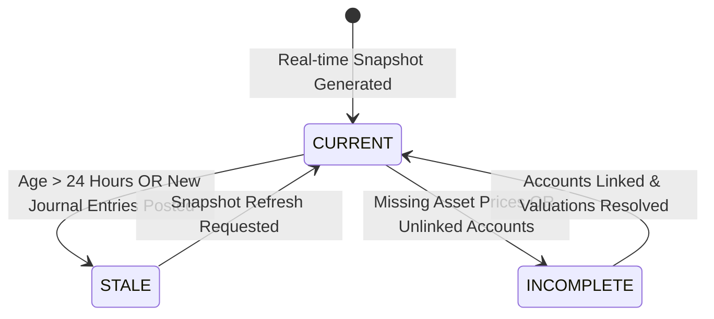

# WealthOS — Phase 10: Personal Financial Digital Twin Architecture

**Document Version:** 1.0.0  
**Status:** Certified Architecture  
**Domain:** `app.domains.twin`  

---

## 1. Architectural Mission

The Personal Financial Digital Twin maintains a coherent, reproducible, and versioned representation of a user's financial reality across all financial domains:
1. Liquid Cash & Bank Accounts (Wave 1)
2. Investment Portfolios & Asset Holdings (Wave 1)
3. Operating Budgets & Monthly Discretionary Outflows (Wave 2)
4. Debt Liabilities & Active Loan Schedules (Wave 2)
5. Long-term Financial Goals & Compounding Progress (Wave 3)
6. India Income Tax Readiness & Estimations (Wave 3)
7. Financial Health Score & Risk Vulnerabilities (Wave 3)

The Digital Twin does **NOT** duplicate or compete with the General Ledger. The General Ledger remains the unalterable financial source of truth ($\sum\text{Dr} = \sum\text{Cr}$). The Digital Twin acts as an analytical projection engine that synthesizes ledger facts, market valuations, and scheduled cash flows into a structured, queryable snapshot.

---

## 2. Digital Twin Data Model

### 2.1 Schema: `financial_twin_snapshots`
- `id` (UUID PK)
- `tenant_id` (UUID FK -> `tenants.id`, RLS enforced)
- `user_id` (UUID FK -> `users.id`, RLS enforced)
- `snapshot_date` (Date)
- `net_worth` (Numeric(18, 4)) = $\text{Total Assets} - \text{Total Liabilities}$
- `liquid_net_worth` (Numeric(18, 4)) = $\text{Cash \& Bank Balances} - \text{Revolving Short-term Debt}$
- `monthly_income` (Numeric(18, 4))
- `monthly_expenses` (Numeric(18, 4))
- `monthly_savings` (Numeric(18, 4)) = $\text{Income} - \text{Expenses}$
- `debt_obligations` (Numeric(18, 4)) = Monthly EMI + minimum credit payments
- `risk_health_score` (Numeric(5, 2)) (0.00 to 100.00)
- `data_freshness_status` (`CURRENT`, `STALE`, `INCOMPLETE`)
- `metrics` (JSONB)
- `source_references` (JSONB)
- `created_at`, `updated_at` (TIMESTAMPTZ)

---

## 3. Freshness Lifecycle & Invalidation Logic

- **`CURRENT`**: Snapshot generated within the last 24 hours, all accounts balanced, latest market prices available.
- **`STALE`**: Snapshot is older than 24 hours or un-reconciled transactions have posted since snapshot generation.
- **`INCOMPLETE`**: User has registered liabilities or assets without valuation, or accounts without currency normalization.

---

## 4. Deterministic Calculation Flow

1. **Cash Aggregation:** Sum verified balances from `financial_accounts` where `account_type IN ('CHECKING', 'SAVINGS', 'CASH')`.
2. **Investment Aggregation:** Sum market value of all active `investment_holding_lots` ($\sum \text{remaining\_quantity} \times \text{current\_price}$).
3. **Liability Aggregation:** Sum `current_principal` of all active `liabilities`.
4. **Income/Expense Derivation:** Aggregated from monthly cash flow runs and budget actuals.
5. **Zero Float Guarantee:** Strictly `Decimal` arithmetic with `ROUND_HALF_UP` and `Numeric(18, 4)`.
