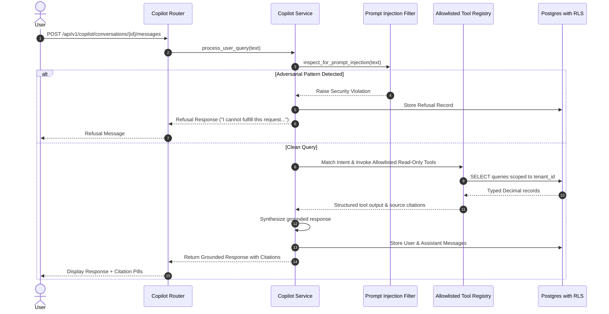

# WealthOS — Phase 10: Financial Copilot Architecture

**Document Version:** 1.0.0  
**Status:** Certified Architecture  
**Domain:** `app.domains.copilot`  

---

## 1. Architectural Mission & Core Invariants

The WealthOS AI Financial Copilot provides a natural-language conversational interface that makes complex multi-domain financial information intuitive, actionable, and transparent for end users.

### Core Non-Negotiable Invariants:
1. **Financial Source of Truth Separation:** LLM models do **not** calculate balances, tax liabilities, or investment returns from ungrounded text. All authoritative calculations are computed by deterministic backend services.
2. **Strict Read-Only Execution:** The Copilot is an analytical advisor. It has zero capability to mutate accounting ledgers, execute wire transfers, open accounts, delete debts, or elevate permissions.
3. **Evidence Citations:** Every quantitative claim made by the Copilot is tied to structured source references (`assets_and_liabilities_ledger`, `financial_accounts`, `budget_allocations`, `investment_holding_lots`, `tax_computations`, `risk_alerts`).
4. **Tenant Isolation:** All underlying queries pass through `tenant_id` boundaries protected by PostgreSQL Row-Level Security (`FORCE ROW LEVEL SECURITY`).
5. **Prompt Injection Defense:** Input text is systematically sanitized and tested against adversarial jailbreaks and privilege escalation attempts before domain processing.

---

## 2. Request Processing Pipeline

---

## 3. Conversational Context & Memory Management

- Conversations are structured into threads stored in `copilot_conversations`.
- Messages are sequenced in `copilot_messages` with timestamps, `tool_calls` audit metadata, and structured `citations`.
- Recent context (last $N$ messages) is provided to maintain dialogue continuity without bloating context window.
- Thread isolation ensures users cannot read or inject messages across workspace tenants or cross-household boundaries.
