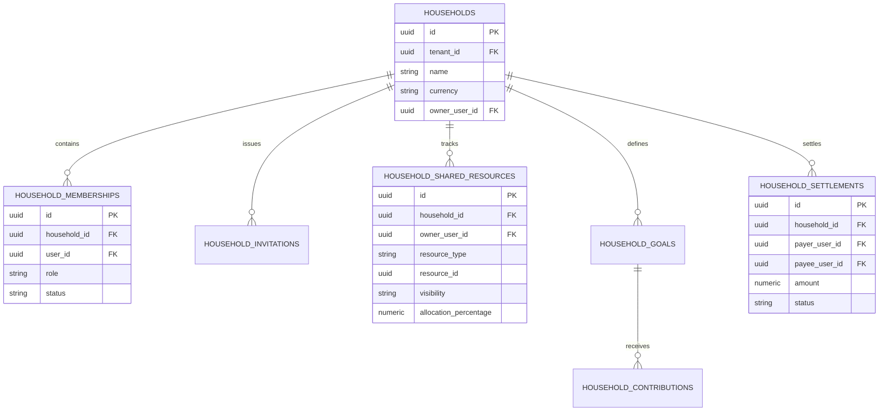

# WealthOS — Phase 11: Household Wealth Management Architecture

**Document Version:** 1.0.0  
**Status:** Certified Architecture  
**Domain:** `app.domains.household`  

---

## 1. Architectural Mission

Household Wealth Management enables families, couples, and shared households to collaborate on their financial health while strictly preserving individual privacy boundaries.

### Core Architecture Principles:
1. **Multi-User Collaboration within Workspace:** A Household acts as a collaborative hub within a tenant, linking multiple verified users.
2. **Three Granular Financial Visibility Scopes:**
   - `PERSONAL_ONLY`: Visible exclusively to the owning user. Never included in household aggregations or shared dashboards.
   - `HOUSEHOLD_SHARED`: Fully included in household net worth, budget roll-ups, and transaction listings.
   - `LIMITED_SHARED`: Aggregated totals are included in household net worth and category summaries, but individual transaction line items and merchant descriptions remain masked from other members.
3. **Consolidated Net Worth without Double Counting:** Joint assets and liabilities are registered with explicit ownership allocation percentages ($\sum \% \le 100\%$). An asset shared 50/50 between two partners is counted exactly once at 100% in household net worth, and 50% in each individual's personal view.
4. **Internal Transfer & Reimbursement Neutrality:** When Member A pays a shared ₹10,000 grocery bill and Member B reimburses Member A ₹5,000:
   - The household records a single expense of ₹10,000 under Groceries.
   - The reimbursement transfer is categorized as an internal settlement (`household_settlements`), creating zero additional income and zero additional expense.
5. **Role-Based Household Access Control:**
   - `OWNER`: Full administrative control, can delete household, manage all members, and link shared resources.
   - `ADMIN`: Can invite members, update sharing scopes, and edit shared budgets/goals.
   - `MEMBER`: Can link own resources, contribute to shared goals, view shared dashboards.
   - `VIEWER`: Read-only view of shared dashboards.

---

## 2. Household Entity Relationship Model

