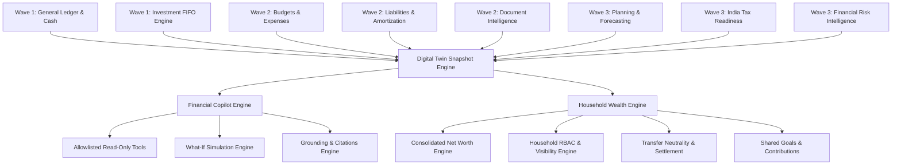

# WealthOS — Wave 4 Dependency & Architecture Integration Map

**Document Version:** 1.0.0  
**Status:** Certified Active  
**Programme:** Wave 4 (Financial Copilot, Personal Financial Digital Twin, Household Wealth Management)  

---

## 1. Domain Interdependency Matrix

Wave 4 is the pinnacle synthesis layer that connects all foundational financial domains across WealthOS.

---

## 2. Component Dependency Table

| Consumer Domain | Upstream Source Domain | Provided Entities / Services | Wave 4 Usage Purpose |
| :--- | :--- | :--- | :--- |
| **Financial Digital Twin** | `app.domains.cash` | `CashPosition`, `CashAccount` | Liquid cash availability and emergency coverage |
| **Financial Digital Twin** | `app.domains.investments` | `InvestmentHoldingLot`, `Instrument` | Portfolio market value, unrealized gain/loss |
| **Financial Digital Twin** | `app.domains.liabilities` | `Liability`, `AmortizationSchedule` | Debt balances, monthly EMI obligations |
| **Financial Digital Twin** | `app.domains.budgets` | `Budget`, `BudgetAllocation` | Spend vs allocated limits, variance analysis |
| **Financial Digital Twin** | `app.domains.tax` | `TaxProfile`, `FYSummary` | Tax liability estimates, regime comparison |
| **Financial Digital Twin** | `app.domains.risk` | `FinancialHealthScore`, `RiskAlert` | Risk score (0-100), active vulnerability alerts |
| **Financial Copilot** | `app.domains.twin` | `FinancialTwinSnapshot` | Current financial profile state and freshness |
| **Financial Copilot** | `app.domains.copilot.tools` | `AVAILABLE_TOOLS` | Deterministic allowlisted data extraction |
| **Household Engine** | `app.domains.household` | `HouseholdSharedResource` | Resource sharing scopes (3 tiers) |
| **Household Engine** | `app.domains.accounting` | `JournalEntry`, `JournalLine` | Inter-member settlement transfer neutrality |
| **Household Engine** | `app.domains.planning` | `FinancialGoal` | Shared household goals and milestone tracking |

---

## 3. Strict Safety & Isolation Rules

1. **Deterministic Execution Layer:** Copilot answers questions by calling verified Python domain functions, never by hallucinating figures or executing raw unvalidated SQL.
2. **Read-Only Invariant:** Tool registry contains zero `INSERT`, `UPDATE`, `DELETE`, or funds transfer functions. Any user attempt to initiate financial mutations via Copilot triggers an immediate refusal.
3. **Multi-User Privacy Isolation:** Household members can only view shared assets and liabilities based on their granted visibility scope (`PERSONAL_ONLY`, `HOUSEHOLD_SHARED`, or `LIMITED_SHARED`). Private accounts are cryptographically and query-level excluded from other members' views.
4. **Internal Transfer Neutrality:** Reimbursing a partner or roommate for a shared utility or grocery bill does not register as secondary expense or new income, avoiding double counting in both household and individual views.
