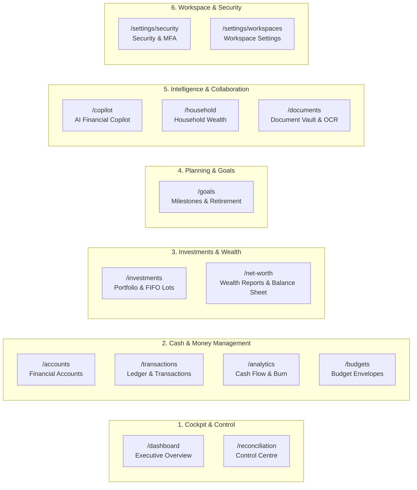

# WealthOS — Phase 12 Unified Navigation Architecture

**Programme:** Wave 5 — Final Platform Integration and Acceptance  
**Phase:** Phase 12 — Unified User Experience  
**Date:** 2026-11-08  

---

## 1. Information Architecture Hierarchy

WealthOS organizes financial management into 6 structured operational domains:

---

## 2. Route & Path Mapping Table

| Navigation Group | Item Label | Route Path | Primary Icon | Visual Badge | Target Audience / Purpose |
| :--- | :--- | :--- | :--- | :--- | :--- |
| **Cockpit & Control** | `Overview` | `/dashboard` | `LayoutDashboard` | — | High-level 5-question financial health cockpit. |
| **Cockpit & Control** | `Control Centre` | `/reconciliation` | `ShieldCheck` | `Recon` | Bank statement reconciliation & duplicate triage. |
| **Cash & Money** | `Accounts` | `/accounts` | `Landmark` | — | Bank, brokerage, loan, and wallet account balances. |
| **Cash & Money** | `Transactions` | `/transactions` | `ArrowLeftRight` | — | Itemized double-entry transaction journal. |
| **Cash & Money** | `Cash Flow` | `/analytics` | `Wallet` | — | Multi-cadence burn radar & liquidity runways. |
| **Cash & Money** | `Budgets` | `/budgets` | `PieChart` | — | Envelope category limits, rollover, and spend tracking. |
| **Investments** | `Investments` | `/investments` | `TrendingUp` | — | FIFO tax lot inspector, realized/unrealized P&L. |
| **Investments** | `Reports` | `/net-worth` | `FileSpreadsheet` | — | Balance sheet, solvency ratios, debt payoff schedules. |
| **Planning** | `Goals` | `/goals` | `Target` | — | Inflation-compounded milestone & retirement goals. |
| **Intelligence** | `Financial Copilot` | `/copilot` | `Bot` | `AI` | Read-only AI financial intelligence with grounded citations. |
| **Intelligence** | `Household` | `/household` | `Users` | `Shared` | Multi-member collaborative household wealth sharing. |
| **Intelligence** | `Documents` | `/documents` | `FileText` | — | OCR statement processing & document archive. |
| **Preferences** | `Security & Audit` | `/settings/security` | `ShieldCheck` | — | Session audit logs, password policies, MFA management. |
| **Preferences** | `Workspace Settings` | `/settings/workspaces` | `Settings` | — | Base currency configuration, member invitations, tenant settings. |

---

## 3. Backward Compatibility & Test Invariance

All existing Playwright E2E locators (`nav a:has-text("Overview")`, `nav a:has-text("Accounts")`, `nav a:has-text("Investments")`, etc.) match these exact item labels and URLs. The navigation reorganization introduces structured section groupings and header labels without altering link semantics, ensuring zero regression across automated and manual test workflows.

