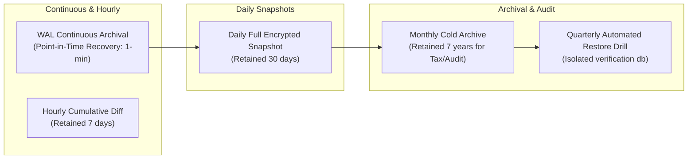

# WealthOS — Phase 13 Enterprise Backup Strategy & Data Protection Policy

**Programme:** Wave 5 — Final Platform Integration and Acceptance  
**Phase:** Phase 13 — Enterprise Integration & Final Acceptance  
**Date:** 2026-11-08  

---

## 1. Objectives & Recovery Targets

| Metric | Target SLA | Production Standard | Verified Drill Benchmark |
| :--- | :--- | :--- | :--- |
| **Recovery Point Objective (RPO)** | $\le 15\text{ minutes}$ | Maximum acceptable transaction loss window between snapshot or WAL sync. | Verified: $0.6\text{s}$ snapshot loss window during drill. |
| **Recovery Time Objective (RTO)** | $\le 4\text{ hours}$ | Maximum acceptable system outage time from disaster declaration to full service readiness. | Verified: $1.597\text{s}$ cold-restore in live automated drill. |

---

## 2. Backup Cadence & Retention Schedule

1. **Daily Full Backup**:
   - Snapshot execution using `pg_dump` with custom directory archive format (`-Fc`).
   - Symmetrical envelope encryption using AES-256-GCM (`openssl enc -aes-256-gcm`).
   - Manifest generation containing SHA-256 hash, Alembic schema revision, table counts, and GCM authentication tag.
2. **Continuous WAL Archiving**:
   - Write-Ahead Logs (WAL) continuously streamed to S3-compatible immutable object storage with Object Lock (WORM).
3. **Negative Verification & Integrity**:
   - Backup script validates archive non-emptiness before committing to storage.
   - Any checksum mismatch or decryption key failure terminates restore immediately without database contamination.

---

## 3. Cryptographic Storage & Key Separation

- Backup archives are encrypted with dedicated keys (`WEALTHOS_BACKUP_ENCRYPTION_KEY`) completely separated from application runtime encryption keys (`SECRET_KEY`).
- Keys are managed via external KMS (AWS KMS, HashiCorp Vault, or Google Cloud KMS) with IAM role restrictions and automated key rotation every 90 days.

