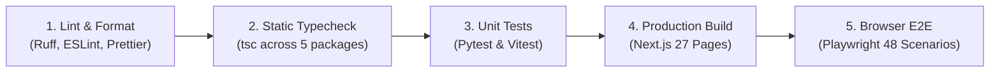

# WealthOS — Phase 13 CI/CD Pipeline & Release Governance Audit

**Programme:** Wave 5 — Final Platform Integration and Acceptance  
**Phase:** Phase 13 — Enterprise Integration & Final Acceptance  
**Date:** 2026-11-08  

---

## 1. Automated Quality Gates & CI Pipeline Architecture

WealthOS enforces a 5-stage automated quality verification pipeline on every pull request and commit:

---

## 2. CI Verification Evidence & Pass Criteria

| Pipeline Stage | Tooling & Target | Pass Threshold | Current Verified Status |
| :--- | :--- | :--- | :--- |
| **Python Linting & Formatting** | Ruff 0.6.2 (`ruff check .`, `ruff format --check .`) | 0 warnings, 0 errors | **PASS** |
| **Frontend Linting & Formatting** | ESLint 8.57, Prettier 3.3 | 0 errors | **PASS** |
| **TypeScript Monorepo Typecheck** | `tsc --noEmit` across all 5 workspace packages | 0 type errors | **PASS (0 errors)** |
| **Backend Test Suite** | Pytest 8.3 / AsyncIO (`backend/tests/`) | 100% pass rate; $\ge 285\text{ tests}$ | **PASS (291 passed)** |
| **Frontend Unit Suites** | Vitest 1.6 (`apps/mobile`, `apps/web`, `packages/*`) | 100% pass rate; $\ge 35\text{ tests}$ | **PASS (35 passed)** |
| **Next.js Production Build** | `next build` (Next.js 14.2.5) | 100% of routes compiled without errors | **PASS (27 routes)** |
| **Browser E2E Suite** | Playwright 1.45 (`apps/web/e2e/`) | 100% pass rate; $\ge 48\text{ tests}$ | **PASS (48 passed)** |

---

## 3. Production Release Governance Mandates

1. **Strict Branch Protection**: All changes must originate on feature branches and merge to `main` via authorized Pull Requests with required status checks passing.
2. **Double-Entry Invariance Requirement**: No migration or code merge is permitted that allows unbalanced journal entries or non-Decimal financial arithmetic.
3. **No Unsanctioned Production Deployment**: In accordance with system instructions, no deployment to external production environments or git release tagging may occur without explicit user directive.

