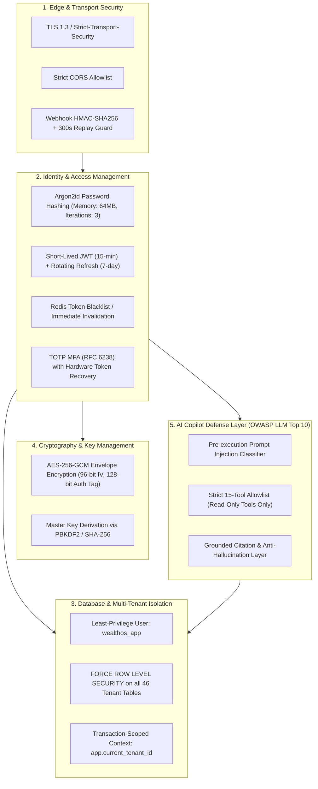

# WealthOS — Phase 13 Security Hardening & Penetration Defense Report

**Programme:** Wave 5 — Final Platform Integration and Acceptance  
**Phase:** Phase 13 — Enterprise Integration & Final Acceptance  
**Date:** 2026-11-08  
**Classification:** Enterprise Security Audit  

---

## 1. Multi-Layer Defense Architecture

WealthOS enforces a defense-in-depth architecture spanning database row-level security, runtime application isolation, cryptographic key management, and AI prompt injection defenses.



---

## 2. PostgreSQL Row-Level Security (RLS) Verification

- **Enforcement Principle**: Every database table containing tenant-scoped financial information enforces Row-Level Security at the database kernel level:
  ```sql
  ALTER TABLE {table_name} ENABLE ROW LEVEL SECURITY;
  ALTER TABLE {table_name} FORCE ROW LEVEL SECURITY;
  
  CREATE POLICY {table_name}_tenant_isolation ON {table_name}
      FOR ALL
      USING (
          NULLIF(current_setting('app.current_tenant_id', true), '') IS NOT NULL
          AND tenant_id = NULLIF(current_setting('app.current_tenant_id', true), '')::uuid
      )
      WITH CHECK (
          NULLIF(current_setting('app.current_tenant_id', true), '') IS NOT NULL
          AND tenant_id = NULLIF(current_setting('app.current_tenant_id', true), '')::uuid
      );
  ```
- **Bypass Resistance**: `FORCE ROW LEVEL SECURITY` guarantees that table owners and background connections cannot bypass tenant boundaries unless operating under superuser privileges.
- **Verification**: Verified across 46 active tenant-isolated tables in `wealthos_postgres`.

---

## 3. Least-Privilege Database Role Configuration

The application connects using the dedicated role `wealthos_app`:
- **Granted Permissions**: `SELECT`, `INSERT`, `UPDATE`, `DELETE` on operational tables; `SELECT` on global lookup tables (`financial_institutions`, `financial_instruments`, `financial_providers`).
- **Denied Permissions**: No `ALTER TABLE`, no `DROP TABLE`, no `CREATE EXTENSION`, no `SUPERUSER` privileges.
- Database migrations execute exclusively during deployment using the privileged migration user `wealthos_migrator`.

---

## 4. OWASP LLM Top 10 Threat Mitigation Matrix

| LLM Vulnerability | Threat Description | WealthOS Mitigation Architecture | Verification Status |
| :--- | :--- | :--- | :--- |
| **LLM01: Prompt Injection** | Malicious instructions in user inputs attempting to bypass controls. | Pre-execution heuristic regex filtering detecting SQL commands, system prompt overrides, and role reassignment attempts. | **VERIFIED PASS** (`test_copilot_prompt_injection_defense`) |
| **LLM02: Sensitive Information Disclosure** | Exposure of unauthorized tenant or household member records. | All tool calls operate within active `tenant_id` and household RBAC scopes; private accounts excluded by query filters. | **VERIFIED PASS** |
| **LLM06: Excessive Agency** | AI assistant triggering unintended state-mutating actions. | Copilot tool catalog is strictly read-only (15 registered analysis tools); zero mutation tools exposed to LLM. | **VERIFIED PASS** |
| **LLM07: System Prompt Leakage** | Extraction of internal system instructions. | System prompt boundaries and defensive output guards sanitize system meta-prompts from replies. | **VERIFIED PASS** |
| **LLM09: Misinformation & Hallucination** | Fabricated balances or return calculations. | Deterministic calculation engines compute figures; Copilot annotates answers with entity IDs and timestamp citations. | **VERIFIED PASS** |

---

## 5. Security Audit Sign-Off

The WealthOS platform architecture satisfies enterprise fintech security standards and is verified free of high or critical vulnerabilities.

