# WealthOS — Final Platform Architecture & Technical Blueprint

**Project:** WealthOS Personal Wealth Management & Financial Intelligence Platform  
**Programme Status:** Waves 1 through 5 Complete & Accepted  
**Certified Target Branch:** `feature/final-financial-intelligence-production`  
**Date:** 2026-11-08  

---

## 1. High-Level Technical Architecture

WealthOS is designed as a modular, enterprise-grade fintech platform combining double-entry general ledger accounting, real-time liquidity management, FIFO investment accounting, actuarial forecasting, AI context synthesis, multi-user household collaboration, and external financial aggregator integrations.

```mermaid
flowchart TD
    subgraph ClientTier["Client Application Tier"]
        WEB["Next.js 14 Web Application<br/>(React 18, Tailwind CSS, Lucide, Shims)"]
        MOBILE["Expo SDK 51 Mobile Application<br/>(React Native, SecureStore, Offline Queue)"]
    end

    subgraph APITier["Backend API & Application Services"]
        GATEWAY["FastAPI REST Application (Uvicorn / Docker)<br/>CORS, Tracing, Exception Handlers, RBAC"]
        AUTH_SVC["Identity & Security Service<br/>Argon2id, JWT Access/Refresh, TOTP MFA"]
        GL_CORE["General Ledger Engine<br/>Double-Entry ΣDr - ΣCr = 0, Immutable Journals"]
        CASH_SVC["Cash Management & Liquidity Service<br/>Transfer Neutrality, Multi-Currency, Burn Radar"]
        INV_SVC["Professional Investment Engine<br/>FIFO Tax Lots, Corporate Actions, XIRR"]
        BUDGET_SVC["Budget & Expense Intelligence<br/>Category Envelopes, Rollover, Variance"]
        DEBT_SVC["Liability & Debt Service<br/>Reducing Balance Amortization, Payoff Simulator"]
        DOC_SVC["Universal Document Intelligence<br/>Quarantine, OCR, Arithmetic Verification"]
        PLAN_SVC["Planning & Forecasting Engine<br/>Inflation Compounding, Retirement Corpus"]
        TAX_SVC["India Tax Readiness Service<br/>FY/AY Demarcation, Section 112A, Dual Regime"]
        RISK_SVC["Financial Risk Intelligence<br/>5-Pillar Health Score, Rule Engine, Alerts"]
        TWIN_SVC["Personal Financial Digital Twin<br/>Snapshot Aggregation, Freshness Tracking"]
        COPILOT_SVC["Financial Copilot Service<br/>15 Read-Only Tools, Injection Defenses, Citations"]
        HH_SVC["Household Wealth Service<br/>3-Tier Visibility, Fractional Net Worth, Settlements"]
        INTEG_SVC["Enterprise Integrations Service<br/>AA Consent, Adapters, HMAC Webhook Defense"]
    end

    subgraph DataTier["Data & Infrastructure Persistence Tier"]
        PG["PostgreSQL 16 Database<br/>RLS Enforced, B-Tree Indexes, Audit Triggers"]
        REDIS["Redis 7 Cache & Message Broker<br/>Token Revocation, Rate Limiting, Celery Queues"]
        MINIO["MinIO / S3 Object Storage<br/>Document Quarantine, Encrypted Statements"]
        CELERY["Celery Asynchronous Workers<br/>worker_ocr, worker_market, worker_default"]
    end

    ClientTier --> GATEWAY
    GATEWAY --> AUTH_SVC & GL_CORE & CASH_SVC & INV_SVC & BUDGET_SVC & DEBT_SVC & DOC_SVC & PLAN_SVC & TAX_SVC & RISK_SVC & TWIN_SVC & COPILOT_SVC & HH_SVC & INTEG_SVC
    APITier --> PG & REDIS & MINIO & CELERY
```



---

## 2. Directory & Domain Organization

```
WEALTHOS/
├── apps/
│   ├── web/                     # Next.js 14 web application (App Router, Tailwind)
│   └── mobile/                  # Expo SDK 51 React Native mobile client
├── packages/
│   ├── shared-types/            # Canonical TypeScript schemas & API types
│   ├── design-tokens/           # WCAG compliant theme colors, spacing, typography
│   └── api-client/              # Typed TypeScript SDK with workspace injection
├── backend/
│   ├── app/
│   │   ├── api/v1/              # Versioned API routes (auth, health, tenants, domains)
│   │   ├── core/                # Config, database, logging, security, tenant context
│   │   ├── domains/             # 12 Independent, cohesive business domains
│   │   │   ├── accounting/      # Core double-entry General Ledger
│   │   │   ├── reconciliation/  # Bank statement matching & discrepancy triage
│   │   │   ├── cash/            # Cash liquidity, multi-currency, burn radar
│   │   │   ├── investments/     # FIFO tax lots, corporate actions, XIRR
│   │   │   ├── budget/          # Envelopes, rollover, variance analysis
│   │   │   ├── liabilities/     # Amortization, loans, payoff simulators
│   │   │   ├── documents/       # OCR quarantine, parsing, arithmetic approval
│   │   │   ├── planning/        # Goal feasibility, actuarial retirement
│   │   │   ├── tax/             # FY/AY Apr-Mar, Section 112A, dual regime
│   │   │   ├── risk/            # 5-pillar Health Score, empirical alert rules
│   │   │   ├── twin/            # Point-in-time Digital Twin state synthesis
│   │   │   ├── copilot/         # Read-only Copilot with prompt injection defense
│   │   │   ├── household/       # Multi-user workspaces, shared net worth, RBAC
│   │   │   └── integrations/    # Normalized provider adapters, AA consent, webhooks
│   │   └── infrastructure/      # Celery task definitions, Redis, MinIO storage
│   ├── migrations/versions/     # 10 Sequential Alembic revisions (0001 -> 0010)
│   └── tests/                   # 291 Passing Pytest test cases
├── scripts/                     # Restore scripts, DR exercise engine, seed utilities
└── docs/                        # Complete wave-by-wave architecture & acceptance docs
```

