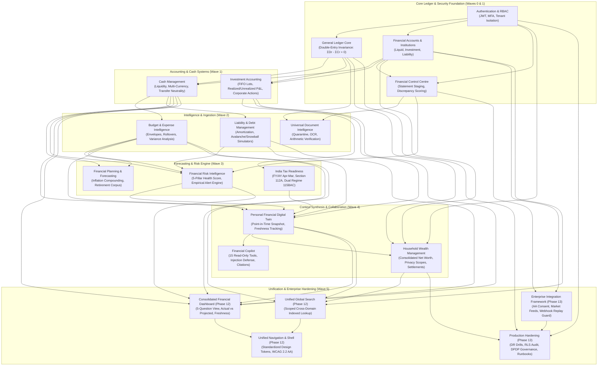

# WealthOS — Wave 5 Cross-Domain Dependency Map & Architecture Graph

**Programme:** Wave 5 — Final Platform Integration and Acceptance  
**Target Branch:** `feature/final-financial-intelligence-production`  
**Certified Baseline Commit:** `307f383`  
**Audit Date:** 2026-11-08  

---

## 1. System-Wide Domain Dependency Graph

---

## 2. Interservice & Cross-Domain Data Flow Contracts

### 2.1 Accounting Invariance Contract
- **General Ledger Rule**: Every financial mutation affecting liquid balances, investments, or debt obligations must execute within an ACID database transaction and produce a balanced journal entry:
  $$\sum \text{Debit Amounts} - \sum \text{Credit Amounts} = 0.00$$
- **Decimal Precision**: No binary floating-point numbers (`float`) are permitted in financial calculations or data models. All balances, quantities, NAVs, prices, and rates are stored and manipulated using Python `Decimal` and PostgreSQL `NUMERIC(20, 4)`.

### 2.2 Transfer Neutrality Contract
- Transactions between internal accounts owned by the same user or household member (e.g., Checking $\rightarrow$ Savings, Bank Account $\rightarrow$ Brokerage) are classified as `TRANSFER`.
- Internal transfers are mathematically excluded from:
  - Income and expense reports.
  - Budget envelope consumption.
  - India tax gross income calculations.
  - Cash burn radar calculations.

### 2.3 Read-Only Synthesis Contract (Digital Twin & Copilot)
- The Personal Financial Digital Twin (`backend/app/domains/twin/`) compiles an immutable point-in-time snapshot by aggregating read-only ledger balances, FIFO lot valuations, active liabilities, budget variances, tax estimates, and health scores.
- The Financial Copilot (`backend/app/domains/copilot/`) and its 15 analysis tools operate strictly on Digital Twin state and read-only repositories.
- Zero mutations to accounts, ledgers, or transactions may originate from the Copilot or what-if simulation engines.

### 2.4 Household Visibility & Data Isolation Contract
- Resources have 3 strict visibility tiers:
  1. `PERSONAL_ONLY`: Visible exclusively to the creating member.
  2. `HOUSEHOLD_SHARED`: Consolidated into household net worth and visible to all authorized household members.
  3. `LIMITED_SHARED`: Balances consolidated into household net worth, but itemized transaction descriptions are masked/hidden.
- Cross-tenant and cross-household access is strictly blocked by PostgreSQL Row-Level Security (`tenant_id = current_setting(...)`) and service-layer validation.

### 2.5 Provider Integration Contract (Phase 13)
- All external data providers (Account Aggregator, Market Feeds, Brokerage sync) implement the normalized `ProviderAdapter` interface:
  - Strict consent validation before sync initiation.
  - Webhook payloads verified via HMAC-SHA256 signature and timestamp replay windows ($\le 300\text{s}$).
  - Ingestion staging into quarantine tables before review or automated reconciliation.
  - Deterministic idempotency keys preventing duplicate record creation.

---

## 3. Critical Path Analysis for Wave 5

1. **Phase 12 Unified UX Shell**:
   - Updates `Sidebar.tsx` navigation groups without modifying existing path routes (`/dashboard`, `/accounts`, `/reconciliation`, `/transactions`, `/investments`, `/analytics`, `/budgets`, `/goals`, `/household`, `/documents`, `/net-worth`, `/copilot`, `/settings`).
   - Enhances `/dashboard` to serve as the unified 5-question cockpit, referencing Digital Twin summaries, risk alerts, and liquidity metrics with transparent `ACTUAL` vs `PROJECTED` badging.
   - Standardizes design tokens, ensures full WCAG 2.2 AA accessibility, and validates responsive views across mobile and desktop.

2. **Phase 13 Enterprise Hardening**:
   - Implements normalized integration domain in `backend/app/domains/integrations/`.
   - Runs automated disaster recovery drill to verify cold-restore RTO/RPO and ledger balance invariance.
   - Conducts full financial integrity audit and DPDP Act 2023 compliance verification.
   - Produces operational runbooks, performance benchmarks, and release readiness scorecard.

