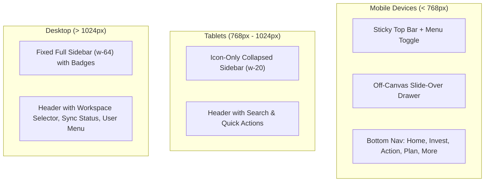

# WealthOS Mobile-to-Web Unification — Deliverable 5: Web Navigation Architecture

**Status:** IMPLEMENTED | WEB_RUNTIME_VERIFIED | RESPONSIVE_TESTED  
**Assigned Role:** Principal Web Application Architect & Senior Mobile UX Specialist  

---

## 1. Multi-Device Navigation Model

WealthOS Web provides an adaptive navigation framework that matches the mobile information architecture across all device form factors:

---

## 2. Navigational Categorization (1:1 with Mobile Drawer)

The desktop sidebar and mobile off-canvas drawer share the exact same 5 categories:

1. **Cockpit & Control:**
   - `Overview` (`/dashboard`) — Executive cockpit & Net Worth hero.
   - `Control Centre` (`/reconciliation`) — Double-entry reconciliation & discrepancy clearing (Badge: `Recon`).

2. **Cash & Money:**
   - `Accounts` (`/accounts`) — 6 connected institutions & account balances.
   - `Transactions` (`/transactions`) — Settled ledger & general journal lines.
   - `Cash Flow` (`/analytics`) — Spending velocity, burn rate, & 50/30/20 framework.
   - `Budgets` (`/budgets`) — Envelope tracking & overspending alerts.

3. **Investments & Reports:**
   - `Investments` (`/investments`) — Holdings, SIPs, SGB, & FIFO tax lots.
   - `Reports` (`/net-worth`) — Balance sheet & debt amortization strategies.

4. **Planning & Intelligence:**
   - `Goals` (`/goals`) — Strategic goals (Bike, FIRE, EV) & savings deposits.
   - `Financial Copilot` (`/copilot`) — AI Copilot with double-entry citations (Badge: `AI`).
   - `Household` (`/household`) — Multi-entity family office sharing (Badge: `Shared`).
   - `Documents` (`/documents`) — OCR extraction & statement auditing.

5. **Preferences & Settings:**
   - `Security & Audit` (`/settings/security`) — Biometric & session management.
   - `Workspace Settings` (`/settings/workspaces`) — Tenant organization settings.

---

## 3. Responsive Adaptations

- **Desktop (>1024px):** Permanent 64-column (`w-64`) sidebar with category headers, text labels, and badges. Collapsible to 20-column (`w-20`) for focused workflows.
- **Tablet (768px–1024px):** Automatically collapses to icon-only mode (`w-20`) with hover tooltips for maximum screen real estate.
- **Mobile (<768px):** Hamburger menu in top header triggers animated off-canvas slide-over drawer with backdrop blur (`bg-black/40`), closing on route change or backdrop tap. Minimum touch target is 44px (`min-h-[44px]`).

